<div align="center">

# Continuum · 无限遛弯

缘溪行，忘路之远近。<br>
<sub>陶渊明《桃花源记》</sub>

[**▶ 在线试玩**](https://benign.host/continuum/) · [设计文档](docs/design.md)

<sub>three.js r160 · WebGL2 · 无构建步骤 · 车模由纯 Python 标准库生成</sub>


</div>

---

## 这是什么

浏览器里的一条路，车在上面自己开，可以一直开下去，也可以挂在墙上当壁纸。路边的世界按里程更换，一共十二个：山间、丘陵、河谷、沿海、沙漠、城市、地底、地狱、深海、天堂、太空、颠倒。世界随开过的距离变化，不随时间变化。

到了两个世界的交界，地形、地面、树、水和天光一起变成下一个世界的样子，用一公里多慢慢换过去，没有加载，也没有黑屏。

十二个世界都接上了，开完太空翻进颠倒，再回到山间，一圈大约 120 km。

世界也可以自己挑。右下角的「世界」里点一个，约一公里后开始换过去，换法和交界一样；`N` 换到下一个。勾选哪些世界轮流出现，选择会记住。

画法也可以换。右下角的「画风」里有七种：写实、手绘、水墨、赛璐璐、版画、像素、方块，`V` 换下一种。一种换成另一种用一秒半慢慢过去，选择会记住。

路不是唯一能开的地方。手动开的时候，车可以开出路肩，贴着地面走：上坡慢，下坡快，草和沙抓地差；树是实心的，楼是实心的，撞上去就停，撞得越快伤得越重；陡坡和深水过不去，车被弹回来。路边的动物能被撞飞：抛出去，翻着跟头落地，弹几下，躺一会儿，消失；越重的越让车掉速，大的还会把车撞得弹起来。动物也会躲树，跑的时候绕开树干。开自动驾驶时，车先被放回路上；`R` 随时把车放回路上，不算翻车。

第十二个世界叫「颠倒」。红云压着天，云里有闪电，每闪一下，整个世界跟着红一下，偶尔闪电照亮的云上，立着一个巨大的蜘蛛的影子。空气里漂着灰，树一片叶子也没有，路边的地里钻出触手，车开近了，它们朝车弯过来。进去的那一下，前面的路绕着视线一圈圈拧过去，拧到一半，整个世界翻了个个：天在脚下，路在头顶，手动开的时候左右也反了，方向盘往反的方向打。进去的时候，画面上浮出一句：天旋地转回龙驭。

<div align="center">

| 写实 | 手绘 |
|---|---|
| 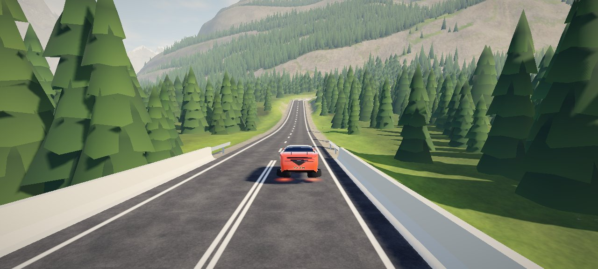 | 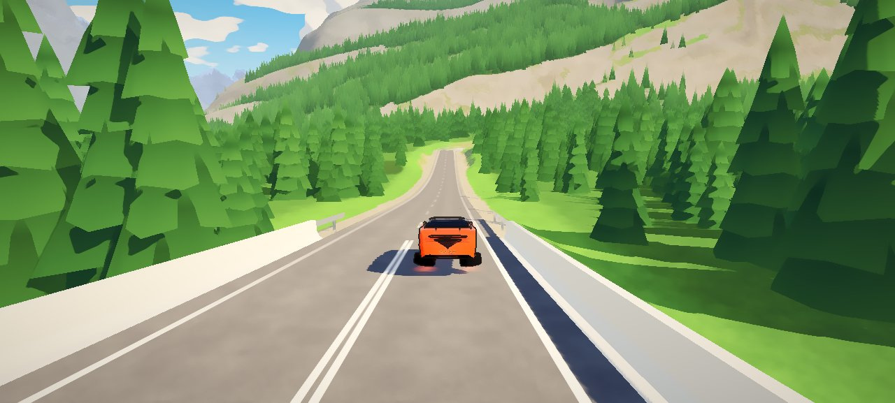 |

| 水墨 | 赛璐璐 |
|---|---|
| 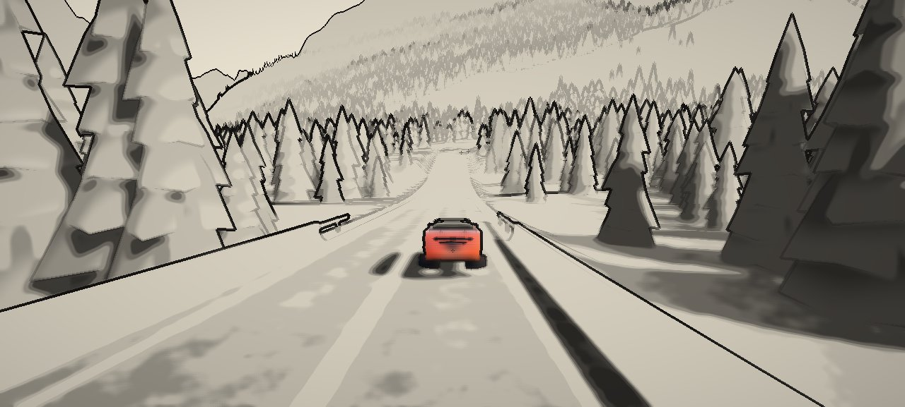 | 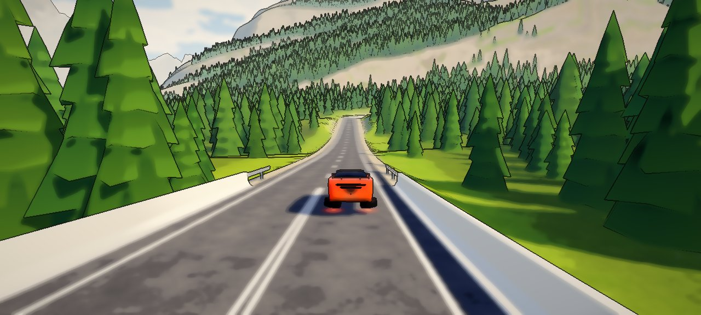 |

| 版画 | 像素 |
|---|---|
| 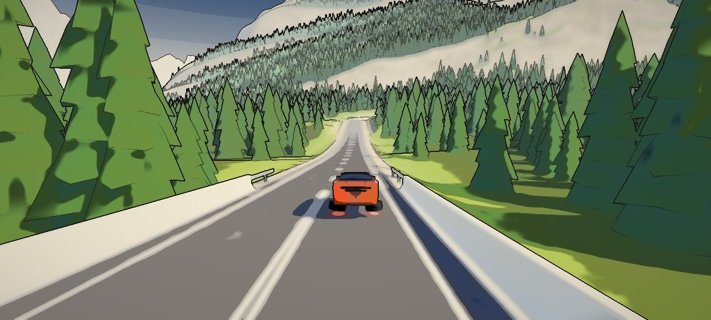 |  |

| 方块，樱树、黑橡和白桦 | 手绘，风、花瓣、路边的鹿和天上的鸟 |
|---|---|
| 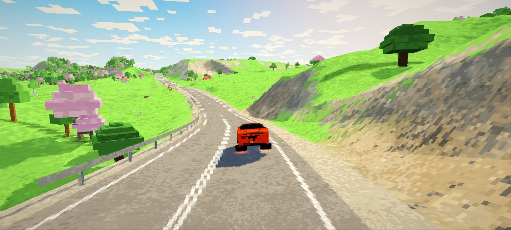 | 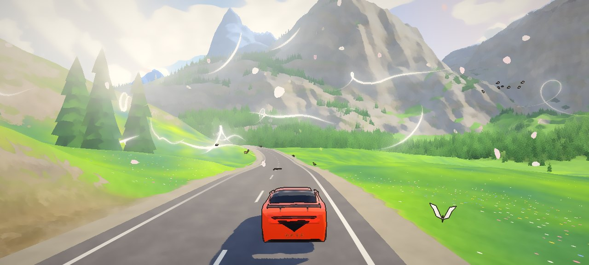 |

</div>

路在每个世界里都像工程师那样选线：沿河谷走，翻垭口，绕开山体；坡太陡就修盘山回头弯，离地太高就上高架桥，埋得太深就打隧道，过水就架桥。路修过的地方，山体被挖成切坡、填成路堤。

<div align="center">

| 盘山路 | 切坡 |
|---|---|
|  |  |

| 隧道 | 高架桥 |
|---|---|
|  |  |

| 丘陵 | 河谷 |
|---|---|
|  |  |

| 沿海 | 沙漠 |
|---|---|
|  |  |

| 城市 | 城市里的高架 |
|---|---|
|  |  |

| 地底 | 地狱 |
|---|---|
| 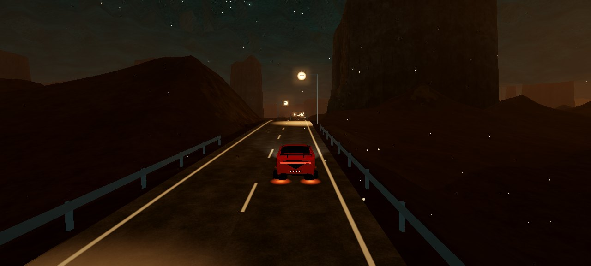 | 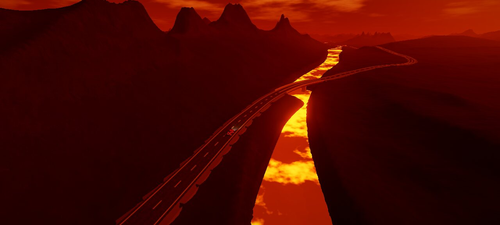 |

| 深海，往上爬出海面 | 天堂 |
|---|---|
| 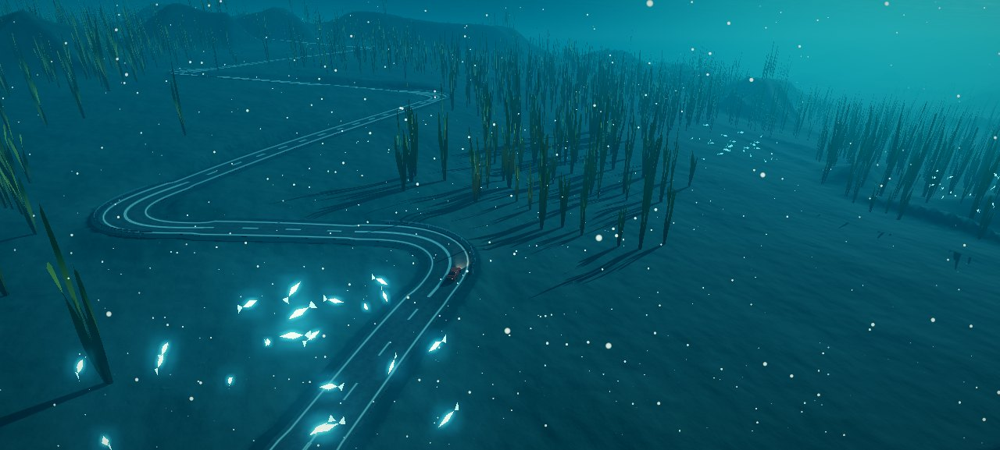 | 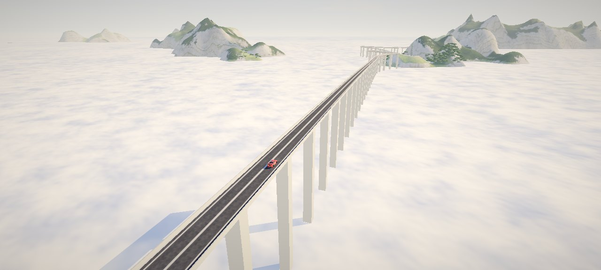 |

| 太空 | 颠倒 |
|---|---|
| 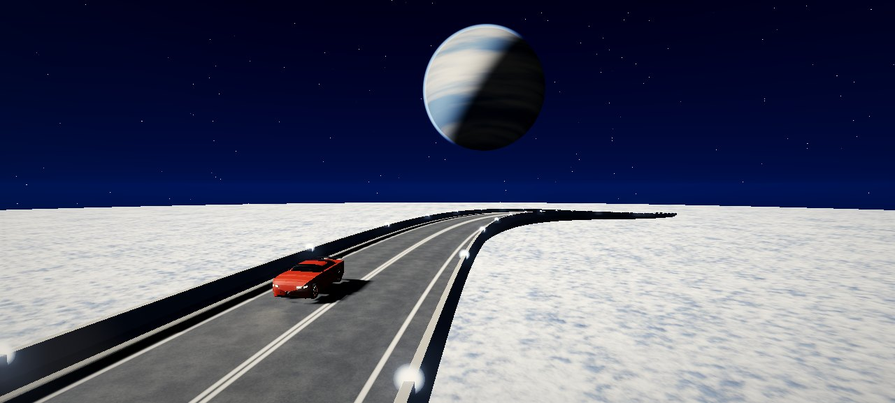 | 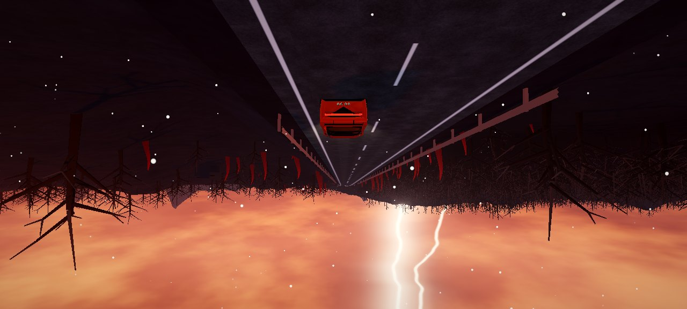 |

| 进颠倒：路扭着翻过去 |
|---|
| 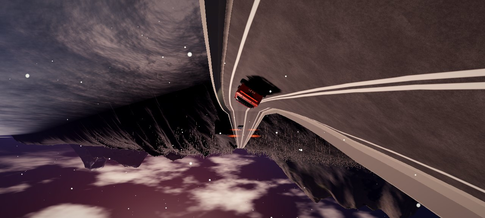 |

</div>

---

## 仪表

<div align="center">


</div>

左下角是一张路线纵断面，画法照公路设计图：浅色的一片是地面，白线是设计线，也就是路面高程；桥下画出桥墩，隧道是一条穿过山体的虚线，回头弯在线上打一个短刻度。120 m 以上的桥和隧道在上方标出长度。路开进下一个世界的地方竖一条虚线，旁边写着那个世界的名字。图上往后 420 m、往前 2.6 km，下一座桥、下一条隧道还没开到就能看见。

上面是车速、桩号、所在的世界、海拔和坡度；过交界时，世界一栏写成「河谷 → 沿海」。桩号照工程写法，K6+833 是第 6 km 又 833 m。在桥上或隧道里，还会多一行，写着这一段还剩多少米。

图上的线都读自车正在开的那批路面采样。橙色的点是车。

---

## 驾驶

| 操作 | 键位 |
|---|---|
| 自动驾驶开关 | `P`（关掉后才能手动开） |
| 油门 / 刹车 | `W` `S` 或 `↑` `↓` |
| 转向 | `A` `D` 或 `←` `→` |
| 手柄 | 左摇杆转向，RT 油门，LT 刹车 |
| 切机位 | `C`：追车、导演、航拍、侧拍、低机位、正面 |
| 全屏 | `F` |
| 壁纸模式（隐藏界面，镜头交给导演） | `H` |
| 声音开关（默认关，选择会记住） | `M` |
| 下一个世界 | `N` |
| 回到路上（不算翻车） | `R` |
| 下一种画风 | `V` |

右下角的按钮也能挑世界、换画风、切机位、开关自动驾驶、进壁纸模式、开关声音。

| 地址栏参数 | 作用 |
|---|---|
| `seed=7` | 固定种子 |
| `s=6900` | 从第 6.9 km 开始 |
| `world=coast` | 从这个世界开始：`alpine` `hills` `river` `coast` `desert` `city` `cavern` `inferno` `abyss` `heaven` `space` `upside` |
| `worldlen=2500` | 每个世界只有这么长（米），用来看交界 |
| `loop=coast,city` | 只让这几个世界轮流出现 |
| `cam=drone` | 起始机位：`chase` `director` `drone` `side` `low` `front` |
| `style=ink` | 起始画风：`real` `paint` `ink` `cel` `print` `pixel` `block` |
| `auto=0` | 一开始就手动驾驶 |
| `debug=1` | 显示帧率、渲染倍率、绘制次数、三角形数和地形块数 |

---

## 车

车模由同仓库的 `carmodel/` 生成：纯 Python 标准库，车身的每根曲线都是一段函数。

车速过 40 km/h，车身先抬高 260 mm，四个轮子绕轮拱里的铰轴转 90°，平躺到底板下，外侧轮面朝下，车身再落到离地 200 mm。轮毂是一块整流盘，盘上一圈发光环，翻平后朝着路面。车速低于 20 km/h 或出了事故，按相反的顺序放下轮子。翻转只改外形，物理仍按四个轮胎算。

```
4500 × 1816 × 1312 mm   轴距 2700 mm   20 英寸轮毂   51,300 三角面
```

<div align="center">


</div>

`preview.html` 可以转着看车模，"悬浮"按钮播放翻转。

---

## 本地运行

```bash
python3 build.py            # 生成 out/car.glb（仓库里已带一份）
node tools/serve.mjs 8173   # http://localhost:8173
```

ES module 在 `file://` 下会被当成 null origin 拒绝，所以要起 http 服务。

改过 `src/` 或 `out/car.glb`，提交前跑一次 `node tools/stamp.mjs`。它给每个模块的地址加上内容哈希，线上的浏览器缓存就不会把新旧文件混着用。

依赖：Node 18+（本地静态服务与检查脚本）、Python 3.10+（仅标准库，只在重建车模时需要），以及支持 WebGL2 的浏览器。three.js r160 已放在 `tools/vendor/`，不需要联网。

---

## 怎么做的

### 世界

每个世界是一份数据加一个地形函数：天空、雾和光，地面每一层的颜色，水，长什么树，以及这个世界的山形。一个点属于哪个世界，只看它在哪：沿着路出发的方向走了多远，交界线再用一个慢变的噪声弯一弯，不会是一条直线。哪段路程是哪个世界，写在一张时间表里，默认十二个世界依次轮流，每个 7 km，最后 1.5 km 变成下一个：地形在两个函数之间插值，地面颜色、树种、水跟着换，天光按镜头所在的位置混合。

着色器用同一条轴、同一个整数哈希逐像素算出这个点在哪个世界，时间表里镜头前后的那几段以数组传进去，颜色从一张每个世界一行的调色板里取，所以地面换颜色的地方正好是地形换形状的地方。太阳在所有世界里站在同一个方向，因为阴影烘焙在地形块里。

### 换世界

点了别的世界，时间表在已经修好的东西之后改写：车前约一公里以外找一处平直的路切断，切口之后的路作废，选线从切口接着往新世界里走；交界从切口之后开始，和别的交界一样慢慢换过去。旧路经过的地形块、树和楼照旧画着，等新路铺好再按新路、新地形重建，好了再换上，不会出现空洞。已经开始交界的那一段改不了，再按「下一个」改的是它之后那一段。

任意两个世界都可能接在一起，有的高差很大。纵断面求解器多了一个下限：除了深海，路不进显出来的液面，所以从云海或海面换到低处的陆地时，路先在液面上走完，再沿高架下来。

河谷的河、沿海的海岸线顺着路出发的方向延伸，路会找最平的那条线走，所以河和海大多就在路边。过水的地方，设计线抬到水面以上 6.5 m 架桥；选线时水面算作平地，但价钱是路的两倍半，窄的海峡直接架桥，宽的海湾绕过去。

城市是蓝调时分：太阳刚落，天顶深蓝，地平线一圈暖色，楼一扇窗一扇窗地亮着。楼按一套顺着出发方向的街网排，每 46 m 一块地，市中心的楼最高，公园里不盖楼、只长树；每栋楼的四个角都离路够远。窗户在着色器里按立面上的米数画，所以不论楼多大都对齐楼边；窗小到几个像素时退成平均的亮度，远处的天际线是一片柔光，不闪。路在城里上 12 m 的高架，每 40 m 一盏路灯，左右交替。

水面其实是一张"液面"，每个世界给它不同的样子：河谷和沿海是水，地狱是带着暗壳、裂缝发光的岩浆，天堂是一片云海，太空里同一片云海落在 320 m 以下。路过液面一律架桥，各世界的桥高不同：水 6.5 m，岩浆 9 m，云海 55 m，太空 320 m，太空里的桥没有墩。深海反过来，路贴着 120 m 深的海底走，海面是头顶一块亮的天花板，海底成片长着海带；从深海到天堂，路沿着一座海山盘上去，穿出海面，海面变成云海。太空的天是黑的，白天也看得见星星，地平线外挂着一颗行星，桥两侧的护栏上一排小灯。深海里海雪往下沉，一群群发青光的小鱼在海带上方绕圈，地狱里火星往上飘，地底的空气里浮着尘。

地底在城市和地狱之间：一个国家那么大的洞，洞顶在 170 m 上，满是蓝绿色的萤火虫光；地上散着发光的水晶，石柱从地面一直顶到洞顶，路在石柱之间绕，路边一盏盏暖色的灯。洞顶是一张跟着镜头的圆盘，形状在顶点着色器里按噪声算，近处挂着钟乳石；跨过边界时洞顶升到天上，所以从城市开过来，天慢慢合上，开进地狱时又打开。

### 选线

先在粗地形上用 A* 找走廊（爬升很贵，所以走河谷和垭口），再用纯追踪沿走廊铺中心线。走廊爬得比公路能爬的快，就设计一段盘山：一条条直腿，每条斜着往山上爬，腿尾一个回头弯掉头。每条腿的角度和长度都先用真正的转向律在地形上试跑一遍，挑最贴地的，所以回头弯落在山坡上，不会埋进山里。

### 纵断面、桥和隧道

纵坡求解器把高程拟合到地面，坡度不超过 9.5%。离地超过 7 m 变高架桥，覆土超过 20 m 变隧道，从另一层路上方经过时一定是桥。

### 同一份采样

路一旦提交就不再改，只有换世界时，车前约一公里以外的那段重修。路面网格、地面改造、物理、自动驾驶、仪表、导演读的是同一批采样，所以画出来的路就是开的路。

### 修路后的地面

`corridor.js` 给每个点算出修路后的地面：路肩平台、1:0.8 的切坡、1:1.6 的路堤；桥下只要求低于梁底，隧道上只要求高于拱顶。地形、树、镜头都问这一个函数。

### 岩层与草地

草皮到崖边断开，边缘不规则，但断得利落。岩壁约 29 m 一层，层层深浅不同；层面随公里尺度的褶皱起伏，所以岩层会斜着穿过一面山。大约每四层有一层更软更暗的泥灰岩。层顶是一道窄台，林线以下长草，以上是碎石。层理只在真正的陡壁和切坡上看得清。草地分出偏干发黄和偏湿发深的片，草坡变陡的地方成簇地露出岩石。

### 阳光

朝太阳沿山体做一次光线步进。地形逐顶点烘焙，路面逐采样烘焙，树逐棵烘焙，车每帧采样，所以车开进山影里会一起变暗。

### 天光

天空球渲染成环境贴图，给地形、路面和车漆提供天光与反射；山谷和冲沟按看得见多少天空变暗。隧道里的光跟着镜头走：镜头进了洞，画面换成灯带的光，眼睛慢慢适应，前面的洞口白得发亮，出了洞那一下外面太亮；镜头在洞外时，洞口是黑的，车开进去就暗下来。

### 画风

画风改三处：材质的光，阳光分成两三级、阴影偏蓝紫、高光变弱；天空，换成一团团积云；调色之后的最后一道处理，笔触、平涂、墨线、墨色、版画的几块平色和像素。墨线和平涂读场景的深度：深度跳变的地方是轮廓，深度的坡度折断的地方是折线。车在画面的 alpha 里给自己做了记号，所以手绘只给车勾线，水墨只留车的颜色。写实画风下三处全关，画面和没有画风时逐位相同。

手绘照着手绘动画的背景画：天是饱满的深蓝，地平线上立着一座座积云塔，向阳面白、背阴面蓝灰；空气清透，雾只留四分之一，远山一层层变蓝；阴影浅而偏蓝，不发黑；绿色重新从三种颜料里取，暗处青绿、中间翠绿、亮处嫩黄绿；草地上是一片片深浅、偏黄偏蓝的色块，近处的草里还有成片的野花；树冠的光碎成一团一团，像一笔一笔点上去的叶子；云的影子被风推着从地上慢慢滑过；亮的地方有一层柔光；笔触是圆的一团团。积云塔、深蓝的天和远山变蓝只在白天的天下面，夜里的城市、地狱和太空留着自己的天。

手绘里还有活物：丘陵、山间、河谷、沿海的路边，草地上站着鹿、兔、狐，有时路边坐着一只黑猫；车开近了，鹿、兔、狐就朝远离路的方向跑开。天上有成群的鸟绕着大圈，路边的草上飞着蝴蝶。它们和车一样被勾上线。写实和别的画风里一只也没有。每个世界的动物不一样：山间有山羊，丘陵里有狸，河谷里有苍鹭，沙漠里是骆驼，地底有一种白色的小精灵低着头走。

手绘里还刮着风。天上画出一道道长长的淡线，像手绘动画里画风的那几笔：先一点点画出去，拐几个弯，有时在尾巴上绕个圈，再一点点擦掉；线里夹着花瓣，一片一片翻着往下落，跟着风往同一个方向飘。风线和花瓣只在白天的几个世界里有：丘陵、山间、河谷，沿海少一些，天堂里的花瓣是金色的。

方块把世界当成一块块方块来画：每个面都铺上一格一格的方格，每格的颜色取自那一格正中的画面，再按各自的随机数明暗一点，像方块表面那张小图；方格贴在世界上，车往前开，它们跟着世界走。离得越远方格越大，所以屏幕上总是几个像素一格。顶面最亮，侧面次之，底面最暗。天是浅蓝的，太阳是方的，云是一块块白色的方块，由风推着走。树换成方块搭的：云杉一层层收窄，阔叶树是一根树干顶着几层叶子，石松是平顶，仙人掌是方柱。路边的动物也是方块搭的，每个世界不一样：山间是羊、牛和狼，丘陵里是猪、羊、牛、鸡、马和村民，沙漠里是骆驼和兔，地底是蜘蛛，地狱里是岩浆怪，太空里是末影人那样的高个子。树也不止一种：丘陵里有橡树、白桦、黑橡和樱树，河谷里有垂柳，沿海有棕榈和金合欢，山间的云杉有高的、有落着雪的，沙漠里有高仙人掌和枯灌木，天堂里是一团团白云做的树。

画面上没有钉在屏幕上的东西。原来的纸纹、水墨的墨斑和枯笔的噪声按屏幕取，世界在动它们不动，看着像镜头上的脏点；现在纸纹和墨斑去掉了，枯笔的噪声贴在世界上，跟着线走。只有像素画风的抖动按屏幕取，那是它本来的样子。

### 导演

导演镜头读前方几百米的路，下一座桥、下一个弯、下一组回头弯还没开到，机位就已经在那里等着。跟着车走的机位（追车、侧拍、前拍、环绕）之间用 1.6 s 绕车滑过去；站着不动的机位（路边长焦、河谷对岸的远景、回头弯上方俯拍、隧道洞口）用 0.45 s 的叠化切入。隧道里一律叠化。只有镜头到车的视线大部分时间不被山体和桥的护栏挡住，这个机位才会被用；中途被挡住就换掉。在高架上，侧拍的机位升到护栏上方，长焦浮在桥面上方。洞口的机位站在洞门外，看车开进山里；车已经在洞里，就在出口外回头等它出来。长焦、远景、俯拍、环绕各有 30–35 s 的冷却，洞口 40 s，好镜头不会每个弯都来一遍。竖屏也照样构图。航拍机位不归导演管，但查的是同一条视线：楼或山挡住车，它就换到另一侧，或升到车后高处顺着路往下看。

### 后台烘焙

一个近处地形块要算 5–10 ms，一帧给不起。地形块和树块交给 1–3 个 Worker 在后台烤：主线程把路的走廊交过去，拿回烤好的数组，只建网格。两边跑的是同一份烘焙代码，烤出来的块逐位相同。主线程上地形每帧的 95 分位从 4.5 ms 降到 0.3 ms，换世界后要重建的地形 1.6 s 建完，原来要 6.9 s。没有 Worker 的时候（还没起来、出过错、无头运行、地址带 `bakers=0`），照旧在页面上分帧烤：每帧给地形 4 ms、森林 2 ms，时间到了就停，下一帧接着算。

### 自适应画质

每半秒量一次帧率。连续 2 秒低于 55 fps，渲染分辨率降一档，五档从满分辨率到一半，最后两档阴影贴图从 2048 降到 1024；连续 8 秒高于 58 fps 再升一档。因为太慢降下来的那一档，1 分钟内不再试，再失败就等 2 分钟、4 分钟，画面不会忽清忽糊。

---

## 项目结构

```
index.html               入口：界面、按钮、无头运行与诊断输出
src/
  game.js                装配、主循环、隧道里的光
  world/                 世界本身，不碰渲染
    worlds.js            十二个世界的数据和地形，世界在哪、怎么交界，时间表
    turn.js              换世界：在车前切断路、改写时间表、重新选线
    landform.js          山间的山形：扭曲 fbm、山脊、冲沟
    surveyor.js          选线：A* 走廊、纯追踪、盘山设计
    road.js              纵断面、桥隧判定、提交后不变的采样
    corridor.js          修路后的地面
    sunlight.js          太阳遮挡的光线步进
    vegetation.js        每个世界长什么树、长在哪
    bakery.js            地形块和树块的烘焙，页面和 Worker 共用
    bakeworker.js        后台烘焙的 Worker
  core/                  车辆物理、自动驾驶、碰撞
  render/                地形、路面与桥隧、森林、水、天空与雾、后处理、车流、镜头
    worldlook.js         着色器里的世界、调色板、交界处的天光
    water.js             河、湖和海
    city.js              城市的楼和窗
    ceiling.js           地底的洞顶
    director.js          导演：按前方的路挑镜头、滑移与叠化
    quality.js           自适应画质
    style.js             画风：材质的光、天上的积云、最后一道处理
    critters.js          小动物：每个世界的，躲树、被撞飞；天上的鸟和蝶
    drift.js             手绘的风线和花瓣
    twist.js             颠倒：沿视线拧转的视图
    upside.js            颠倒里的闪电、触手，和怎么拧
    props.js             每个世界路边的建筑
    bakers.js            Worker 池：发块、收块，出错退回页面
  ui/hud.js              仪表：车速、桩号、路线纵断面
carmodel/                程序化车模（纯 Python 标准库）
tools/                   检查脚本、截图、发布前加版本号、本地服务、three.js r160
  brand/                 og 图、图标和字标的生成
docs/design.md           设计文档
```

---

## 验证

| 检查 | 命令 | 结果 |
|---|---|---|
| 路网 | `node tools/road_check.mjs 16` | 5 个种子，每 16 km 有 26–54 个回头弯、13–22 座桥、2–12 条隧道；最大纵坡 9.5%，最小半径 14 m，自交 0 |
| 世界 | `node tools/world_check.mjs 130` | 种子 7、42、3 各 130 km，不渲染：十二个世界按顺序出现，每个 7–18 km 路，除了深海路面没有一处在液面下，最大纵坡 9.5% |
| 换世界 | `node tools/switch_check.mjs <seed>` | 种子 7、42、3 各 110 种换法，不渲染：切口处路接得上，只遇到点的那个世界，最大纵坡 9.5%，除了深海路面不在液面下；交界在点了之后 1.15–3.6 km 开始，通常 1.3 km |
| 驾驶 | `node tools/physics_check.mjs 600 <seed>` | 600 秒出界 0 帧、翻车 0 次，车道偏差最大 0.92 m，最大横向加速度 0.57 g |
| 整页 | `node tools/game_check.mjs 300 42` | 真实页面跑 300 秒：4.8 km，碰撞 0，翻车 0，路面块与几何体有上限 |
| 后台烘焙 | `node tools/bake_check.mjs` | 真实页面，五个世界外加一次换世界：镜头周围和前方路边的 365 个地形块、276 个树块，在页面上和 Worker 里各烤一次，1892 万个数逐位相同；Worker 加载的十个模块地址都带内容哈希 |
| 车身表现 | `node tools/presentation_check.mjs` | 车轮转动、前轮转向、车身俯仰侧倾、镜头有滞后；起步时轮子着地，过 40 km/h 后轮子翻平、车身悬浮；按 10–40 fps 走帧，镜头离车 14.7–15.7 m |
| 画风 | `node tools/style_check.mjs` | 同一帧画七种：水墨除了车，95% 的像素饱和度不到 0.13，车的红一点没少，纸和淡墨占四成多；手绘、赛璐璐饱和度 0.24–0.25（写实 0.19），纹理只剩一半到三分之一；版画天顶印一道靛蓝；像素全是 3 px 的方块、每通道八级；方块的路面 79% 的像素和右邻同色（写实 18%），饱和度 0.28。手绘、水墨、版画、方块相隔半秒的两帧里，没有钉在屏幕上的图案（相关 −0.01、0.04、0.04、0.01，门槛 0.09）。丘陵里 7 秒：写实没有动物，手绘 11 只在走、103 只在飞，风里 60 道线、300 片花瓣，方块 13 只在走，树比写实多三种；换回写实后动物和风都不见了，树又是树，和没换过的只差 0.1%。换画风时一半时间过一半，路上天空重画 6 次；换回写实，和从没换过的那次只差 0.1% |
| 开出路外 | `node tools/offroad_check.mjs` | 离路 16 m 的车贴着地面走，离地最多 0.05 m，上上下下 12 m、腾空 96 步；撞树停在离树皮 0.15 m 处，撞房子也一样；自动驾驶把车放回路上；方块里一只羊挡在路上被撞飞 5.4 m，车慢了 1 m/s，躺着躺着消失了；手绘里一头鹿冲着树干跑，绕过去，离树 1.2 m |
| 颠倒 | `node tools/upside_check.mjs` | 空间进颠倒的路在 100 m 里翻过去：翻之前画面没变，翻到一半路绕着视线转了 2.6 rad，且这时视锥剔除是关的，翻完是半圈、天在画面下方，剔除重新打开，方向盘反过来，一次闪电点亮天空，路边有 70 个触手；七种画风都能画翻过来的世界，没有一条报错 |
| 导演 | `node tools/director_check.mjs 180` | 种子 7、42、3 各 180 秒，外加一次竖屏、一次种子 7 的 1.2 km 高架，种子 7 在城市、地底、天堂、深海、太空各一次，一次潜进深海，和一次城市里的航拍：车在画面里 99.9–100% 的帧，被山体、护栏、楼或洞顶挡住的不到 0.3%，没有不带叠化的跳切 |
| 截图 | `node tools/shot.mjs out/a.png 90 "s=6900&cam=drone"` | 一次运行里同时出图和诊断数据 |
| 发布前 | `node tools/stamp.mjs` | 每个模块的地址带上内容哈希，浏览器不会把新旧文件混着用；`game_check` 会先查这一步 |
| 车模几何 | `python3 build.py --verify` | 尺寸、法线朝向、轮胎不穿车身、材质齐全；轮子翻转的全过程不碰路面、底板和车身 |

---

## 许可

MIT
