<div align="center">

# Continuum · 无限遛弯

缘溪行，忘路之远近。<br>
<sub>陶渊明《桃花源记》</sub>

[**▶ 在线试玩**](https://benign.host/continuum/) · [设计文档](docs/design.md)

<sub>three.js r160 · WebGL2 · 无构建步骤 · 车模由纯 Python 标准库生成</sub>


</div>

---

## 这是什么

浏览器里的一条路，车在上面自己开，可以一直开下去，也可以挂在墙上当壁纸。路边的世界按里程更换，一共十二个：山间、丘陵、河谷、沿海、沙漠、城市、地底、地狱、深海、天堂、太空、颠倒。世界随开过的距离变化，不随时间变化。

到了两个世界的交界，地形、地面、树、水和天光一起变成下一个世界的样子，用一公里多慢慢换过去，没有加载，也没有黑屏。车开过交界的中点，画面中间偏下浮出新世界的名字和一句话（山间是「路从山里修出来」），4 秒后淡去。

十二个世界都接上了，开完太空翻进颠倒，再回到山间，一圈大约 120 km。每个世界除了地形、天和树，还有自己的东西：城市楼顶的水箱和轨道高架上迎面开来的列车，河谷岸边的一排杨树，沿海拍上滩的浪和远处的帆船，沙漠的尘卷风和风滚草，天堂云海上飞过的鹤，太空的银河和带环的行星……见下面的「每个世界自己的东西」。

世界也可以自己挑。右下角的「世界」里点一个，约一公里后开始换过去，换法和交界一样；`N` 换到下一个。勾选哪些世界轮流出现，选择会记住。六个白天的世界各有三种天：正午、金色的傍晚、阴天，按第几次来到这个世界轮；世界菜单里点世界后面的小圆点，能把它钉在一种天上。

画法也可以换。右下角的「画风」里有八种：写实、手绘、水墨、浅绛、赛璐璐、版画、像素、方块，`V` 换下一种。一种换成另一种用一秒半慢慢过去，选择会记住。浅绛是在水墨上罩一层很淡的颜色：山石和路染赭，远山染花青，草木染汁绿。水墨和浅绛下，画面右上角落一行竖排的题款和一方朱印，8 秒后淡出。

右下角的齿轮打开设置：画质（自动、高、中、低）、帧率上限、镜头晃动、运动模糊、三条音量、单位（km/h 或 mph）、语言（中文或 English），和手柄、键盘的转向手感。改了立刻生效，选择记在浏览器里；地址栏指定了的那一项灰着改不动。第一次来的人什么都不用选，系统设了「减少动态效果」时镜头不晃、手柄和手机不震。

界面有英文版：浏览器的语言不是中文就用英文。三十秒没人碰、又开着自动驾驶，仪表和按钮淡到三分之一，一有输入就回来。第一次打开页面，左下角出一行「它自己会开。按 P 接手。」。

路不是唯一能开的地方。手动开的时候，车可以开出路肩，贴着地面走：上坡慢，下坡快，草和沙抓地差；树是实心的，楼是实心的，丘陵路边的石墙也是，撞上去就停，撞得越快伤得越重；陡坡和深水过不去，车被弹回来。

路边的动物能被撞飞：抛出去，翻着跟头落地，弹几下，躺一会儿，消失；越重的越让车掉速。动物也会躲树，跑的时候绕开树干。开自动驾驶时，车先被放回路上；`R` 随时把车放回路上，不算翻车。

第十二个世界叫「颠倒」。红云压着天，云里有闪电，每闪一下，整个世界跟着红一下，每第五次闪电落到车前的地上，留一块焦痕。空气里漂着灰，树一片叶子也没有，路边的地里钻出触手，车开近了，它们朝车弯过来。

黑的根从远处的荒地里一路爬向路肩，爬到哪里，哪里就立起一根触手；在里面待得越久，根和触手越多。天上飞着成群的蝙蝠，地上的孢子荚车一近就炸开。

进颠倒的那一段路是拧过去的：一段 200–500 m 的直路绕着自己的走向拧半圈，像一根麻花，两侧立着一排排红灯的杆和拱，跟着路拧成两道螺旋。大地跟着卷过去，离路越远卷得越缓，是一道几公里长的大卷：前面的大地在路的一侧立起来，越过头顶，在另一侧落下去，再往前整个世界倒挂着。

车沿着麻花开过去，画面跟着车转，转到哪里只看车开到哪里，不看时间：开得快转得快，停在半路就侧着停在那里。翻完，天在脚下，路在头顶；手动开的时候，方向盘往反的方向打。从颠倒里出来的那一段接着往同一个方向拧满一整圈。翻的时候，画面上浮出一句：天旋地转回龙驭。

<div align="center">

| 写实 | 手绘 |
|---|---|
|  |  |

| 水墨 | 赛璐璐 |
|---|---|
|  |  |

| 版画 | 像素 |
|---|---|
| 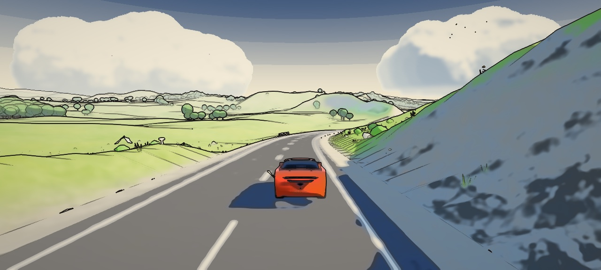 | 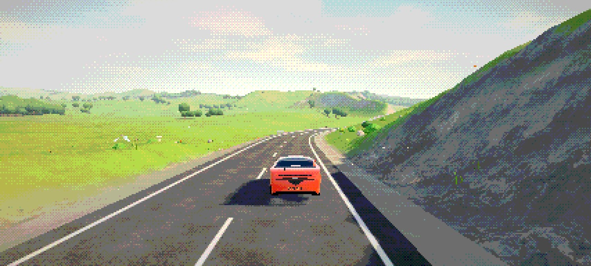 |

| 方块，樱树、黑橡和白桦 | 手绘，风、花瓣、路边的鹿和天上的鸟 |
|---|---|
| 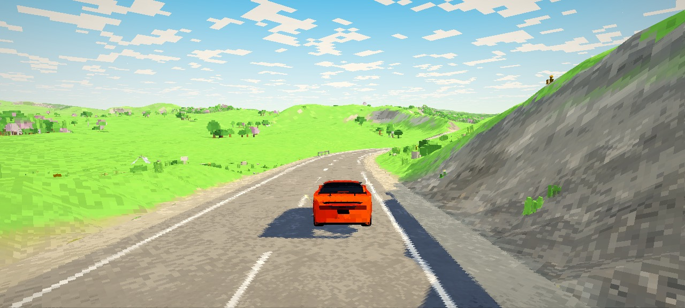 | 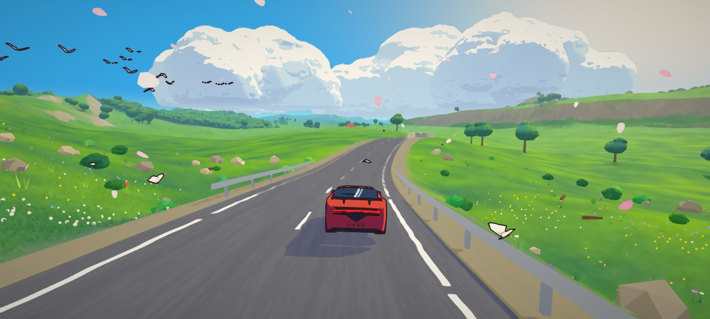 |

</div>

路在每个世界里都像工程师那样选线：沿河谷走，翻垭口，绕开山体；坡太陡就修盘山回头弯，离地太高就上高架桥，埋得太深就打隧道，过水就架桥。路修过的地方，山体被挖成切坡、填成路堤。

<div align="center">

| 盘山路 | 切坡 |
|---|---|
|  |  |

| 隧道 | 高架桥 |
|---|---|
|  | 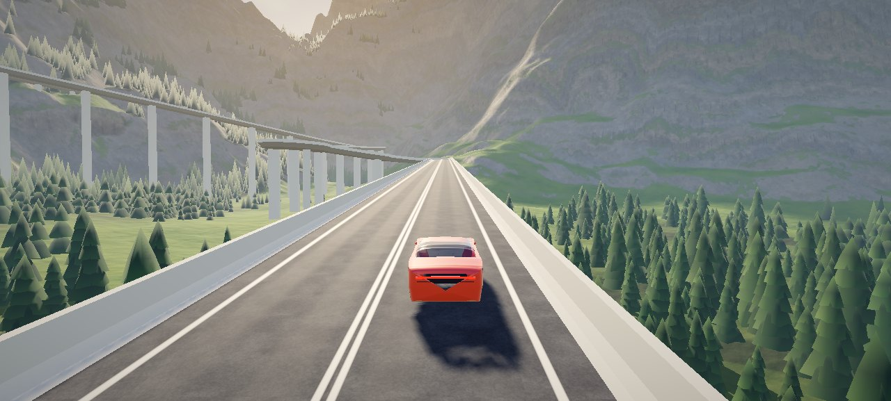 |

| 丘陵 | 河谷 |
|---|---|
|  | 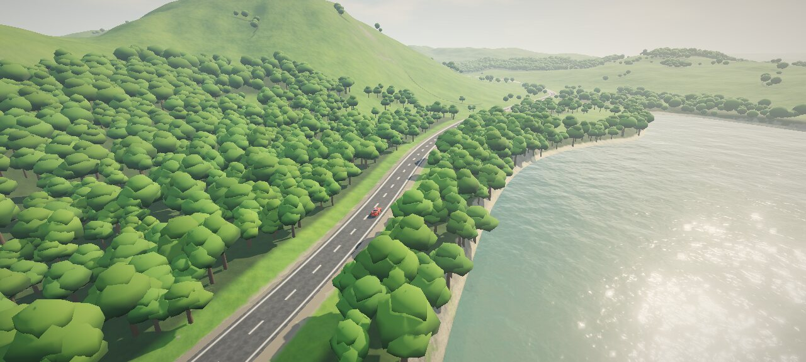 |

| 沿海 | 沙漠 |
|---|---|
|  |  |

| 城市 | 城市里的高架 |
|---|---|
|  | 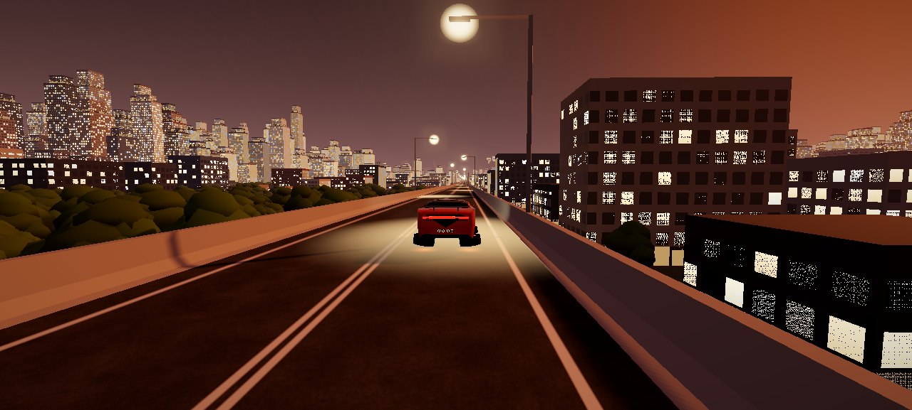 |

| 地底 | 地狱 |
|---|---|
|  | 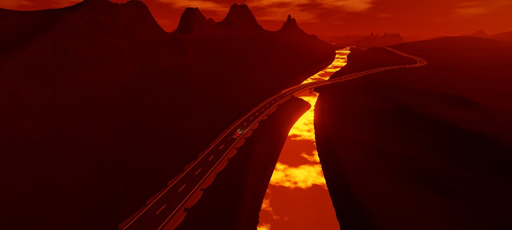 |

| 深海，往上爬出海面 | 天堂 |
|---|---|
| 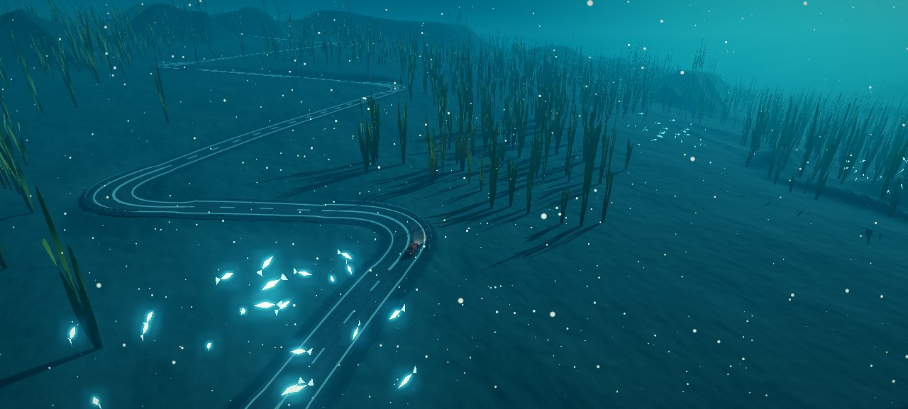 | 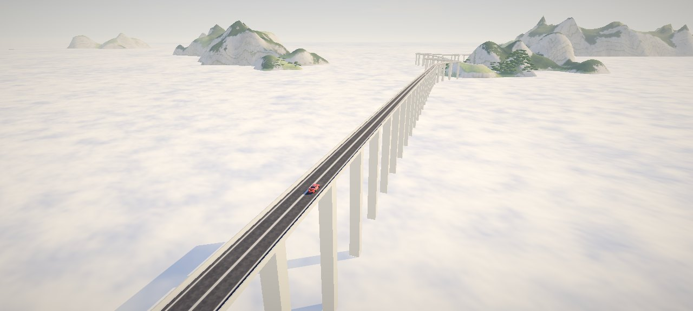 |

| 太空 | 颠倒 |
|---|---|
|  |  |

| 进颠倒：大地卷过去，车沿着拧成麻花的路翻过去（1.2 km 外、开到之前、九十度、翻完） |
|---|
|  |

</div>

---

## 仪表

<div align="center">

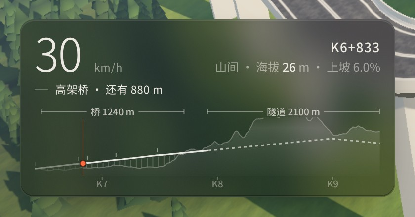

</div>

左下角是一张路线纵断面，画法照公路设计图：浅色的一片是地面，白线是设计线，也就是路面高程；桥下画出桥墩，隧道是一条穿过山体的虚线，回头弯在线上打一个短刻度。120 m 以上的桥和隧道在上方标出长度。路开进下一个世界的地方竖一条虚线，旁边写着那个世界的名字。图上往后 420 m、往前 2.6 km，下一座桥、下一条隧道还没开到就能看见。

上面是车速、桩号、所在的世界、海拔和坡度；过交界时，世界一栏写成「河谷 → 沿海」。桩号照工程写法，K6+833 是第 6 km 又 833 m。在桥上或隧道里，还会多一行，写着这一段还剩多少米。选 mph 时车速、海拔和距离换成 mph、ft、mi。

图上的线都读自车正在开的那批路面采样。橙色的点是车。

---

## 驾驶

| 操作 | 键位 |
|---|---|
| 自动驾驶开关 | `P`（关掉后才能手动开） |
| 油门 / 刹车 | `W` `S` 或 `↑` `↓` |
| 转向 | `A` `D` 或 `←` `→` |
| 手柄 | 左摇杆转向，RT 油门，LT 刹车；有震动马达的手柄在落地、撞击、开出路外、打滑时会震 |
| 触屏（关掉自动驾驶后出现） | 横屏左半屏拖是方向，右下两块是刹车和油门；竖屏下面一条是方向，油门和刹车在它上面两边。两指在屏幕中间点一下切机位 |
| 切机位 | `C`：追车、导演、航拍、侧拍、低机位、正面、引擎盖 |
| 绕着车看一圈（只在追车机位） | 按住鼠标右键拖，松开 2 秒后回到原位 |
| 全屏 | `F` |
| 壁纸模式（隐藏界面，镜头交给导演） | `H` |
| 拍照模式（世界停住，镜头放开，拍一张 2 倍大的图） | `K` 进出 |
| 拍照模式里 | `W` `A` `S` `D` 平移（`Shift` 快四倍），`Q` `E` 降升，鼠标拖转向，滚轮改视场角，`Z` `X` 滚转；`Enter` 拍，`Esc` 出去 |
| 声音开关（默认关，选择会记住） | `M` |
| 下一个世界 | `N` |
| 回到路上（不算翻车） | `R` |
| 下一种画风 | `V` |

右下角的按钮也能挑世界、换画风、切机位、开关自动驾驶、进壁纸模式、进拍照模式、开关声音、打开设置。屏幕的主指针是手指时，按钮栏挪到上面，拇指搁的地方留给踏板，每个能点的东西不小于 40×40 像素。

声音是浏览器里现做的，不用录音。车的嗡声和涡轮声随车速升，风随车速变响，每个世界有自己的空气声；开出路外，脚下的草、沙、碎石各有各的声音；轮胎打滑会尖叫，撞树、楼、墙、别的车、动物各有一声；别的车擦身而过有一声从高滑到低的呼啸，按在镜头哪一边放到左耳或右耳。最后有一道限幅器，所有声音一起响也不破。

方向的手感：摇杆和手指推出来的量过了死区（默认 0.08），按曲线（线性，或默认的「中心更稳」）取幂，再乘灵敏度。键盘按下去给的是打满；「键盘转向」可以加一道缓冲，柔和或更柔。

拍照模式：按 `K`，车、车流、动物、风、云、水波都停住，界面收成底部一条细工具条。镜头离地至少 0.3 m，离车不超过 400 m。按快门把这一帧按画布 2 倍大（最多 3840×2160）重画一遍，存成 `continuum-世界名-画风-桩号.png`，笔触和轮廓线的粗细和屏幕上一样。工具条上还有景深（点一下画面对焦，光圈 f/1.4 到 f/16）和加减 2 EV 的曝光补偿。

追车的镜头会看路，也会跟着车的动作动：前面的路一拐，镜头先往弯里转过去；过弯时往弯外侧歪一点；车速过 42 m/s 开始细细地震；落地时往下沉一下。设置里的「镜头晃动」关掉，这些晃就都没有了，看进弯里的转向照常。机位「引擎盖」把镜头放在车头盖上。

写实画风下开得快时有运动模糊：车速过 25 m/s 渐渐出来，只在追车机位里。它只算镜头自己的动，所以近处的路面和路边被拉开，远山和天几乎不动；车不糊。设置里能关，低档没有。

| 地址栏参数 | 作用 |
|---|---|
| `seed=7` | 固定种子 |
| `s=6900` | 从第 6.9 km 开始 |
| `world=coast` | 从这个世界开始：`alpine` `hills` `river` `coast` `desert` `city` `cavern` `inferno` `abyss` `heaven` `space` `upside` |
| `worldlen=2500` | 每个世界只有这么长（米），用来看交界 |
| `loop=coast,city` | 只让这几个世界轮流出现 |
| `cam=drone` | 起始机位：`chase` `director` `drone` `side` `low` `front` `hood` |
| `style=ink` | 起始画风：`real` `paint` `ink` `qianjiang` `cel` `print` `pixel` `block` |
| `sky=golden` | 白天的世界都用这种天：`noon` `golden` `grey` |
| `auto=0` | 一开始就手动驾驶 |
| `debug=1` | 显示帧率、渲染倍率、绘制次数、三角形数和地形块数 |
| `cap=30` | 每秒最多画这么多帧。默认 60：屏幕刷新率在 108 Hz 以上就隔一两次画一次；`0` 是每次刷新都画 |
| `ppr=1` | 画布像素比的上限，默认 2；场景最多按 1.5 画，见「清晰」 |
| `gpu=high` | 机器有两块显卡时用快的那块；默认让浏览器挑 |
| `tier=low` | 把画质钉在 `high` `mid` `low` 中的一档，见「自适应画质」 |
| `ao=0` | 写实画风不做环境遮蔽（用来和做了的比） |
| `night=0` | 写实画风夜里不要车灯的光型、路灯下的光和窗里的屋子（用来和有的比） |
| `blur=0` | 关掉写实画风高速时的运动模糊（`1` 打开） |
| `lang=en` | 界面语言：`zh` `en`。不带就跟设置，设置里没选就跟浏览器 |
| `haptics=0` `deadzone=0.1` `curve=linear` `sens=1.2` `keys=soft` | 震动、死区、转向曲线、灵敏度、键盘转向 |

设置面板里有的几项（`tier` `cap` `blur` `lang` 和手感的五项），地址栏带了就以地址栏为准。

车是车：路有起伏的地方它会离地。每一步在车前后各 3 m 取一次地面，量这一处坡顶有多尖；尖到车速的平方除以曲率半径超过重力加速度的 1.2 倍，轮胎就卸了载，车按抛物线飞出去，空中不转向、不加油、不刹车。落下来的那一下，撞地的速度决定车身压下去多深、镜头抖多少、尘扬多高、响多重的一声。

丘陵、山间、河谷、沿海、沙漠、地狱、颠倒的直路上，隔一阵有一段路起伏成三到五个坡，每个坡六十米上下，高低差三米多：车速过 80 到 105 km/h，每个坡顶都会离地，120 km/h 上下能飞到近两米、几十米远。开到路外，土坡的坡顶用的是同一个算法。自动驾驶过这些坡不减速，所以它也飞。

---

## 车

车模由同仓库的 `carmodel/` 生成：纯 Python 标准库，车身的每根曲线都是一段函数。

车速过 40 km/h，车身先抬高 260 mm，四个轮子绕轮拱里的铰轴转 90°，平躺到底板下，外侧轮面朝下，车身再落到离地 200 mm。轮毂是一块整流盘，盘上一圈发光环，翻平后朝着路面。车速低于 20 km/h 或出了事故，按相反的顺序放下轮子。翻转只改外形，物理仍按四个轮胎算。

写实画风里的车有自己的一套材质（`render/carlook.js`）：金属底漆上罩一层清漆，高光有两层；玻璃透得见座椅和仪表台；胎侧有字，整流盘是拉丝的；车头灯夜里和隧道里才亮，尾灯刹车时亮三倍；悬浮时推进环后面的空气被热扭一下。别的画风里车的材质不变。

```
4500 × 1816 × 1312 mm   轴距 2700 mm   20 英寸轮毂   51,300 三角面
```

<div align="center">


</div>

`preview.html` 可以转着看车模，"悬浮"按钮播放翻转。

---

## 本地运行

```bash
python3 build.py            # 生成 out/car.glb（仓库里已带一份）
node tools/serve.mjs 8173   # http://localhost:8173
```

ES module 在 `file://` 下会被当成 null origin 拒绝，所以要起 http 服务。这个服务只监听本机；要从别的设备打开页面，加 `HOST=0.0.0.0`。

改过 `src/` 或 `out/car.glb`，提交前跑一次 `node tools/stamp.mjs`。它给每个模块的地址加上内容哈希，线上的浏览器缓存就不会把新旧文件混着用。

依赖：Node 18+（本地静态服务与检查脚本）、Python 3.10+（仅标准库，只在重建车模时需要），以及支持 WebGL2 的浏览器。three.js r160 已放在 `tools/vendor/`，不需要联网。

---

## 怎么做的

### 世界

每个世界是一份数据加一个地形函数：天空、雾和光，地面每一层的颜色，水，长什么树，以及这个世界的山形。一个点属于哪个世界，只看它在哪：沿着路出发的方向走了多远，交界线再用一个慢变的噪声弯一弯，不会是一条直线。

哪段路程是哪个世界，写在一张时间表里，默认十二个世界依次轮流，每个 7 km，最后 1.5 km 变成下一个：地形在两个函数之间插值，地面颜色、树种、水跟着换，天光按镜头前方的位置混合（见「天气」）。

着色器用同一条轴、同一个整数哈希逐像素算出这个点在哪个世界，时间表里镜头前后的那几段以数组传进去，颜色从一张每个世界一行的调色板里取，所以地面换颜色的地方正好是地形换形状的地方。太阳在所有世界里站在同一个方向，因为阴影烘焙在地形块里。

### 换世界

点了别的世界，时间表在已经修好的东西之后改写：车前约一公里以外找一处平直的路切断，切口之后的路作废，选线从切口接着往新世界里走；交界从切口之后开始，和别的交界一样慢慢换过去。旧路经过的地形块、树和楼照旧画着，等新路铺好再按新路、新地形重建，好了再换上，不会出现空洞。已经开始交界的那一段改不了，再按「下一个」改的是它之后那一段。

任意两个世界都可能接在一起，有的高差很大。纵断面求解器多了一个下限：除了深海，路不进显出来的液面，所以从云海或海面换到低处的陆地时，路先在液面上走完，再沿高架下来。

河谷的河、沿海的海岸线顺着路出发的方向延伸，路会找最平的那条线走，所以河和海大多就在路边。过水的地方，设计线抬到水面以上 6.5 m 架桥；选线时水面算作平地，但价钱是路的两倍半，窄的海峡直接架桥，宽的海湾绕过去。

水面其实是一张"液面"，每个世界给它不同的样子：河谷和沿海是水，地狱是带着暗壳、裂缝发光的岩浆，天堂是一片云海，太空里同一片云海落在 320 m 以下。

路过液面一律架桥，各世界的桥高不同：水 6.5 m，岩浆 9 m，云海 55 m，太空 320 m，太空里的桥没有墩。深海反过来，路贴着 120 m 深的海底走，海面是头顶一块亮的天花板；从深海到天堂，路沿着一座海山盘上去，穿出海面，海面变成云海。

城市是蓝调时分：太阳刚落，天顶深蓝，地平线一圈暖色，楼一扇窗一扇窗地亮着。楼按一套顺着出发方向的街网排，市中心的楼最高，公园里不盖楼、只长树。窗户在着色器里按立面上的米数画，窗小到几个像素时退成平均的亮度，远处的天际线是一片柔光，不闪。路在城里上 12 m 的高架。

地底在城市和地狱之间：一个国家那么大的洞，洞顶在 170 m 上，满是蓝绿色的萤火虫光；地上散着发光的水晶，石柱从地面一直顶到洞顶，路在石柱之间绕。洞顶是一张跟着镜头的圆盘，跨过边界时升到天上，所以从城市开过来，天慢慢合上，开进地狱时又打开。

### 每个世界自己的东西

每个世界都有一个只由地形、路和种子决定的规划（`world/*plan.js`），摆出它自己的东西，所以每次开过都一样。高档全画，中档大多减半，低档不画（声音留着）；手绘里是平色，方块里是方块搭的。细节和数在 [docs/design.md](docs/design.md) 的「0. 世界」。

- **山间**：路边一对对红白的雪杆，崖壁上的瀑布，雪线以上的山脊顺风飘着雪烟，沟里和背阴的坡上留着残雪，林线下的草坡传来牛铃。
- **丘陵**：地分成一块块田（麦、油菜、翻过的土、牧草、苜蓿、麦茬），田埂上长着树篱，麦茬地里成行的草垛；路边有干砌的石墙、一排木电线杆，从路肩岔进田里的土路。石墙和电线杆是实心的。
- **河谷**：岸边一排高而窄的杨树，河面上贴着水飘着薄雾，河中间有水面刚好盖住的卵石滩，偶尔一座木栈桥伸进水里，头上系着小船；离水近了听得到流水声。
- **沿海**：浪顺着岸扫上沙滩，退下去的沙是湿的，留一层泡沫纹；远处海上十二条帆船，近岸立着出水的黑礁石；路贴着海的地段，路肩外有一道矮石墙和白栏杆。浪声和海鸥。
- **沙漠**：远处贴地的地方有热浪，平地上起尘卷风，风滚草从路上滚过去，路边是褪色的旧广告牌和一排漂白的电线杆，沙丘顶上一缕缕扬沙从脊上吹下来。
- **城市**：楼顶上站着水箱、空调外机和天线，三成的楼底下挂一块发光的招牌（图形，不是字）；路的一侧有一条平行的轨道高架，每 40 秒迎面开来一列亮着窗的列车；一些高楼顶上冒白汽，公园里一盏盏矮灯。
- **地底**：每簇水晶在脚下投一片自己颜色的光，洞底的低处积着水，钟乳石滴水落进水洼起涟漪；隔一公里上下有一道光柱从洞顶透下来，钟乳石下垂着发青光的萤火虫丝，路边有一段段矿轨和停着的矿车。
- **地狱**：岩浆隔几秒溅起一处，火星落在岸上留一个红点；裂缝里的火柱定时喷发，照亮周围的地；岩浆的暗壳顺着河槽漂，地面被下面的岩浆照着、光在轻轻抖。
- **深海**：海底和路面上铺着会动的光纹，海面斜着透下几道光束；车的托盘冒着气泡，镜头周围漂着发淡紫光的水母；隔几公里，一条鲸从车上方慢慢游过。深海里海雪往下沉，一群群发青光的小鱼在海带上方绕圈。
- **天堂**：云海有三层厚度，岛和桥墩入云的地方淡成云色；背着太阳的那一点周围有两圈淡淡的虹，云海上方有成队的鹤排成人字飞过，岛边挂着细瀑布，神庙附近响着钟。
- **太空**：天是黑的，白天也看得见星星；天上有一条银河、两团淡淡的星云、偶尔划过的流星和慢慢爬过的卫星；地平线外挂着一颗带环的行星，环上有缝，行星和环互相投影。桥两侧的护栏上一排小灯。
- **颠倒**：拧的那一段路上的杆、拱和红灯，前后 300 m 里往上落的雨丝，落到地上的闪电和焦痕，炸开的孢子；在里面待得越久，那个低的嗡声越低。

### 选线

先在粗地形上用 A* 找走廊（爬升很贵，所以走河谷和垭口），再用纯追踪沿走廊铺中心线。走廊爬得比公路能爬的快，就设计一段盘山：一条条直腿，每条斜着往山上爬，腿尾一个回头弯掉头。每条腿的角度和长度都先用真正的转向律在地形上试跑一遍，挑最贴地的，所以回头弯落在山坡上，不会埋进山里。

路按 400 m 一轮往前铺，一轮不在一帧里做完：游戏每帧给选线约 2 ms，做不完下一帧接着做。分不分块，铺出来的路逐位相同；车前不到 600 m 时先整轮整轮铺够，不看钟。

### 纵断面、桥和隧道

纵坡求解器把高程拟合到地面，坡度不超过 9.5%。离地超过 7 m 变高架桥，覆土超过 20 m 变隧道，从另一层路上方经过时一定是桥。

### 同一份采样

路一旦提交就不再改，只有换世界时，车前约一公里以外的那段重修。路面网格、地面改造、物理、自动驾驶、仪表、导演读的是同一批采样，所以画出来的路就是开的路。

### 修路后的地面

`corridor.js` 给每个点算出修路后的地面：路肩平台、1:0.8 的切坡、1:1.6 的路堤；桥下只要求低于梁底，隧道上只要求高于拱顶。地形、树、镜头都问这一个函数。

### 岩层与草地

草皮到崖边断开，边缘不规则，但断得利落。岩壁约 29 m 一层，层层深浅不同；层面随公里尺度的褶皱起伏，所以岩层会斜着穿过一面山。大约每四层有一层更软更暗的泥灰岩。层顶是一道窄台，林线以下长草，以上是碎石。草地分出偏干发黄和偏湿发深的片，草坡变陡的地方成簇地露出岩石。

近处的陡壁按岩层的硬度凸出或凹进，最多 0.6 m，轮廓和影子是一级级的台阶；岩石、路堤、沙和雪另有 Worker 里生成的法线贴图（石块的接缝、石子、风纹），崖脚撒一扇碎石。低档没有这些。

### 阳光

朝太阳沿山体做一次光线步进。地形逐顶点烘焙，路面逐采样烘焙，树逐棵烘焙，车每帧采样，所以车开进山影里会一起变暗。

镜头附近的影子，树、护栏、石头、车投下的，是两张阴影图画的：近的一张盖 70 m 见方，远的一张盖 360 m 见方。两张都按纹素的整数倍挪，所以地上的影子钉在地上，车开过去不游；远的一张里没有会动的东西，中心挪了 8 m 或过了 1 秒才重画。高档另有一道贴地的影子，车脚下、石头旁有一道实的暗。

### 天光

天空球渲染成环境贴图，给地形、路面和车漆提供天光与反射；山谷和冲沟按看得见多少天空变暗。隧道里的光跟着镜头走：镜头进了洞，画面换成灯带的光，眼睛慢慢适应，前面的洞口白得发亮，出了洞那一下外面太亮；镜头在洞外时，洞口是黑的，车开进去就暗下来。

### 天气

地面是逐像素画的，天空、雾和光也不只看相机所在的那一点：相机周围有一圈二十四个方向，每个方向读 1.8 km 外那一点的世界（交界处照旧混），低处的天空和远处的雾用它，头顶的天空和身上的光用相机往前 450 m 处的。

所以天气的锋面是迎面来的：地平线上先暖起来，先暗下去，先出星星，云先聚拢，城市在暮色里远远立着；车开近了，头顶才变，车开进去，光才落到身上；身后还是上一个世界的天。风声和空气里飘着的东西跟着那 450 m 走。

### 天色

六个白天的世界（山间、丘陵、河谷、沿海、沙漠、天堂）各有三种天：正午、金色、阴天。路第一次来到某个世界是正午，第二次是金色，第三次是阴天，第四次又是正午；世界菜单里的小圆点能把一个世界钉在一种天上，地址栏的 `sky=` 盖过一切。夜里的六个世界只有一种天。

太阳的方向在哪种天里都不动，因为阴影是烘在地形、树和路里的；换的是太阳的颜色和强度、天的颜色、雾、曝光、云的颜色和影子的轻重。金色是低低的金黄太阳，云亮面是桃色、暗面是紫色；阴天是一层灰蓝的天，云在地上没有影子，影子本身也淡。换天色时走天气的锋面，和相邻两个世界一样混。

### 写实的白天

写实画风下，白天的天是蓝的，阳光下的东西亮，影子里的东西真的暗。六个白天的世界的正午各有一组天顶、中间、地平线的颜色，按曝光写进色调曲线，所以天不会被洗成近白；曝光、天光和雾取写实自己的一份，暗部再压一点。

天上是真的云：烘好的积云不分级地上色，受光的白顶到背光的蓝灰连续过去，云底是灰的，朝着太阳看时云边亮一道银边。9 km 高处另有一层卷云，顺着风慢慢移。太阳在画面里或刚出画面时有光柱，挡在前面的山和树把它切成几道扇开的亮。雾按世界坐标有浓有淡。夜里的世界和别的画风不取这些。

### 环境遮蔽

写实画风下，东西挨在一起的地方暗一点：缝里、墙角、树冠里面、护栏和路肩的脚、车底下。它读场景的深度，在半个画面大的目标上给每个点找两边的「地平线」，算出朝着天开的那一块占几成；半径是世界里的 1.2 m，80 m 起淡出。天空、灯和亮到会泛光的像素不乘；噪声按世界里的位置取，不钉在屏幕上。`ao=0` 或低档不画。

### 路面

写实画风下，路面看得出颗粒、修补和磨损，下过雨的世界是湿的。沥青、路肩、混凝土护墙和钢护栏的颗粒是四块在 Worker 里生成的小块，按沿路和横向的米数贴在路上。沥青上有修补、沿路的裂缝、每条车道两道更光的轮迹，标线有厚度、边会晃、会磨掉，夜里朝车灯回亮。河谷、沿海、城市的路是湿的，低洼处和车辙里有积水，城市夜里路灯在湿路面里拉出亮带。

### 水

写实画风下，河和海映着岸和天，岸边有浅有深、浅处有白沫，河往下游流，近处的水面有起伏。水画之前，把此刻场景的那一帧抄一份到半大的目标上（只在镜头附近真有水的时候抄），水面按身后东西的远近定深浅和透明，沿反射方向在这一帧里找对岸的树和桥；河谷的波纹顺着河槽流，60 m 内的水面按四个波起伏。中档没有屏幕上的映像，低档也没有深浅和白沫。

### 树和草

写实画风下，云杉、阔叶树、石松和枯树有自己的树（`render/treegeo.js`）：树干和枝是收细的管，叶子是交叉的片，贴一张代码画的叶子图，阳光从背面透过来时偏黄。树按在屏幕上有多高分档，远处的树是每棵一张朝着镜头转的片，贴着这棵树从八面看的图。贴图在 Worker 里画，换到写实时才要。

写实画风下路边也有草：和手绘的草是同一套机器，叶子更细更密，高矮不齐，颜色取脚下地面的颜色，所以树荫里、云影里的叶子和那里的地一样暗。中档的叶子是高档的 0.6，低档不画。

### 夜里的光

写实画风下，夜里的灯照得出东西。车头灯是一束上沿一条线的近光，湿的路上照得更远；每盏路灯下面有一道光；路上的车亮着灯，对面来的车在湿路面里拉出长长的一道亮。城市的窗近了是一间间屋子，看得见后墙和家具，有的拉着窗帘；六十米以上的楼顶有一盏红灯，两秒闪一次。`night=0` 关掉这些。

### 画风

画风改三处：材质的光，阳光分成两三级、阴影偏蓝紫、高光变弱；天空，换成一团团积云；调色之后的一道处理，笔触、平涂、墨线、墨色、版画的套色和像素。墨线和平涂读场景的深度：深度跳变的地方是轮廓，深度的坡度折断的地方是折线。

会勾线的画风让东西在画面的 alpha 里给自己做记号（树、建筑、车的每个部件、动物各一个数），所以手绘只给车、路上的车和动物勾线，水墨只留车的颜色。写实画风下这三处全关。

手绘照着手绘动画的背景画：天是饱满的蓝，天上一堆堆白顶蓝灰暗面的积云；远山是一块块平色的面，一道山脊后面的另一道更蓝更淡；每样东西有亮、暗两个颜料，暗的是另调的颜色，不是把亮的压暗，受光和背光之间一步跨过去。

草地上路边长着草，草里开着野花；路、房子的瓦和窗、车都是画出来的，车是平色加深紫褐的线。夜里的六个世界各有自己的三四个主色，暗处是有颜色的暗。

手绘里还有活物和风：路边的草地上站着鹿、兔、狐，车开近了就跑开；天上有成群的鸟，草上飞着蝴蝶。天上画出一道道长长的风线，一阵一阵的，线里夹着翻落的花瓣。动物不只是手绘的，每种画风里都有，各按各的画法画；每个世界的动物不一样：山间有山羊，河谷里有苍鹭，沙漠里是骆驼，地底有一种白色的小精灵低着头走。

水墨的墨色按远近和高低铺：近处浓，远处一路变淡，远处低在地平线上的地里是雾，白天的天留白，夜里的天是一层匀的淡墨。线也按远近，近处粗而黑、会枯，远处细而淡，最远的山脊不勾线，下面染一道墨。

山石和坡面上顺着坡画皴：缓坡是长而细的披麻皴，陡壁是短而折的斧劈皴。树叶是一簇簇点出来的，远处的林子是沿等高线排的横点。河和海是纸，上面落几笔水纹，岸上的东西倒映在水里；雪线以上的地留白。

浅绛就是水墨，墨色一级不差，只在墨上罩一层很淡的颜色：山石、泥土和路染赭，远山和原本发蓝的东西染花青，草和树叶染汁绿；纸、天、水面和车不染。画面里的颜色只落在这三个色相上。低档不上色，就是水墨。

赛璐璐照着动画片的一格画：每样东西只有亮、暗两个平色，天分两条平带，东西的外轮廓是自己的深色画的线，远处的地、树和山是没有线的平面。车速过 33 m/s，镜头两侧的空气里出现白色的速度线。

版画照一张套色木刻印：画面里只有六种墨加纸，靛、蓝、绿、赭、朱和墨黑，一块一块平印。天是一道由浓到淡的拭染，外轮廓是黑色的主版线，粗细像刀刻的；颜色的版比主版线挪开一个像素，平色里压一层很淡的木纹。

像素照老主机画：屏幕高约 180 格，每格只有一种颜色，每个世界有自己的一套 24 色调色板，两种颜色之间用 4×4 的有序抖动。场景直接画到格数的两倍，没有泛光，所以一帧比写实便宜。车外面有一圈一格宽的最深的灰；交界处每一格按自己的抖动值取这边或那边的调色板，不混色。

方块把世界当成一块块方块来画：每个面都铺上一格一格的方格，每格的颜色取自那一格正中的画面，方格贴在世界上，离得越远方格越大，屏幕上总是几个像素一格。天是浅蓝的，太阳是方的，云是一块块白色的方块。

树、动物、车、地上的东西都是方块搭的，每个世界不一样：丘陵里有橡树、白桦、黑橡和樱树，猪、羊、牛、鸡和村民；草是十字交叉的草片，水是每秒换四次颜色的方格，地底的路灯换成火把。

画面上没有钉在屏幕上的东西：纸纹、墨斑和笔触的噪声都贴在世界上，跟着世界走。只有像素画风的抖动按屏幕取，那是它本来的样子。

### 路上的车，地上和空气里的东西

路上跑的车是各个世界自己的：山间有越野车和扫雪的橙色卡车，丘陵里是掀背车、皮卡和慢吞吞的拖拉机，河谷里是厢式货车和房车，沿海是跑车、房车和旅游大巴，沙漠是吉普、皮卡和卡车，城市里黄色的出租车和公交，地底和地狱是矿用卡车和越野车，深海和天堂是白色的悬浮舱，太空是月球车，颠倒里是锈透了的旧车，红色的灯一闪一闪。

每种车是几十块面搭起来的，每块面有自己的种类（车漆、玻璃、轮胎、车灯、镀铬、货箱），一种车一个实例化网格，车漆是每辆车自己的颜色，车灯在暗的世界和隧道里亮起来。方块画风里车是方块搭的，轮子也是方的；手绘里圆角更大，两个平色加外轮廓。

地面上撒着小东西，也是各个世界自己的：山间的雪岩、草簇和倒木，丘陵的野花、灌木和蘑菇，河谷的芦苇，沿海的贝壳和浮木，沙漠的枯草球、仙人掌苗和白骨，城市路边的杂物箱和路锥，地底的石笋、发光的水晶，地狱的黑色碎岩和火炭，深海的珊瑚和海草，天堂云海上的云团，太空里漂在路边的碎金属板，颠倒里的孢子荚、枯根和骨头。

地面按 10 m 一格撒，一格里有什么只由格子的编号和种子决定，所以每次开过都一样；镜头 84 m 内的格子一帧补几格，远了丢掉，边上淡出；路上、水里（芦苇、海草、珊瑚、贝壳除外）、楼里不放。

空气里也各不一样：山间飘雪沫，丘陵里是花粉，河谷里是蠓虫，沿海是顺风跑的浪沫，沙漠里是贴着地吹过去的沙，城市里是灯光里的灰，天堂里金粉往上升，太空里是几乎不动、一闪一闪的冰晶，深海的海雪、地狱的火星、地底的浮尘、颠倒的灰。

车扬起的东西看脚下是什么：沙漠是沙，沿海是细沙，山间是雪粉，丘陵和河谷是泥，地狱和颠倒里夹着火星，深海是淤泥，云上是白雾。开出路外，后面拖一道长长的尘；悬浮着的时候，四个托盘把地上的东西往外吹出一圈低低的尘；落地时往四周抛一圈；轮胎滑的时候冒烟。

### 导演

导演镜头读前方几百米的路，下一座桥、下一个弯、下一组回头弯还没开到，机位就已经在那里等着。跟着车走的机位（追车、侧拍、前拍、环绕）之间用 1.6 s 绕车滑过去；站着不动的机位（路边长焦、河谷对岸的远景、回头弯上方俯拍、隧道洞口）用 0.45 s 的叠化切入。隧道里一律叠化。

只有镜头到车的视线大部分时间不被山体和桥的护栏挡住，这个机位才会被用；中途被挡住就换掉。在高架上，侧拍的机位升到护栏上方，长焦浮在桥面上方。洞口的机位站在洞门外，看车开进山里；车已经在洞里，就在出口外回头等它出来。长焦、远景、俯拍、环绕各有 30–35 s 的冷却，洞口 40 s，好镜头不会每个弯都来一遍。竖屏也照样构图。

航拍机位不归导演管，但查的是同一条视线：楼或山挡住车，它就换到另一侧，或升到车后高处顺着路往下看。

### 后台烘焙

一个近处地形块要算 5–10 ms，一帧给不起。地形块和树块交给 1–3 个 Worker 在后台烤：主线程把路的走廊交过去，拿回烤好的数组，只建网格。路面的颗粒、地面的法线贴图、卷云的小块、写实的树的贴图也在 Worker 里画。两边跑的是同一份烘焙代码，烤出来的块逐位相同。

页面把 Worker 要的模块（`render/bakers.js` 的 `MODULES`）解析成带内容哈希的地址交给它，少一个 Worker 就起不来。没有 Worker 的时候（还没起来、出过错、无头运行、地址带 `bakers=0`），照旧在页面上分帧烤：每帧给地形 4 ms、森林 2 ms，时间到了就停，下一帧接着算。

### 远处的树和被挡住的地

一帧要画的三角形大半看不见：近处的山坡一挡，后面的地形块大多露不出一个像素。每帧画之前，用镜头附近的地算一道地平线，被它挡住的地形块和树块不画（`render/horizon.js`，只会少藏，不会错藏）。树按它在屏幕上有多少像素高分档：远处一块地里一种树是一个合成的网格，一次绘制；近处的树一棵一棵挑档。阴影图只画落在它里面的树。

整块都在镜头 1.5 km 以外的地形块用地形程序的一个省掉的版本：按距离淡掉的那些细节到那里都已经是 0，这个版本里直接没有，画面一个像素都不变。

### 清晰

场景画进合成器自己的目标，画布自带的多重采样一个三角形也见不到，所以抹边在最后一道 pass 里做（`render/present.js`）。画布取屏幕自己的像素（像素比至多 2），场景按 1.5 画（屏幕没有那么多就按屏幕的），最后一道做三件事：

- 抹边：沿每条边走到两头，把像素挪到它那一侧覆盖率相当的位置（FXAA 的搜索）；单个或并排两个像素的小点（星、火星、雪上的闪点）不抹，抹了只会变暗；
- 锐化：不在边上的像素按四邻离削顶的余量加权（CAS），暗部和亮部不烧，边上交给抹边，锐化画不出亮边；
- 放大：场景比画布小时，抹边和锐化先在场景的大小上做，再用 Catmull-Rom 五个采样放上去，不是双线性。

一种画风自己定抹多少、锐多少：写实 1 和 0.2，手绘 1 和 0.15，水墨 0.5 和 0，赛璐璐 1 和 0，版画 0.8 和 0，像素和方块都是 0，它们的硬边就是画风。

怎么量：同一帧画到两倍大，2×2 取平均，当"一个像素四个采样"的参照，量各种画法离它多远（PSNR，越高越近）。没有最后一道时和有它时：

| 画法 | 山间 | 沙漠 |
|---|---|---|
| 画布大小，双线性 → 最后一道 | 33.46 → 34.93 dB | 33.44 → 34.45 dB |
| 场景 0.75 倍放大，双线性 → 最后一道 | 31.96 → 32.99 dB | 31.15 → 31.97 dB |
| 边之间的细节（参照 = 100%），画布大小 | 101% → 105% | 93% → 99% |
| 同上，0.75 倍放大 | 80% → 104% | 60% → 84% |

### 功耗

同一件事，每一帧少做点。

| 做法 | 省在哪 |
|---|---|
| 刷新率 108 Hz 以上的屏幕隔一两次画一次 | 车的物理每秒走 60 步，两步之间画的是同一辆车：120 Hz 和 144 Hz 画的帧减半，165 Hz 少三分之二，240 Hz 少四分之三 |
| 地形最后画 | 深度测试先把被树、路、楼和车盖住的地面挡掉，不进着色器：六个世界里这样的像素占地面的 39%–88% |
| 岩层只在有岩石的像素上算 | 草地的像素不再读岩层的几次纹理、算一串正弦：单这一项，一帧快 6%–8% |
| 远处的地形块换一个程序 | 1.5 km 外的地形块不算那些已经淡成 0 的细节，画面逐字节相同 |
| 地形细节贴图的各向异性 8 → 4 | 贴着地面看过去，每次读取要读好几下：沙漠快一成，画面 4 级以上不同的像素不到 0.15% |
| 调色板每色只读一行 | 世界交界以外，不读第二个世界的那一行 |
| 画布不要多重采样 | 少一块几倍大的缓冲，每帧不再白白合并 |
| 让浏览器挑显卡 | 有两块显卡的笔记本不默认叫起快的那块（`gpu=high` 要回来） |
| 仪表的剖面每秒画 20 次 | 一张画布每秒少往显卡传 40 次，肉眼看不出 |

### 自适应画质

每半秒量一次帧率，对着页面要画的帧率：60，屏幕刷新率更低就取它。连续 2 秒低于它的 92%，场景画的大小降一档，五档从满到一半，最后两档阴影贴图从 2048 降到 1024；连续 8 秒高于它的 96.5% 再升一档。画布一直是屏幕自己的像素，降档不重建它，也不闪。因为太慢降下来的那一档，1 分钟内不再试，再失败就等 2 分钟、4 分钟，画面不会忽清忽糊。

分辨率之外还有一个档位（`tier`），管的是画多少东西：`high`、`mid`、`low`。它跟着上面五档走，依次是 `high high mid mid low`。地址里的 `tier=` 或设置里的「画质」把它钉死，分辨率照旧跟着帧率升降。各种东西都按它分三档：笔触的采样、环境遮蔽、路面的颗粒、水的映像、阴影图、各世界自己的东西……

`low` 是写死的一套（`src/render/quality.js` 的 `LOW` 和各模块的档位表）：场景画到画布的 0.6，帧率上限 30，一张 1024 的阴影图，没有草、泛光、环境遮蔽、水里的映像、光柱和运动模糊，地上的小东西只铺到 56 m，各世界自己的东西不画；车灯和它照在路上的光斑留着。

帧稳不稳另外量（`npm run check:hitch`）。会卡的地方是第一次用到一种材质时编着色器，所以运动模糊、别的画风的远树、另一种画风的程序在第一帧之后提前编，天堂的鹤和瀑布、城市的楼在那个世界还有 1.5 km 时编。

---

## 项目结构

```
index.html               入口：界面、按钮、无头运行与诊断输出
src/
  boot.js                启动：下车模、建游戏、画第一帧
  game.js                装配、主循环、隧道里的光
  world/                 世界本身，不碰渲染
    worlds.js            十二个世界的数据和地形，世界在哪、怎么交界，时间表，白天世界的三种天色
    turn.js              换世界：在车前切断路、改写时间表、重新选线
    landform.js          山间的山形：扭曲 fbm、山脊、冲沟
    surveyor.js          选线：A* 走廊、纯追踪、盘山设计
    road.js              纵断面、桥隧判定、提交后不变的采样
    corridor.js          修路后的地面
    sunlight.js          太阳遮挡的光线步进
    vegetation.js        每个世界长什么树、长在哪
    alpineplan.js        山间的雪杆、瀑布、雪烟的山脊、牛铃
    fields.js            丘陵的田、田埂、树篱、草垛，只由绝对坐标定，着色器里有同样的一份
    hillsplan.js         丘陵的石墙、电线杆和土路
    valleyplan.js        河谷的杨树、卵石滩、栈桥，镜头周围哪里有水
    coastplan.js         沿海的船、礁石、护墙，浪的相位和沙湿多少，海鸥
    desertplan.js        沙漠的广告牌、电线杆、尘卷风、风滚草、沙丘顶上的扬沙
    cityplan.js          城市楼顶的东西和招牌
    cityrail.js          城市的轨道高架和列车
    cavernplan.js        地底的水洼、光柱、矿轨、滴水
    infernoplan.js       地狱的岩浆飞溅、火柱、地形块上到岩浆的方向
    abyssplan.js         深海的光纹、光束、气泡、水母和鲸
    heavenplan.js        天堂云海的厚度、光环、鹤、瀑布和钟
    skyspace.js          太空的天：银河、星云、行星的环、流星和卫星
    skymaps.js           银河和星云的噪声，算成两张小贴图
    upsidefx.js          颠倒的路标、雨、落地的闪电、孢子
    cloudsets.js         每套云的摆法，只由种子和套名决定
    cloudnoise.js        云的表面用的噪声
    strata.js            岩面的层：顶点挪多少
    groundtex.js         岩石、石子和风纹的法线贴图，页面和 Worker 共用
    surface.js           路面的颗粒：沥青、路肩、混凝土、钢，页面和 Worker 共用
    cirrus.js            写实的卷云小块，页面和 Worker 共用
    foliage.js           写实的树的叶子图集和树皮，页面和 Worker 共用
    bakery.js            地形块和树块的烘焙，页面和 Worker 共用
    bakeworker.js        后台烘焙的 Worker
  core/                  车辆物理、自动驾驶、手动开的输入、手柄的震动、碰撞
  render/                地形、路面与桥隧、森林、水、天空与雾、后处理、车流、镜头
    worldlook.js         着色器里的世界、调色板、交界处的天光
    weather.js           镜头周围一圈方向上的世界：天和雾用它
    water.js             河、湖和海
    waterback.js         写实的水读的那一帧：画水之前一刻的场景
    waterlook.js         写实的水：深浅、白沫、屏幕上的反射、流、四个波
    swash.js             拍岸的浪：海面的升降、沙的湿和泡沫纹
    city.js              城市的楼和窗
    citylife.js          城市楼顶的东西、招牌、轨道高架和列车、白汽、公园的灯
    ceiling.js           地底的洞顶
    cavern.js            地底自己的东西：光池、水洼、光柱、萤火虫丝、矿轨
    inferno.js           地狱自己的东西：岩浆飞溅、火柱、光的抖动
    valley.js            河谷自己的东西：杨树、雾、卵石滩、栈桥
    coast.js             沿海自己的东西：帆船、礁石、护墙、浪声
    desert.js            沙漠自己的东西：广告牌、电线杆、尘卷风、风滚草、扬沙
    alpine.js            山间自己的东西：雪杆、瀑布、雪烟、牛铃
    hills.js             丘陵自己的东西：田、石墙、电线杆、土路、草垛
    abyss.js             深海自己的东西：光纹、光束、气泡、水母、鲸
    heaven.js            天堂自己的东西：瀑布、钟；鹤在 cranes.js
    spacesky.js          太空的天上多出来的东西
    plumes.js            通用的带子：风带着走的雪或沙
    director.js          导演：按前方的路挑镜头、滑移与叠化
    quality.js           自适应画质和档位
    pacing.js            读屏幕的刷新率，高刷新率的屏幕隔一两次画一次
    present.js           最后一道：抹边、锐化、放大到画布
    lens.js              写实的运动模糊
    photo.js             拍照模式：停住的世界、放开的镜头、景深
    ao.js                写实的环境遮蔽
    shafts.js            写实的光柱
    headbeam.js          写实的车头灯光型
    nightlight.js        写实夜里的光：路灯下的光、车的灯和光束、楼顶的红灯
    carlook.js           写实的车：车漆、玻璃和座舱、灯、热浪
    surfaces.js          路面的颗粒做成贴图
    foliage.js           写实的树：叶子和树皮的贴图、远处每种树从八面看的图
    treegeo.js           写实的树的几何
    style.js             画风：材质的光、天上的积云、调色之后的一道处理
    pixelpal.js          像素画风的调色板
    clouds.js            天上的积云：在显卡上烘成立方体贴图
    cirrus.js            卷云的小块做成贴图
    grass.js             手绘、赛璐璐、像素和写实的草：地面图、叶子、风
    blockgrass.js        方块的草：十字交叉的草片
    critters.js          小动物：每个世界的，躲树、被撞飞；天上的鸟、蝶和颠倒里的蝙蝠
    traffic.js           车流：每个世界、每种画风自己的车
    clutter.js           地上的东西：草簇、花、芦苇、贝壳、骨头、水晶、珊瑚、孢子荚……
    effects.js           车辙，和车扬起的尘、沙、雪、灰、火星
    drift.js             手绘的风线和花瓣
    creep.js             颠倒里爬过地面的根
    twist.js             颠倒：拧成麻花的路和跟着卷过去的大地
    turn.js              颠倒：跟着车翻过去的镜头，车是锚
    upside.js            颠倒里的闪电、触手，路在哪里拧
    waymarks.js          颠倒：拧的那一段路上的杆、拱和红灯
    horizon.js           镜头附近的地平线：被近处的地挡住的块不画
    props.js             每个世界路边的建筑
    bakers.js            Worker 池：发块、收块，出错退回页面
  ui/hud.js              仪表：车速、桩号、路线纵断面
  ui/strings.js          界面上所有的字，中文和英文各一份
  ui/settings.js         设置：地址栏、上次的选择、系统三处的先后，和设置面板
  ui/sound.js            声音：车、风、各世界的空气、撞击、限幅器
  ui/touch.js            触屏：方向、油门、刹车三块地方
  ui/photo.js            拍照模式的工具条
  ui/epigraph.js         天上浮出的诗句，和水墨下的题款和印
  ui/worldname.js        进新世界时浮出的名字和一句话
carmodel/                程序化车模（纯 Python 标准库）
tools/                   检查脚本、截图、发布前加版本号、本地服务、three.js r160
  brand/                 og 图、图标和字标的生成
docs/design.md           设计文档
```

---

## 验证

每个检查守住什么，门槛和量法写在脚本开头的注释和 [docs/design.md](docs/design.md) 的「12. 检查」里。

| 检查 | 命令 | 结果 |
|---|---|---|
| 驾驶 | `node tools/physics_check.mjs 600 <seed>` | 600 秒出界 0 帧、翻车 0 次，车道偏差最大 0.92 m，最大横向加速度 0.57 g |
| 整页 | `npm test`（`node tools/game_check.mjs 300 42`） | 真实页面跑 300 秒：碰撞 0，翻车 0，路面块与几何体有上限，页面报的档位是要的那一档 |
| 路网 | `node tools/road_check.mjs 16` | 5 个种子，每 16 km 的回头弯、桥、隧道在该有的范围里；最大纵坡 9.5%，最小半径 14 m，自交 0 |
| 选线分块 | `node tools/survey_check.mjs` | 不开浏览器：路一帧一整轮铺和每帧给一点时间分块铺，铺出来的路逐位相同；在一轮的任何位置换世界也一样，车前从不少于 600 m |
| 单步 | `npm run check:steps` | 真页面 5 分钟、1.68 万步：选线自己占一步最多 5 ms，车前的路一直比 600 m 长 |
| 帧稳不稳 | `npm run check:hitch` | 真显卡上开 5 分钟，中途换两次画风、换一次世界：超过 25 ms 的帧最多 5 个，超过 50 ms 的没有，99 分位不超过 18 ms |
| 世界 | `node tools/world_check.mjs 130` | 三个种子各 130 km，不渲染：十二个世界按顺序出现，除了深海路面没有一处在液面下，最大纵坡 9.5% |
| 换世界 | `node tools/switch_check.mjs <seed>` | 三个种子各一百多种换法，不渲染：切口处路接得上，只遇到点的那个世界，最大纵坡 9.5%；交界通常在点了之后 1.3 km 开始 |
| 天气 | `node tools/weather_check.mjs` | 六个交界上沿路每 12 m 读一次天和光，没有一处跳；到交界起点时前方的地平线已经是下一个世界的，身后的还是上一个的；烘焙的云换一套时慢慢叠化 |
| 清晰 | `node tools/clarity_check.mjs` | 高刷新率的屏幕隔几次画一次，画质档位跟着帧率降、一次卡顿不算；真实页面里最后一道比双线性更近参照，细节不多不少，画布没有多重采样 |
| 档位 | `npm run check:tier` | 不开浏览器，逐行核 `low` 的那一套：场景 0.6、帧率上限 30、一张 1024 的阴影图、没有草和泛光、地上的小东西 56 m…… |
| 后台烘焙 | `node tools/bake_check.mjs` | 真实页面，六个世界外加一次换世界：地形块、树块、路面颗粒、卷云和写实树的贴图在页面上和 Worker 里各做一次，逐位相同；Worker 加载的地址都带内容哈希 |
| Worker 的模块 | `npm run check:bakers` | 不开浏览器：Worker 顺着 import 用到的模块和 `render/bakers.js` 的 `MODULES` 一个不差 |
| 远处的地形 | `npm run check:farterrain` | 1.5 km 外的地形块换成省掉的程序，同一帧 3 级以上不同的像素不超过 0.2%，换程序的那一帧看不出 |
| 地平线 | `npm run check:horizon` | 不开浏览器：约 95 万条射线验被近处的地挡住的块，一个错藏的都没有 |
| 卷着时少算的活 | `npm run check:fold` | 太空和颠倒的世界卷着时，地形和海只算用得着的项，和每项都算的同一帧差 3 级以上的像素不超过 0.2% |
| 车身表现 | `node tools/presentation_check.mjs` | 车轮转动、转向、车身俯仰侧倾、过 40 km/h 轮子翻平；追车镜头往弯里看、侧倾、震、落地下沉都在范围里，关掉晃动就没有 |
| 开出路外 | `node tools/offroad_check.mjs` | 车贴着地面走，撞树、房子、石墙停在跟前；被撞的羊飞出去，鹿绕过树跑 |
| 飞坡 | `node tools/drive_check.mjs` | 起伏的路上慢开不离地、快开飞起来又落地，不翻车；十二个世界各有自己的车、地上和空气里的东西 |
| 导演 | `node tools/director_check.mjs 180` | 三个种子各 180 秒，外加竖屏、高架和各个世界：车在画面里 99.9% 以上的帧，被挡住的不到 0.3%，没有不带叠化的跳切 |
| 输入 | `npm run check:input` | 键盘、摇杆的死区和曲线、键盘缓冲、触屏三块地方、双指切机位、震动的五种事件，各对各的数 |
| 界面 | `npm run check:ui` | 中英文两张表的键一样、都用得上；设置面板、地址栏的先后、世界的名字、仪表淡出、色条和天色圆点；水墨下的题款和印什么时候出、什么时候收 |
| 拍照 | `npm run check:photo` | 图是画布的 2 倍、最大 3840×2160；镜头怎么走、离地离车多远；世界停住；景深和曝光补偿关着时帧和没有它们时逐位相同 |
| 声音 | `node tools/sound_demo.mjs --check` | 真页面里把声音离线渲染出来量：总电平在范围里，开出路外、撞击、打滑、擦身各在该响的频带和时刻响，最响处不破 |
| 运动模糊 | `npm run check:lens` | 设置、减少动态效果和地址栏的先后；25 m/s 起、低档不画；车的像素开和关一样，别的像素被拉开 |
| 地面 | `npm run check:ground` | 缓坡和路边 12 m 内一个顶点不挪，最多挪 0.6 m；法线贴图两边逐字节相同；写实的近处地面细节在门槛里 |
| 路面的颗粒 | `npm run check:surface` | 四块小块两边逐字节相同、无接缝；三档各读哪几块；颗粒让路面更细碎、远处更不闪 |
| 水 | `npm run check:water` | 只有河谷和沿海有浪、只有河在流；写实的水岸边更亮、有白沫、映着岸，纹理顺着河往下游走；别的画风的水逐字节不变 |
| 写实的树 | `npm run check:trees` | 三档的贴图两边逐字节相同；近、中两档的三角形有上限；树不再一片平色，车停着时近处的树不闪，远树的片和近树颜色接得上 |
| 草 | `npm run check:grass` | 草的颜色就是脚下的地：叶子画成平的和不画草，近处地面差不到 0.004；路面上、水下没有草；中档 0.6、低档不画 |
| 影子 | `npm run check:shadow` | 两张阴影图按纹素的格子挪，地上的影子钉在地上；远的一张挪 8 m 才重画；三档各画几张 |
| 远图的节奏 | `node tools/cadence_check.mjs` | 22 m/s 开 20 秒，画远图的帧不超过 10%，留着的远图和重画的差不到 0.1% 的像素 |
| 环境遮蔽 | `npm run check:ao` | 车前 100 m 内平均暗 1% 上下，变亮的不超过 0.1%；天空、远处和灯不动；噪声不钉在屏幕上；中档一个方向，低档不画 |
| 写实的白天 | `npm run check:real` | 白天机位的晴空是蓝的（色相 225°–255°），暗部够暗，没有烧白；灰板在阳光下和影子里的亮度在门槛里 |
| 写实的空气和云 | `npm run check:air` | 卷云的小块两边逐字节相同、无接缝；光柱只在对着太阳时画；夜里和别的画风逐字节不变 |
| 夜里的光 | `npm run check:night` | 车头灯的光型、路灯下的光、车灯和光束、红灯两秒一闪；三档一档比一档少；别的画风和白天逐像素不变 |
| 车 | `npm run check:car` | 写实的车：清漆、玻璃、座舱、尾灯、热浪的数，近处颗粒 6 m 外看不出；别的画风里车的材质不变 |
| 画风 | `node tools/style_check.mjs` | 同一帧画每种画风：水墨除了车几乎没有颜色，手绘和赛璐璐比写实饱满、平，像素全是方块，方块的路一段段同色；没有钉在屏幕上的图案；换画风一半时间过一半，换回写实和没换过的几乎一样 |
| 赛璐璐 | `npm run check:cel` | 速度线 33 m/s 以上才有、最多 40 条；赛璐璐的草两圈、没有花；换回写实，草、平涂和天的色带都关了 |
| 版画 | `npm run check:print` | 画面几乎全是六种墨和纸；主版线、错开一个像素的颜色版、木纹各改它该改的像素；低档没有木纹 |
| 像素 | `npm run check:pixel` | 每个像素都是自己那一格的颜色，一帧的颜色都在这个世界的调色板里；2 倍大的照片格子和屏幕上的一帧逐格相同；一帧比写实便宜 |
| 方块 | `npm run check:block` | 方块的草一个网格一次绘制，远树一块地一种树一个网格；水按格子换颜色；换回写实，方块的东西都收起来 |
| 水墨的墨色、线和树 | `npm run check:ink` | 水墨各机位：近处的地比远处浓，五级墨都有，纸留白；近处的线粗、远处的细，远山脊下有染边；树是点出来的 |
| 水墨的水、云和雪 | `npm run check:inkpass` | 这几段代码只在带平涂的程序里；三档各画什么；液面在交界上慢慢出来；雪线以上留白 |
| 浅绛 | `node tools/qianjiang_check.mjs` | 浅绛的数和水墨的只差上色；画面饱和度比水墨高、颜色只落在三个色相上，墨色深浅和水墨的一样；低档不上色 |
| 城市 | `npm run check:city` | 轨道每次铺都一样、在城市里，列车按时迎面开过；楼顶的东西不出边、不互相穿，招牌在该在的地方；三档 |
| 地底 | `npm run check:cavern` | 水洼、天井、矿轨的位置每次一样、离路够远、在没修过的地上；光池、水洼和萤火虫丝只在地底画；三档 |
| 河谷 | `npm run check:valley` | 杨树离岸 6–13.5 m 排成一排，栈桥和卵石滩在该在的地方，雾只在有水处；三档 |
| 沿海 | `npm run check:coast` | 浪 8 s 一圈、顺着岸扫过去，湿沙 6 s 干；船在深水上，礁石在浅水里，护墙在贴着海的路边；浪声和海鸥 |
| 沙漠 | `npm run check:desert` | 广告牌、电线杆、尘卷风、风滚草、沙丘顶上的扬沙每次一样、在该在的地方；热浪只挪远处贴地的像素；三档 |
| 山间 | `npm run check:alpine` | 雪杆每 25 m 一对，瀑布挂在陡崖上，雪烟从脊顶顺风飘；牛铃和水声；三档 |
| 丘陵 | `npm run check:hills` | 着色器和 node 里说的是同一块田；树篱和草垛在田里；石墙、电线杆、土路的位置和形状；车撞得上墙 |
| 地狱 | `node tools/world_inferno_check.mjs` | 溅起来的岩浆起自镜头附近的岩浆、落回岩浆或岸上；火柱每公里至多一处、定时喷；朝岩浆的光指向真的岩浆 |
| 深海 | `npm run check:abyss` | 海底的光纹、光束、气泡、水母和鲸：位置、数量和动法，同一处同一刻每次一样；三档 |
| 天堂 | `npm run check:heaven` | 两层薄云、入云的过渡、光环、鹤和钟的数；岛入云的地方没有硬线；三档 |
| 太空 | `npm run check:space` | 银河过车前的天，流星和卫星的间隔，环的缝和影子；三档 |
| 颠倒 | `node tools/upside_check.mjs` | 拧的那一段路和卷过去的大地：同一处拧多少从近处、远处、航拍看都一样；车开过去画面跟着转，不跳，车一直在画面正中；方向盘反过来；每种画风都能画翻过来的世界 |
| 颠倒自己的东西 | `npm run check:upside` | 路标、雨、落地的闪电和孢子的数和位置；2.5 km 外不画；三档 |
| 画面的数 | `npm run look`（`node tools/look.mjs`） | 一把尺子，不判过不过：种子 7 的固定机位、每种画风量一帧，给出每类区域的颜色、明暗、细碎、平色的份额和成本；`--check` 对门槛，`--dump` 存图 |
| 对比图 | `node tools/sheet.mjs <之前> <之后>` | 两次 `look.mjs --dump` 的图按机位和画风拼成左右对比的一张 JPEG |
| 两次画面的差 | `node tools/framediff.mjs <之前> <之后> --limit 0.002` | 两次 `look.mjs --dump` 的图逐个比，数一个通道差 3 级以上的像素，超过 `--limit` 就失败 |
| 开一段路的成本 | `npm run check:perf` | 十二个世界各开一段、换一次世界，每一步 `Game.update` 的毫秒数对着自己的基线 |
| 启动 | `npm run check:cold` | 没有缓存的新浏览器、放慢 4 倍的 CPU 和网络：到第一帧的秒数、之后的卡帧、下载的字节对着基线 |
| 开多久都不涨 | `npm run check:soak` | 开 10 分钟游戏时间、十二个世界、每种画风两遍：几何体、贴图、着色器程序和内存不随时间涨 |
| 截图 | `node tools/shot.mjs out/a.png 90 "s=6900&cam=drone"` | 一次运行里同时出图和诊断数据 |
| 发布前 | `node tools/stamp.mjs` | 每个模块的地址带上内容哈希，浏览器不会把新旧文件混着用；`game_check` 会先查这一步 |
| 车模几何 | `python3 build.py --verify` | 尺寸、法线朝向、轮胎不穿车身、材质齐全；轮子翻转的全过程不碰路面、底板和车身 |

---

## 许可

MIT
