<div align="center">

# Continuum · 无限遛弯

缘溪行，忘路之远近。<br>
<sub>陶渊明《桃花源记》</sub>

[**▶ 在线试玩**](https://benign.host/continuum/) · [设计文档](docs/design.md)

<sub>three.js r160 · WebGL2 · 无构建步骤 · 车模由纯 Python 标准库生成</sub>


</div>

---

## 这是什么

浏览器里的一条路，车在上面自己开，可以一直开下去，也可以挂在墙上当壁纸。路边的世界按里程更换，一共十二个：山间、丘陵、河谷、沿海、沙漠、城市、地底、地狱、深海、天堂、太空、颠倒。世界随开过的距离变化，不随时间变化。

到了两个世界的交界，地形、地面、树、水和天光一起变成下一个世界的样子，用一公里多慢慢换过去，没有加载，也没有黑屏。

十二个世界都接上了，开完太空翻进颠倒，再回到山间，一圈大约 120 km。

世界也可以自己挑。右下角的「世界」里点一个，约一公里后开始换过去，换法和交界一样；`N` 换到下一个。勾选哪些世界轮流出现，选择会记住。

画法也可以换。右下角的「画风」里有七种：写实、手绘、水墨、赛璐璐、版画、像素、方块，`V` 换下一种。一种换成另一种用一秒半慢慢过去，选择会记住。

右下角的齿轮打开设置：画质（自动、高、中、低）、帧率上限（30、60、不限）、镜头晃动（开、关）、声音（总音量、车声、环境声三条）、单位（km/h 或 mph）、语言（中文或 English），再往下是手上的几项：震动（开、关）、死区、转向曲线（线性、中心更稳）、灵敏度、键盘转向（直接、柔和、更柔）。改了立刻生效，不用重开页面，选择记在浏览器里；「清晰度」一行只显示，是场景现在画到画布的几成。地址栏带了 `tier=`、`cap=`、`lang=`、`haptics=`、`deadzone=`、`curve=`、`sens=`、`keys=` 的话，面板里显示地址栏的值，那一项灰着改不动，旁边写着「由地址栏指定」。第一次来的人什么都不用选：画质自动，帧率上限 60，语言跟浏览器，死区 0.08、曲线「中心更稳」、灵敏度 1.00、键盘直接，系统设了「减少动态效果」时镜头不晃、手柄和手机不震。

界面有英文版：浏览器的语言不是中文就用英文，也可以在设置里选。世界和画风的名字用 id 首字母大写（Alpine、Hills、River……Real、Paint、Ink……），仪表上的字一起换；诗不翻，英文下每句诗的下面多一行小字的意译。选 mph 时车速、海拔和仪表上的距离换成 mph、ft、mi。窄屏上所有能点的东西不小于 40×40 像素。

车开过两个世界交界的中点，画面中间偏下浮出新世界的名字：两个大字，英文下是英文名，下面一行小字说这个世界是什么样（山间是「路从山里修出来」），4 秒后淡去，壁纸模式下也出。三十秒没人碰任何东西、又开着自动驾驶，仪表和按钮淡到三分之一，一有输入（按键、鼠标、触摸、手柄）0.3 秒内回来；手动开车或开着菜单时不淡。世界菜单里每个世界前面有一条小色条，天顶和地平线两个天色加一个地色，取自这个世界自己的数据，换画风也不变。第一次打开页面（浏览器里没有 `continuum.hint`）左下角出一行「它自己会开。按 P 接手。」（主指针是手指的屏幕上写「它自己会开。点方向盘图标接手。」），8 秒后消失，再打开不出。带 `run=` 的页面不出名字和提示。

路不是唯一能开的地方。手动开的时候，车可以开出路肩，贴着地面走：上坡慢，下坡快，草和沙抓地差；树是实心的，楼是实心的，撞上去就停，撞得越快伤得越重；陡坡和深水过不去，车被弹回来。路边的动物能被撞飞：抛出去，翻着跟头落地，弹几下，躺一会儿，消失；越重的越让车掉速，大的还会把车撞得弹起来。动物也会躲树，跑的时候绕开树干。开自动驾驶时，车先被放回路上；`R` 随时把车放回路上，不算翻车。

第十二个世界叫「颠倒」。红云压着天，云里有闪电，每闪一下，整个世界跟着红一下，偶尔闪电照亮的云上，立着一个巨大的蜘蛛的影子。空气里漂着灰，树一片叶子也没有，路边的地里钻出触手，车开近了，它们朝车弯过来。地不再干净：灰一片一片落着，煤烟熏黑的地方，一块块干裂的地，每隔几块有一块底下还烧着，一道道黑色的脉络爬过去，里面红红的。黑的根从远处的荒地里一路爬向路肩，边爬边分叉，爬到哪里，哪里就从根梢上立起一根触手；在里面待得越久，根和触手越多，脉络也越粗。天上飞着成群的蝙蝠，闪电一亮，翅膀的边缘红一下。进颠倒的那一段路是拧过去的：一段直路绕着自己的走向拧半圈，像一根麻花，最长 500 m，路不够直就短一些，最短 200 m；路正好在交界上拐弯的话，这一段挪到前后 500 m 内最近的一段直路上。大地跟着卷过去，离路越远卷得越缓：路上几百米拧完，离路 300 m 的地用一公里，一公里外的地用三公里。所以它不是横在路上的一面墙，是一道几公里长的大卷：前面的大地在路的一侧立起来，越过头顶，在另一侧落下去，再往前整个世界倒挂着，从几公里外就看得见。这个大卷是世界里固定的形状，开过去的一路上它不动。卷到天上去的远处的地是淡进天里的，不是一面雾色的墙；从底下看过去的地是天，看不见站在另一面的树。车沿着麻花开过去，跟着路翻过来，画面跟着车转。天不跟着翻：这一头的天在上，那一头的天在它的地平线下面，车是从一片天底下开到另一片天底下。转到哪里只看车开到路上的哪里，不看时间：开得快转得快，停在半路就侧着停在那里，倒出来又转回去；先慢，中间最快，到头时多冲一点再回来。车一直在画面中间，车下面的路一直在车下面。翻完，天在脚下，路在头顶；从颠倒里出来的那一段接着往同一个方向拧，拧满一整圈。手动开的时候，画面转过一半，左右就换了位置，方向盘往反的方向打。翻的时候，画面上浮出一句：天旋地转回龙驭。

<div align="center">

| 写实 | 手绘 |
|---|---|
| 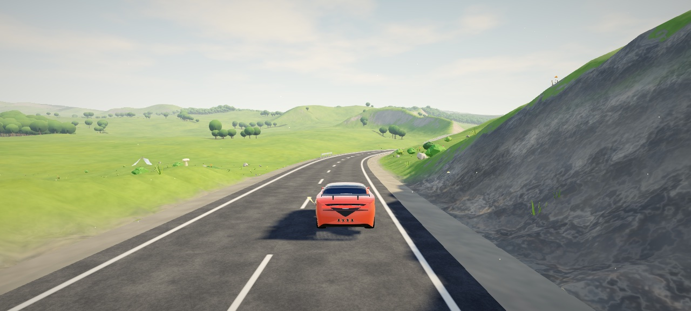 | 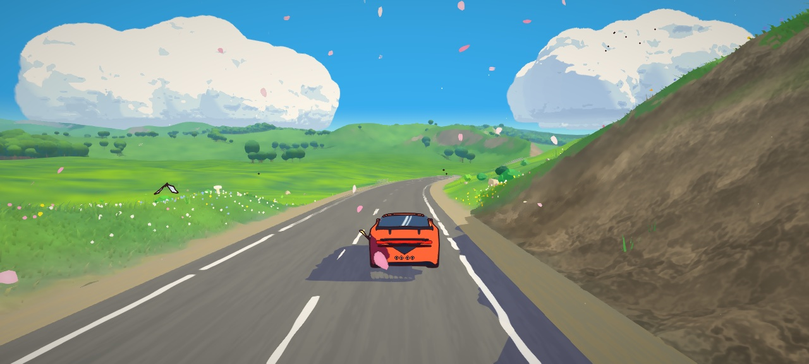 |

| 水墨 | 赛璐璐 |
|---|---|
|  |  |

| 版画 | 像素 |
|---|---|
|  |  |

| 方块，樱树、黑橡和白桦 | 手绘，风、花瓣、路边的鹿和天上的鸟 |
|---|---|
|  |  |

</div>

路在每个世界里都像工程师那样选线：沿河谷走，翻垭口，绕开山体；坡太陡就修盘山回头弯，离地太高就上高架桥，埋得太深就打隧道，过水就架桥。路修过的地方，山体被挖成切坡、填成路堤。

<div align="center">

| 盘山路 | 切坡 |
|---|---|
| 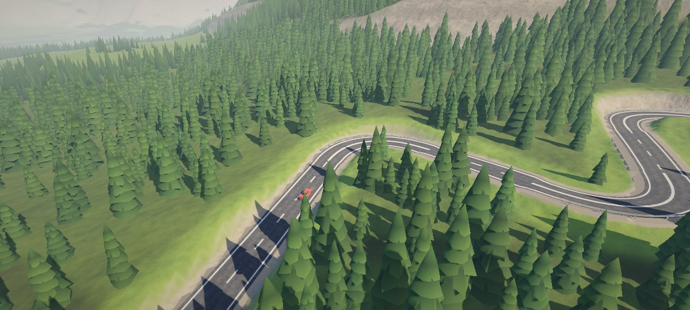 | 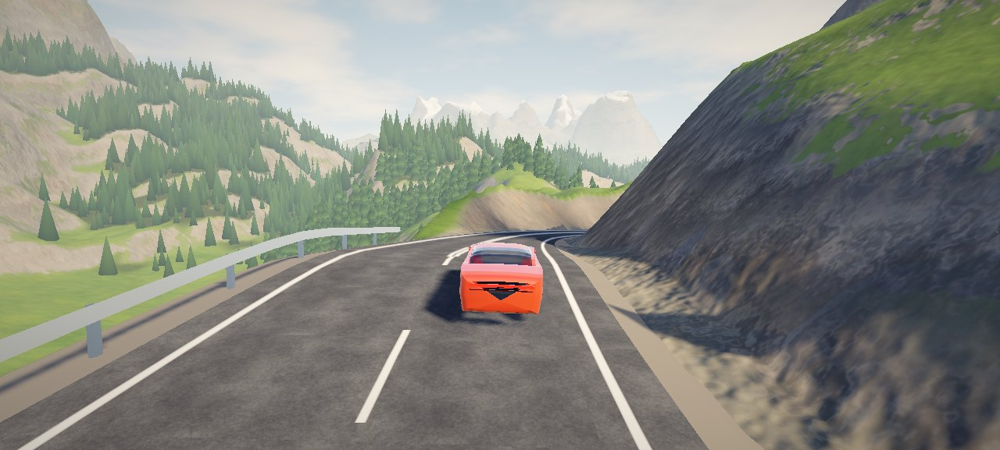 |

| 隧道 | 高架桥 |
|---|---|
| 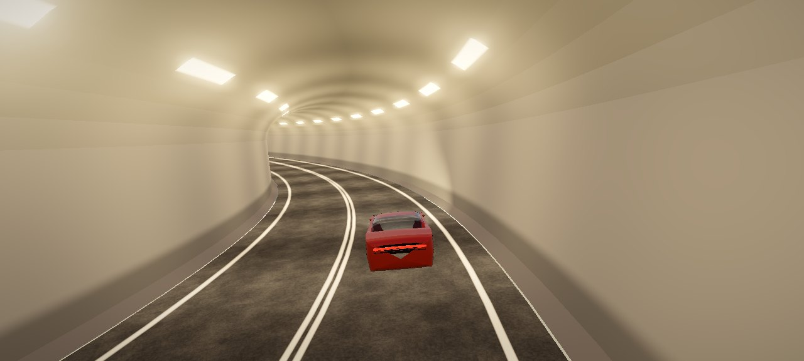 |  |

| 丘陵 | 河谷 |
|---|---|
|  |  |

| 沿海 | 沙漠 |
|---|---|
|  | 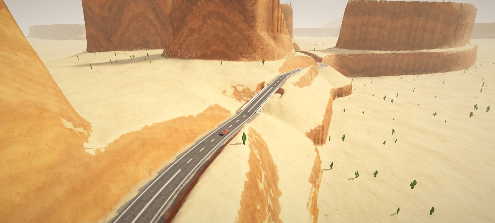 |

| 城市 | 城市里的高架 |
|---|---|
| 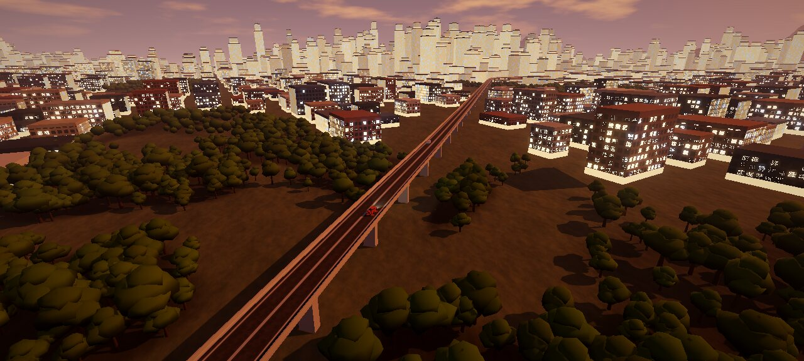 |  |

| 地底 | 地狱 |
|---|---|
| 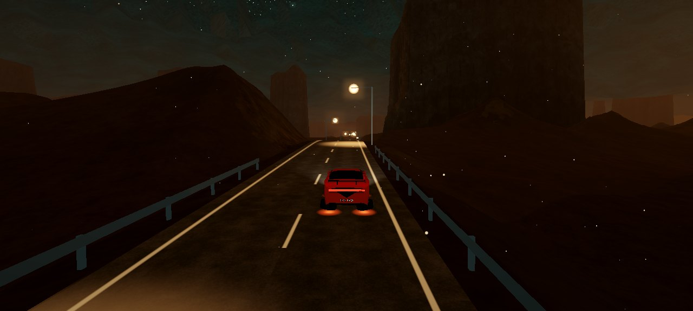 |  |

| 深海，往上爬出海面 | 天堂 |
|---|---|
|  |  |

| 太空 | 颠倒 |
|---|---|
| 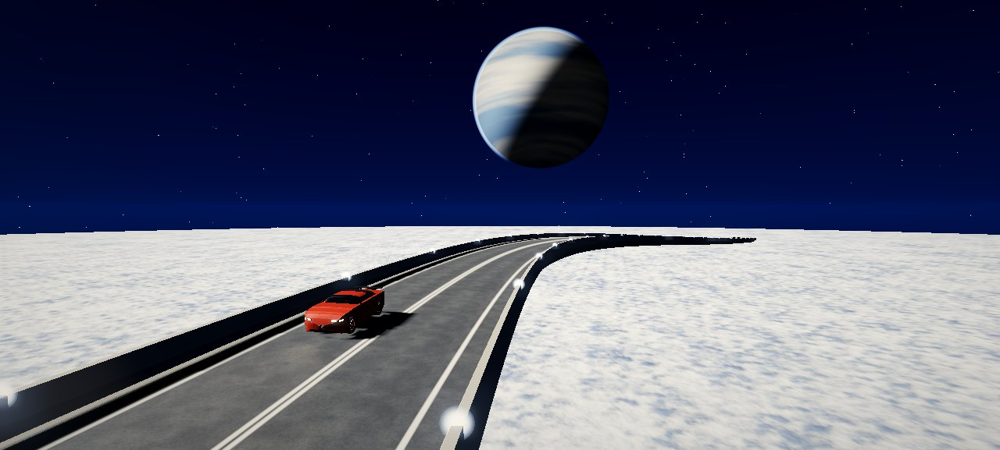 | 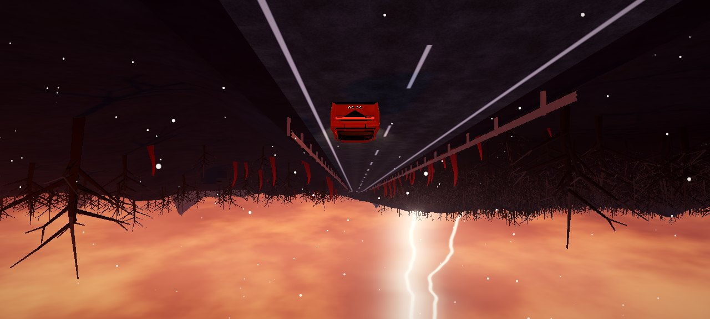 |

| 进颠倒：大地卷过去，车沿着拧成麻花的路翻过去（1.2 km 外、开到之前、九十度、翻完） |
|---|
| 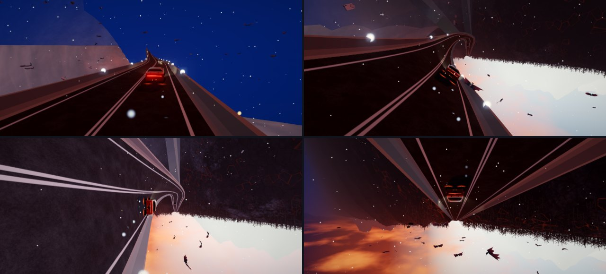 |

</div>

---

## 仪表

<div align="center">


</div>

左下角是一张路线纵断面，画法照公路设计图：浅色的一片是地面，白线是设计线，也就是路面高程；桥下画出桥墩，隧道是一条穿过山体的虚线，回头弯在线上打一个短刻度。120 m 以上的桥和隧道在上方标出长度。路开进下一个世界的地方竖一条虚线，旁边写着那个世界的名字。图上往后 420 m、往前 2.6 km，下一座桥、下一条隧道还没开到就能看见。

上面是车速、桩号、所在的世界、海拔和坡度；过交界时，世界一栏写成「河谷 → 沿海」。桩号照工程写法，K6+833 是第 6 km 又 833 m。在桥上或隧道里，还会多一行，写着这一段还剩多少米。

图上的线都读自车正在开的那批路面采样。橙色的点是车。

---

## 驾驶

| 操作 | 键位 |
|---|---|
| 自动驾驶开关 | `P`（关掉后才能手动开） |
| 油门 / 刹车 | `W` `S` 或 `↑` `↓` |
| 转向 | `A` `D` 或 `←` `→` |
| 手柄 | 左摇杆转向，RT 油门，LT 刹车；手柄有震动马达的话，落地、撞上东西、撞到动物、开出路外、轮胎打滑时会震 |
| 触屏（关掉自动驾驶后出现） | 横屏：左半屏按住左右拖是方向，拖 80 像素打满，松手回正；右半屏下面两块，右边油门、左边刹车，手指按得越靠上压得越重。竖屏：下面三分之一整条是方向，油门和刹车在它上面的两边（左刹右油，各占屏宽的 30%），中间留给车。两根手指一起在屏幕中间点一下，切一次机位 |
| 切机位 | `C`：追车、导演、航拍、侧拍、低机位、正面、引擎盖 |
| 绕着车看一圈（只在追车机位） | 按住鼠标右键拖：左右各转到 140°，往上 50°、往下 10°；松开 2 秒后用 1.2 秒回到原位 |
| 全屏 | `F` |
| 壁纸模式（隐藏界面，镜头交给导演） | `H` |
| 拍照模式（世界停住，镜头放开，拍一张 2 倍大的图） | `K` 进出，右下角的按钮也行（触屏、没有精细指针的设备上没有这个按钮） |
| 拍照模式里：移动镜头 | `W` `A` `S` `D` 平移（按住 `Shift` 快四倍），`Q` `E` 降升，鼠标拖转向，滚轮改视场角（20°–100°），`Z` `X` 滚转（±30°） |
| 拍照模式里：拍、出去 | `Enter` 或快门按钮拍；`Esc`、`K` 或退出按钮出去。`P` `C` `R` `H` `N` 在里面不起作用（世界停着，`W` `A` `S` `D` 也不开车），`V` `M` `F` 照旧 |
| 拍照模式里：景深、光圈、曝光补偿 | 工具条上的「景深」按钮开关景深，开着时点一下画面，就对到点中的东西上；光圈滑杆 f/1.4 到 f/16（默认 f/2.8，数字越小，没对上焦的地方越虚）；曝光补偿滑杆加减 2 EV，每格 0.1。滑杆有焦点时 `←` `→` 一次一格 |
| 声音开关（默认关，选择会记住） | `M` |
| 下一个世界 | `N` |
| 回到路上（不算翻车） | `R` |
| 下一种画风 | `V` |

右下角的按钮也能挑世界、换画风、切机位、开关自动驾驶、进壁纸模式、进拍照模式、开关声音、打开设置。

手机上开：点按钮栏里的方向盘图标关掉自动驾驶，三块地方浮出来，轮廓很淡，只在手指按下时亮一下（各写一个字：方向、刹车、油门）。拖方向的时候，方向块里画一根 160 像素长的线，圆点跟着手指走，线的两头是打满的位置；踏板从底下填到手指的高度。自动驾驶、壁纸模式、拍照模式和开着菜单时它们不在，手指落在画布上什么也不做（拍照模式里拖一下是转镜头）；最后给输入的是键盘或手柄时它们也收起来。屏幕的主指针是手指时，按钮栏和菜单挪到上面，拇指搁的地方是踏板，每个能点的东西不小于 40×40。仪表让手指穿过去，鼠标右键拖着看一圈照旧。车卡在路外时，点两下方向盘图标（开自动驾驶，再关掉）：开自动驾驶时车先被放回路上（键盘上是 `R`）。

手柄会震：手柄有震动马达（`vibrationActuator`）、车在手里开（不是自动驾驶）、手柄是最后给输入的，就按下面的表震；没有就不震。手机用 `navigator.vibrate`，只有落地（40 ms）和撞击（80 ms）。设置里的「震动」关着，或者系统设了「减少动态效果」而设置里没选过时，`playEffect` 和 `vibrate` 一次也不调。

| 什么时候 | 弱马达 | 强马达 | 多久 |
|---|---|---|---|
| 落地 | 0.3 | 撞地速度 ÷ 8，最多 1 | 180 ms |
| 撞上东西（车流、树、楼） | 0.6 | 相对速度 ÷ 12，最多 1 | 250 ms |
| 撞到动物 | 0.4 | 0.5 | 120 ms |
| 开出路外 | 0.15 + 0.2 × 车速 ÷ 30 | 0 | 每 100 ms 续一次 |
| 轮胎打滑（路上画出车辙的时候） | 0.25 | 0 | 每 100 ms 续一次 |

方向的手感：摇杆和手指推出来的量，在死区（默认 0.08）里是 0，过了按曲线取幂（线性，或默认的「中心更稳」，1.6 次方：推到一半，方向是 0.33）再乘灵敏度（0.6–1.4，不会超过打满）。键盘按下去给的是打满，车的转向机构限着速，从中间打满要 0.15 秒；「键盘转向」可以再加一道缓冲：柔和（0.18 秒到满、0.12 秒回正）、更柔（0.35 秒、0.25 秒），默认是直接。

拍照模式：按 `K`，世界停住，车、车流、动物、风、云、水波、草的摆都不走，天光、云和雾定在按下的那一刻；镜头放开，界面收成底部一条细工具条（快门、画风、藏车、景深、光圈和曝光补偿两条滑杆、退出）。镜头按真实时间走，松开按键就停，不钻进地里（离地至少 0.3 m，地形、路面、水面取最高的），离车不超过 400 m。按快门把这一帧按画布 2 倍大（最多 3840×2160）重画一遍，存成 `continuum-世界名-画风-桩号.png`；后处理和画风最后一道都按新的大小算，笔触和轮廓线的粗细和屏幕上看到的比例一样。画布自己不动，屏幕上不闪。出去时镜头用 0.6 秒回到原来的机位，世界从停住的那一刻接着走。壁纸模式和拍照模式二选一。

拍照模式里的景深和曝光补偿：工具条上的「景深」打开后，对焦的东西清楚，近处和远处按它们离焦点的远近虚掉，像一支大光圈的镜头；第一次打开对在车上，之后点一下画面就对到点中的东西（对焦的距离是沿镜头轴线量的，镜头怎么挪都不变；拖镜头、点在工具条上不算点），点的地方出四个角和一个点的对焦标，0.8 秒后淡去。光圈从 f/1.4 到 f/16 共 22 档（三分之一档一格，默认 f/2.8，景深关着时滑杆灰着）：光圈越大、视场角越窄、对焦越近，虚得越多；虚的大小按画面高度的比例算，拍出来的 2 倍大的图里是同一帧画得更细，也带着景深。曝光补偿加减 2 EV，每格 0.1，乘在世界当时的曝光之上，写实和各种画风都一样，画出来的天也跟着亮暗。景深先于画风：手绘、水墨这些画风的笔触和墨线画在虚过的画面上，没对上焦的地方的笔触没有了、成了柔和的色块，来自轮廓的墨线（车和小动物的边）仍然是清楚的。景深关着、补偿为 0 时，画面、绘制次数、着色器和没有这两样东西时逐位相同；出去时景深、光圈、补偿、对焦点都回到默认。

追车的镜头会看路，也会跟着车的动作动：前方 0.9 秒路程处的路一拐，镜头就先往弯里转过去，弯越急、车越快转得越多，最多 8°；过弯时镜头往弯外侧歪一点，每 1 m/s² 的横向加速度歪 0.23°，最多 2.5°，地平线跟着车的倾斜还在，20 m/s 过半径 60 m 的弯，两样加起来净歪 1°，朝外；车速过 42 m/s，镜头开始细细地震，越快越大，最大 2 cm；落地时镜头往下沉一下，视场角宽 2°，三分之一秒弹回来；和别的车擦身而过时，镜头朝它偏 0.4°，0.3 秒回来。设置里的「镜头晃动」关掉，震、侧倾、下沉、视场角变宽、擦身的偏就都没有了；看进弯里的转向是路的走向，不算晃，照常。最后一个机位「引擎盖」把镜头放在车头盖上，画面最下面是引擎盖的漆面，往上是路。

| 地址栏参数 | 作用 |
|---|---|
| `seed=7` | 固定种子 |
| `s=6900` | 从第 6.9 km 开始 |
| `world=coast` | 从这个世界开始：`alpine` `hills` `river` `coast` `desert` `city` `cavern` `inferno` `abyss` `heaven` `space` `upside` |
| `worldlen=2500` | 每个世界只有这么长（米），用来看交界 |
| `loop=coast,city` | 只让这几个世界轮流出现 |
| `cam=drone` | 起始机位：`chase` `director` `drone` `side` `low` `front` `hood` |
| `style=ink` | 起始画风：`real` `paint` `ink` `cel` `print` `pixel` `block` |
| `auto=0` | 一开始就手动驾驶 |
| `debug=1` | 显示帧率、渲染倍率、绘制次数、三角形数和地形块数 |
| `cap=30` | 每秒最多画这么多帧。默认 60：屏幕刷新率在 108 Hz 以上就隔一两次画一次；`0` 是每次刷新都画。设置里也能改，地址栏带了就以地址栏为准 |
| `ppr=1` | 画布像素比的上限，默认 2；场景最多按 1.5 画，见「清晰」 |
| `gpu=high` | 机器有两块显卡时用快的那块；默认让浏览器挑 |
| `tier=low` | 把画质的档位钉在 `high` `mid` `low` 中的一档（画多少东西，见「自适应画质」）；分辨率照旧跟着帧率升降。设置里的「画质」就是它，地址栏带了就以地址栏为准 |
| `lang=en` | 界面语言：`zh` `en`。不带就用设置里选的，设置里没选就跟浏览器的语言 |
| `haptics=0` `deadzone=0.1` `curve=linear` `sens=1.2` `keys=soft` | 震动（0、1）、死区（0–0.3）、转向曲线（`linear`、`soft`）、灵敏度（0.6–1.4）、键盘转向（`instant`、`soft`、`softer`）。就是设置里的那几项，地址栏带了就以地址栏为准 |

车是车：路有起伏的地方它会离地。每一步在车前后各 3 m 取一次地面，量这一处坡顶有多尖；尖到车速的平方除以曲率半径超过重力加速度的 1.2 倍，轮胎就卸了载，车按抛物线飞出去，空中不转向、不加油、不刹车，落下来的那一下，撞地的速度决定车身压下去多深、镜头抖多少、尘扬多高、响多重的一声，重的还会损一点速度。丘陵、山间、河谷、沿海、沙漠、地狱、颠倒的直路上，隔一阵有一段路起伏成三到五个坡，每个坡六十米上下，高低差三米多：车速过 80 到 105 km/h（看这一段的坡顶多尖），每个坡顶都会离地，120 km/h 上下能飞到近两米、几十米远。开到路外，土坡的坡顶用的是同一个算法。自动驾驶过这些坡不减速，所以它也飞。

---

## 车

车模由同仓库的 `carmodel/` 生成：纯 Python 标准库，车身的每根曲线都是一段函数。

车速过 40 km/h，车身先抬高 260 mm，四个轮子绕轮拱里的铰轴转 90°，平躺到底板下，外侧轮面朝下，车身再落到离地 200 mm。轮毂是一块整流盘，盘上一圈发光环，翻平后朝着路面。车速低于 20 km/h 或出了事故，按相反的顺序放下轮子。翻转只改外形，物理仍按四个轮胎算。

```
4500 × 1816 × 1312 mm   轴距 2700 mm   20 英寸轮毂   51,300 三角面
```

<div align="center">


</div>

`preview.html` 可以转着看车模，"悬浮"按钮播放翻转。

---

## 本地运行

```bash
python3 build.py            # 生成 out/car.glb（仓库里已带一份）
node tools/serve.mjs 8173   # http://localhost:8173
```

ES module 在 `file://` 下会被当成 null origin 拒绝，所以要起 http 服务。这个服务只监听本机；要从别的设备打开页面，加 `HOST=0.0.0.0`。

改过 `src/` 或 `out/car.glb`，提交前跑一次 `node tools/stamp.mjs`。它给每个模块的地址加上内容哈希，线上的浏览器缓存就不会把新旧文件混着用。

依赖：Node 18+（本地静态服务与检查脚本）、Python 3.10+（仅标准库，只在重建车模时需要），以及支持 WebGL2 的浏览器。three.js r160 已放在 `tools/vendor/`，不需要联网。

---

## 怎么做的

### 世界

每个世界是一份数据加一个地形函数：天空、雾和光，地面每一层的颜色，水，长什么树，以及这个世界的山形。一个点属于哪个世界，只看它在哪：沿着路出发的方向走了多远，交界线再用一个慢变的噪声弯一弯，不会是一条直线。哪段路程是哪个世界，写在一张时间表里，默认十二个世界依次轮流，每个 7 km，最后 1.5 km 变成下一个：地形在两个函数之间插值，地面颜色、树种、水跟着换，天光按镜头前方的位置混合（见「天气」）。

着色器用同一条轴、同一个整数哈希逐像素算出这个点在哪个世界，时间表里镜头前后的那几段以数组传进去，颜色从一张每个世界一行的调色板里取，所以地面换颜色的地方正好是地形换形状的地方。太阳在所有世界里站在同一个方向，因为阴影烘焙在地形块里。

### 换世界

点了别的世界，时间表在已经修好的东西之后改写：车前约一公里以外找一处平直的路切断，切口之后的路作废，选线从切口接着往新世界里走；交界从切口之后开始，和别的交界一样慢慢换过去。旧路经过的地形块、树和楼照旧画着，等新路铺好再按新路、新地形重建，好了再换上，不会出现空洞。已经开始交界的那一段改不了，再按「下一个」改的是它之后那一段。点的那一刻正在做的一轮先做完，所以切口和重修的路，和一轮一轮整做时逐位相同；重修的路每帧也只做约 2 ms。

任意两个世界都可能接在一起，有的高差很大。纵断面求解器多了一个下限：除了深海，路不进显出来的液面，所以从云海或海面换到低处的陆地时，路先在液面上走完，再沿高架下来。

河谷的河、沿海的海岸线顺着路出发的方向延伸，路会找最平的那条线走，所以河和海大多就在路边。过水的地方，设计线抬到水面以上 6.5 m 架桥；选线时水面算作平地，但价钱是路的两倍半，窄的海峡直接架桥，宽的海湾绕过去。

城市是蓝调时分：太阳刚落，天顶深蓝，地平线一圈暖色，楼一扇窗一扇窗地亮着。楼按一套顺着出发方向的街网排，每 46 m 一块地，市中心的楼最高，公园里不盖楼、只长树；每栋楼的四个角都离路够远。窗户在着色器里按立面上的米数画，所以不论楼多大都对齐楼边；窗小到几个像素时退成平均的亮度，远处的天际线是一片柔光，不闪。路在城里上 12 m 的高架，每 40 m 一盏路灯，左右交替。

水面其实是一张"液面"，每个世界给它不同的样子：河谷和沿海是水，地狱是带着暗壳、裂缝发光的岩浆，天堂是一片云海，太空里同一片云海落在 320 m 以下。路过液面一律架桥，各世界的桥高不同：水 6.5 m，岩浆 9 m，云海 55 m，太空 320 m，太空里的桥没有墩。深海反过来，路贴着 120 m 深的海底走，海面是头顶一块亮的天花板，海底成片长着海带；从深海到天堂，路沿着一座海山盘上去，穿出海面，海面变成云海。太空的天是黑的，白天也看得见星星，地平线外挂着一颗带环的行星，桥两侧的护栏上一排小灯。天上还有一条银河（一条 25° 宽的带子，星比别处密四倍，底下淡淡一片光，中间被一片一片的尘挡暗）、两团很淡的星云（一团紫、一团青，各 30° 大）、每隔 20 到 40 秒划过的一颗流星，和两三颗慢慢爬过天空、每 4 秒闪一下的卫星；行星的环当中有一道缝，行星的影子落在环上，环的影子落在行星上，行星也照着背着太阳的东西，一点冷光。这些都画在天空里，从路出发的方向摆，所以总在车前的天上；手绘里是一块块平色，水墨里天是留白。银河和星云的噪声算一次、放进两张小贴图（0.5 MB），天空里每一层读一次。分三档：高档全有，中档的银河少一层噪声、环上没有影子、卫星少一颗，低档一样都不画。深海里海雪往下沉，一群群发青光的小鱼在海带上方绕圈，地狱里火星往上飘，地底的空气里浮着尘。

地底在城市和地狱之间：一个国家那么大的洞，洞顶在 170 m 上，满是蓝绿色的萤火虫光；地上散着发光的水晶，石柱从地面一直顶到洞顶，路在石柱之间绕，路边一盏盏暖色的灯。洞顶是一张跟着镜头的圆盘，形状在顶点着色器里按噪声算，近处挂着钟乳石；跨过边界时洞顶升到天上，所以从城市开过来，天慢慢合上，开进地狱时又打开。

地底自己还有几样东西：每簇水晶在脚下投一片自己颜色的光，半径是水晶高的 4 倍；洞底的低处有积水，水面映着洞里的天色，洞顶的钟乳石每隔几秒落一滴水下来，落进水洼起三圈涟漪、响一声，带着洞里的回响；每一公里上下有一道冷白的光柱从洞顶透下来，光柱里的浮尘更亮，脚下的地上长着草；钟乳石下面垂着一串串发青光的点，轻轻摆；路边每隔几百米有一段矿轨，一辆矿车停在轨上。高档全画，中档减半，低档不画；手绘里是平色的光斑、水洼和圆点，方块里是方的。

### 选线

先在粗地形上用 A* 找走廊（爬升很贵，所以走河谷和垭口），再用纯追踪沿走廊铺中心线。走廊爬得比公路能爬的快，就设计一段盘山：一条条直腿，每条斜着往山上爬，腿尾一个回头弯掉头。每条腿的角度和长度都先用真正的转向律在地形上试跑一遍，挑最贴地的，所以回头弯落在山坡上，不会埋进山里。

路按 400 m 一轮往前铺（选线、拟合纵坡、提交、分类），一轮不在一帧里做完：路线搜索和盘山设计也能做到一半放下，游戏每帧给选线约 2 ms，做不完下一帧接着做。分不分块，铺出来的路逐位相同；车前不到 600 m 时先整轮整轮铺够，不看钟。

### 纵断面、桥和隧道

纵坡求解器把高程拟合到地面，坡度不超过 9.5%。离地超过 7 m 变高架桥，覆土超过 20 m 变隧道，从另一层路上方经过时一定是桥。

### 同一份采样

路一旦提交就不再改，只有换世界时，车前约一公里以外的那段重修。路面网格、地面改造、物理、自动驾驶、仪表、导演读的是同一批采样，所以画出来的路就是开的路。

### 修路后的地面

`corridor.js` 给每个点算出修路后的地面：路肩平台、1:0.8 的切坡、1:1.6 的路堤；桥下只要求低于梁底，隧道上只要求高于拱顶。地形、树、镜头都问这一个函数。

### 岩层与草地

草皮到崖边断开，边缘不规则，但断得利落。岩壁约 29 m 一层，层层深浅不同；层面随公里尺度的褶皱起伏，所以岩层会斜着穿过一面山。大约每四层有一层更软更暗的泥灰岩。层顶是一道窄台，林线以下长草，以上是碎石。层理只在真正的陡壁和切坡上看得清。草地分出偏干发黄和偏湿发深的片，草坡变陡的地方成簇地露出岩石。

### 阳光

朝太阳沿山体做一次光线步进。地形逐顶点烘焙，路面逐采样烘焙，树逐棵烘焙，车每帧采样，所以车开进山影里会一起变暗。

### 天光

天空球渲染成环境贴图，给地形、路面和车漆提供天光与反射；山谷和冲沟按看得见多少天空变暗。隧道里的光跟着镜头走：镜头进了洞，画面换成灯带的光，眼睛慢慢适应，前面的洞口白得发亮，出了洞那一下外面太亮；镜头在洞外时，洞口是黑的，车开进去就暗下来。

### 天气

天空、雾和光原来只按相机所在的那一点混合，地面却是逐像素画的：前面的世界早就铺着自己的颜色，头顶还是上一个世界的天，沙漠在丘陵的雾里发灰，城市迎着满天的日光迎面走来，车开进去才暗下去。现在相机周围有一圈二十四个方向，每个方向读 1.8 km 外那一点的世界（交界处照旧混）：低处的天空和远处的雾用它，头顶的天空和身上的光用相机往前 450 m 处的。天气的锋面是迎面来的：地平线上先暖起来，先暗下去，先出星星，云先聚拢，城市在暮色里远远立着；车开近了，头顶才变，车开进去，光才落到身上；身后还是上一个世界的天。风声和空气里飘着的东西跟着那 450 m 走；白天的世界里，一粒小东西最大只画 2.4 像素，贴着镜头的一粒灰就是一粒灰。

### 天色

六个白天的世界（山间、丘陵、河谷、沿海、沙漠、天堂）各有三种天：正午（世界原来的样子）、金色（傍晚）、阴天。哪一种按圈轮：路第一次来到某个世界是正午，第二次是金色，第三次是阴天，第四次又是正午；圈数从时间表里数，就是这个世界这是第几次到，点了某个世界之后改写的时间表也一样数。世界菜单里每个白天的世界后面有三个小圆点，点一个就把这个世界钉在那种天上，再点一下松开；钉的记在浏览器里（`continuum.sky`），带 `run=` 的页面不读不写。地址栏的 `sky=noon`、`sky=golden`、`sky=grey` 盖过一切：所有白天的世界都是它，圆点灰着，旁边写「由地址栏指定」。夜里的六个世界只有一种天。

太阳的方向在哪种天里都不动，因为阴影是烘在地形、树和路里的；换的是光和天的数：太阳的颜色和强度，天顶、地平线和太阳周围的颜色，雾的浓度，曝光，云的颜色，还有影子有多重。金色是低低的金黄太阳，地平线一圈橙、往上是紫蓝，云亮面是桃色、暗面是紫色，光比正午弱，影子偏冷。阴天是一层灰蓝的天：太阳只剩正午的 0.35，雾的密度是 1.8 倍，云在地上没有影子，影子本身也淡：`card` 机位里写实的灰板在影子里和在阳光下的 L 之比，正午 0.62、金色 0.65、阴天 0.86；手绘里丘陵机位车影处的路面亮度是身前路面的 0.89、0.88、1.00。每种天是一组 `look` 的数，换的时候走原来的天气锋面，相邻两段的天色不一样时和相邻两个世界一样混：丘陵和河谷依次交界，三种天之间沿路每 12 m 最多动全程的 2.8%。

手绘里，天顶、中间、地平线三个颜色每种天各有一份（金色是暖的三条色带，阴天是灰蓝的三条），云的亮面、中间、暗面、底四个颜色也各有一份。云是先烘好的，只存亮、形、空气和云量，颜色在天空着色器里上，所以换天色不用重烤。手绘的亮、暗两个颜料原来只跟着光的强度走，不带光的颜色，现在各乘一个颜色（`uSkyLit`、`uSkyShade`，正午是 1、1、1，画面和原来逐字节相同）：金色里亮的偏暖、暗的偏冷，阴天里都冷一点；阴天里受光的地方只比背光的地方亮 0.4 的差，所以平色的块之间差得少。这两个乘法只在手绘的成对颜料那一段里，每个像素多六次乘法，别的画风的程序里没有。水墨、赛璐璐、版画、像素、方块读的是画出来的亮度和颜色，不另外加代码。

### 写实的白天

写实画风下，白天的天是蓝的，阳光下的东西亮，影子里的东西真的暗。六个白天的世界（山间、丘陵、河谷、沿海、沙漠、天堂）的正午各有一组天色：天顶、中间、地平线三个颜色，画的时候除以曝光，所以进色调曲线（ACES）的正是这三个数；不这样画，从天顶的光算出来的一片渐变，过了 ACES 就是近白（晴空的色度 0.013，色相 136°，亮度 0.89）。金色和阴天没有这组数，天还是按天顶和地平线算出来的那一片。曝光、天光和雾也是写实自己取的份额：曝光取世界的 0.43–0.6（沙和海亮，沿海、沙漠取得最少；山间的谷里背着太阳，取得最多），半球光和环境贴图的天光取 0.8–1，丘陵、河谷、沿海、沙漠的雾取 0.6；金色和阴天取世界的同一份天光和雾，曝光也是同一份（金色把配方压低的 0.7 倍取回来，写实的曝光和正午相同；阴天是世界的份额，在配方的 1.1 倍曝光上），变的是太阳的强度和颜色、天光的颜色、雾的浓度和天，所以三种天是同一幅画在三种光里；最后调色时，暗部（sRGB 值低于 0.22 的，到 0.36 平滑地不再动）再按 1.08 次方往下压。夜里的世界一样也不取。镜头进了隧道，曝光和天光跟着眼睛适应往世界的数走，洞里的灯是照世界的曝光配的（进洞 35 m 的一帧，洞里的亮度中位数 L 0.59，取世界全部曝光和天光时 0.65）。别的画风读的是 `look` 里世界自己的数，这几样它们一个字也没碰。

量到的（丘陵正午，种子 7，软件渲染；括号里是没有这些、写实取世界的全部曝光和天光、天是一片渐变时的数）：晴空色度 `sky.c95` 0.075（0.013），色相 238°（136°），亮度 0.73（0.89）；画面最暗的百分之一 `frame.L01` 0.28（0.46），中位数 `frame.L50` 0.59（0.76）。机位 `card` 在车旁放一块 18% 灰板、另一块在悬着的圆盘的影子里的灰板和一个白球（只在这个机位里放进场景）：灰板在阳光下 L 0.66（0.82）、在影子里 0.41（0.63）。沿海、沙漠的 `frame.L50` 0.68、0.68（0.84、0.84），河谷、沿海、沙漠最暗的百分之一 0.18、0.14、0.28（0.35、0.32、0.49），八个白天机位没有烧白的像素。丘陵的 `frame.L50` 正午 0.59、金色 0.52、阴天 0.57，金色的 `sky.clearH` 66°，阴天的 `sky.c95` 0.011。`npm run check:real` 守着正午的这些。

### 画风

画风改三处：材质的光，阳光分成两三级、阴影偏蓝紫、高光变弱；天空，换成一团团积云；调色之后的一道处理，笔触、平涂、墨线、墨色、版画的几块平色和像素。墨线和平涂读场景的深度：深度跳变的地方是轮廓，深度的坡度折断的地方是折线。会勾线的画风让东西在画面的 alpha 里给自己做记号：树叶和草 0.92，建筑 0.80，自己的车每个部件一个数（0.46–0.58，玻璃不写），动物和路上的车 0.30，草的花 0.945；液面是混合画的，不做记号。手绘用它们给车、路上的车和动物勾线，把树叶和建筑上的笔触抹得小一半（草的花几个像素大，笔触遇到它原样放过）；水墨只留车的颜色，墨色按远近和高低铺：近处浓，远处一路变淡，远处低在地平线上的地里是雾，白天的天留白，夜里的天是一层匀的淡墨（星和云是留出来的纸）。写实画风下这三处全关；白天的世界里写实另有自己的一套天色、曝光、天光、雾和暗部（见上面的「写实的白天」），夜里的世界不取。

手绘照着手绘动画的背景画：天是饱满的蓝，每个白天世界给天顶、中间、地平线三个颜色，直接上屏，不再被曝光洗白，用的是画家的色调曲线（调色板里的颜色原样上屏，亮处慢慢压住，不烧白），天上是一堆堆积云：白的顶，蓝灰的暗面，更深一点的平底，边是利落的一团团，远处的淡进空气里；这些云是先烘好的，不是每帧现算的；空气清透，远山是一块块平色的面，每个面受光、背光各一个颜色，山坡上一棵棵的树画到 1 km，再远的林子是一块平的林色；空气分成一层一层，一道山脊后面的另一道更蓝更淡，山顶的空气比谷里清；每样东西有亮、暗两个颜料：暗的是另调的颜色（有颜色的朝青蓝转，树转得多些，灰的偏蓝），不是把亮的压暗，草地亮的一面也从黄绿往翠绿带一点，受光的一边和背光的一边之间一步跨过去，云的影子在地上也是这样；车、路上的车和动物有自己的画法（见下面）；草地上是一片片深浅、偏黄偏蓝的色块，路边长着草（见下面），草里开着成片的野花；树冠的光碎成一团一团，像一笔一笔点上去的叶子；云的影子被风推着从地上慢慢滑过；亮的地方有一层柔光；笔触是圆的一团团，只落在地、树和房子上，不碰天、车和动物，贴着镜头的草叶和树叶抹得小。深蓝的天和远山变蓝只在白天的天下面；夜里的六个世界（城市、地底、地狱、深海、太空、颠倒）的天是自己的一套画法（见下面）。

手绘里还有活物：丘陵、山间、河谷、沿海的路边，草地上站着鹿、兔、狐，有时路边坐着一只黑猫；车开近了，鹿、兔、狐就朝远离路的方向跑开。天上有成群的鸟绕着大圈，路边的草上飞着蝴蝶。它们和车一样被勾上线。动物不只是手绘的：写实、水墨、赛璐璐、版画、像素里一样有，各按各的画法画出来；方块里路边是方块搭的猪羊牛鸡，天上照样有鸟。每个世界的动物不一样：山间有山羊，丘陵里有狸，河谷里有苍鹭，沙漠里是骆驼，地底有一种白色的小精灵低着头走。

手绘里的车、路上的车和动物是画在背景上的角色，平色加线。自己的车每个部件有三个颜色：亮、暗、深。车漆亮的是橙，暗的是偏紫的红（不是把橙压暗，也不发黑），轮拱里、底板和朝下的面是更深的紫红；玻璃是蓝，轮胎和饰件是深蓝（不用黑：一团黑会盖住下面的形状），轮毂和镀铬是偏蓝的银白。每个点用哪一个颜色，看它朝不朝着太阳、阳光有没有被挡住（阴影贴图，边收硬；云影也算）、在不在轮拱和底板附近（遮蔽值是加载车模时按位置估的，不用改车模），一步跨过去，没有渐变。天光在整辆车上一个样，车上没有天空的倒影和清漆的反光。车漆上有一块高光，是朝上的面上法线靠近太阳和视线中间方向的那一片；车窗上有两道平行的斜条，跟着视线在玻璃上滑。线是最后一道按记号画的：相邻像素的记号不同、其中一边是车或动物，就画一道深紫褐的线，所以车和背景之间，车门、车窗、轮子这些部件之间都有线；一样东西挡在车前面（比如草叶），那条边是它的，不勾；按深度画的折线留着，减半，画车门和引擎盖的缝。路上的车和动物只有两个色加外轮廓：亮的是它自己的颜色，暗的是另调的一个（暖色往洋红转，绿色往蓝转，再暗一点）。这些颜色的亮度都压在泛光的阈值以下，一辆白色的厢货从镜头旁边开过，不会在身边的路和轮胎上糊出一片光。夜里手绘的城市和地狱里，光是有颜色的灯、岩浆和低太阳的余晖，颜料只拿得到光的亮度，车在那里保持物理光照，和别的画风一样，只多了线。地底、深海、太空和颠倒里车用自己的颜料，亮度跟着那个世界自己定的一档走：物理光照下车在那里是一团黑，只在边上透一圈橙，用颜料是一块红橙、一块深紫红，玻璃上有两道斜条。别的画风里车、路上的车和动物照旧，它们的着色程序里没有这些。

手绘里路边长着草。近处是一片一片的叶子，朝着风的方向倒，风一阵一阵地来，草浪从路边滚过去，和云的影子一起走；草丛里开着成片的小花，白、黄、粉、蓝，立在草尖上，跟着草一起摆。叶子的颜色就是脚下地面的颜色：先从正上方把周围的地面画成一张小图，叶子到图里取颜色、高度和长不长，所以影子、云影、车灯照在草上和照在地上一样，岩石、砾石、路肩、雪、水边、路面上不长，树荫里稀一些。草画到 44 m，往远处一片一片地矮下去、没掉，看不出一条线。丘陵、山间、河谷、沿海（稀一点）、沙漠（极稀）和天堂有草，别的世界没有；低档不画。

手绘里路也是画出来的。沥青是一片带笔意的暖灰：顺着路有一道道淡淡的笔触，每条车道两道轮迹略深一点，亮面和暗面各是一个颜色，暗面偏蓝。标线是微微发暖的白，边上有一点手抖，宽窄也不一样，百分之六的长度磨掉了，虚线每段的长短略有出入。路肩是两种碎石一笔一笔铺的。护栏、桥面的护墙、桥墩、洞口和隧道的衬砌各有亮、暗两个颜料，所以背光的一面是偏蓝的灰；护墙顶下面有竖的水渍，桥墩脚比腰上深一点，墩身上有顺着墩的笔触。这些笔触都按路的里程和离路中心的米数取，贴在路上，不是钉在屏幕上。别的画风的路照旧，它们的着色程序里没有这些。

手绘里路边的房子是画上去的。丘陵里的农舍、谷仓和风车：屋顶是一排排瓦，每排、每片深浅不同，一排的下沿压在下一排上，檐口旧而暗、脊线亮一点，背光那一面的低处长着一点苔；白墙的脚下泛黄、有水渍，上半截有竖的淡痕，太阳照到的墙在檐下暗一条；墙上有窗，窗台下的墙暗一块，有的人家装着百叶（绿的、蓝的或红褐的），正面有一扇拱顶的门；谷仓是一条条竖着的木板，板缝里偶尔有一个节，筒仓是一圈淡色的墙；风车的塔上窗少一些，最底下一层没有窗，门开在朝路的那一面。这些都按它在屏幕上有多大来画：瓦远了就换成大一号的瓦，再远就没了，窗和门到几十米外淡掉，所以远处的房子是干净的色块，不会碎成一片噪点；开过去的时候，瓦和窗跟着房子一起挪，不在原地闪。别的画风里房子还是原来的样子。

手绘里夜里的城市和地狱也是画出来的：夜是蓝的、紫的，不是黑的，亮的东西是一块块平色。城市的天是三条平色的带，天顶深蓝、中间紫、贴着地平线一条橙，天上留着一百来颗星，每颗是一个平色的点；楼的背光面是蓝紫，受光的一面偏暖。窗是两种暖色（橙、黄）和一种冷色（淡蓝）的平块，近了是一块块方窗，远了变成一层柔光，开过去不闪；路灯在地上的光是一个边清楚的椭圆，外面一圈软的，灯头是一个平的圆盘外面一圈。地狱的天是深紫红、红、橙三条带，天上是白天世界那一套积云，换成奶黄的顶和粉褐的暗面；岩石的暗面是绛紫，受光的一面偏火色；岩浆是两个颜色，芯是黄、边是橙，中间一条硬边，外面是暗壳，远处的岩浆只剩大块的明暗，不闪。路面和标线带一点夜里的色；城市里的风线暗一些，没有花瓣，地狱里没有风线。画面里比 L 0.2 还暗的像素城市 7%、地狱 17%，最暗的百分之一不暗于 L 0.18。别的画风里这两个世界还是原来的样子。

手绘里夜里的地底、深海、太空和颠倒也是画出来的，每个世界一眼看去有自己的三四个主色，暗处是有颜色的暗，亮的东西是一块块平色。地底是幽蓝：洞顶是一块平的深青，上面一片一片青色的点是萤火虫（近处是一个个圆点，远了变成一层柔光，开过去不闪）；地和路是蓝灰；水晶是三个颜色（亮面、暗面，正对着镜头的那几面是浅色的芯），外面勾一圈线；路灯在地上的光是一个边清楚的橙色椭圆。深海是越往下越暗的青：从水下往上看，海面就是天，三条青带从上到下一条比一条深，海面透下来的光是一块块平的亮斑，慢慢挪；海带是三个颜色（根部的深青、中间的绿、梢上的黄绿）。太空是带蓝的黑，星星少而清楚，每颗是一个白点；行星是几条平的色带（淡紫、粉橙、蓝），明暗之间一条硬边，亮的那一边有一圈细细的光；云海是三块平色（深蓝、蓝紫、淡紫白）；桥的背光面是蓝紫。颠倒是压抑的红紫：天是紫黑、洋红、深红三条带，天上是白天世界那一套积云，换成粉白的顶和红褐的暗面，地是暗紫；闪电来的时候天一下变成一块淡粉，闪电是一个白的形状，地面不被照亮，站在它前面成了剪影，这一瞬画面只剩淡粉的天、白的闪电和暗的地这几块颜色。画面里比 L 0.2 还暗的像素地底、深海、太空是 0，颠倒 20%，最暗的百分之一不暗于 L 0.16。别的画风里这四个世界还是原来的样子。

手绘里还刮着风。天上画出一道道长长的淡线，像手绘动画里画风的那几笔：先一点点画出去，拐几个弯，有时在尾巴上绕个圈，再一点点擦掉；风是一阵一阵的，阵里有七八道，阵与阵之间只有零星几笔；线里夹着花瓣，一片一片翻着往下落，跟着风往同一个方向飘。风线和花瓣只在白天的几个世界里有：丘陵、山间、河谷，沿海少一些，天堂里的花瓣是金色的。

赛璐璐照着动画片的一格画：每样东西只有亮、暗两个平色，亮暗之间一步跨过去，影子的边也是；车上多一块高光，玻璃上有两道斜条。天是深蓝的，分两条平带，贴着地平线一条浅青，往上一条蔚蓝，再往上是天顶的深蓝，带与带的边只有一两个像素；云只有两个色，白的顶、蓝灰的暗面，边也是一个像素宽。地、路、树、海都是一块一块的平色：草是两种绿按高度分开，路没有笔触，海没有浪，树上的光碎成一团团，远了就成一整面。东西的外轮廓是深色的线，线色是被勾的东西自己的深色，两个像素粗，从 80 m 起渐淡，260 m 外没有；远处的地、树和山没有线，是一块块平面，一层一层变淡变蓝，干净。路边有稀一些的草，每片叶子两个色，不勾线。车速过 33 m/s，镜头两侧的空气里出现白色的细线，沿着车走的方向，每条只活四分之一秒，车越快越多，最多 40 条。夜里的六个世界也是这样画：天是自己的三条带，亮的东西是平色。

方块把世界当成一块块方块来画：每个面都铺上一格一格的方格，每格的颜色取自那一格正中的画面，再按各自的随机数明暗一点，像方块表面那张小图；方格贴在世界上，车往前开，它们跟着世界走。离得越远方格越大，所以屏幕上总是几个像素一格。顶面最亮，侧面次之，底面最暗。天是浅蓝的，太阳是方的，云是一块块白色的方块，由风推着走。树换成方块搭的：云杉一层层收窄，阔叶树是一根树干顶着几层叶子，石松是平顶，仙人掌是方柱。路边的动物也是方块搭的，每个世界不一样：山间是羊、牛和狼，丘陵里是猪、羊、牛、鸡、马和村民，沙漠里是骆驼和兔，地底是蜘蛛，地狱里是岩浆怪，太空里是末影人那样的高个子。树也不止一种：丘陵里有橡树、白桦、黑橡和樱树，河谷里有垂柳，沿海有棕榈和金合欢，山间的云杉有高的、有落着雪的，沙漠里有高仙人掌和枯灌木，天堂里是一团团白云做的树。

画面上没有钉在屏幕上的东西。原来的纸纹、水墨的墨斑和枯笔的噪声按屏幕取，世界在动它们不动，看着像镜头上的脏点；现在纸纹和墨斑去掉了，枯笔的噪声贴在世界上，跟着线走。只有像素画风的抖动按屏幕取，那是它本来的样子。

### 路上的车，地上和空气里的东西

路上跑的车是各个世界自己的：山间有越野车和扫雪的橙色卡车，丘陵里是掀背车、皮卡和慢吞吞的拖拉机，河谷里是厢式货车和房车，沿海是跑车、房车和旅游大巴，沙漠是吉普、皮卡和卡车，城市里黄色的出租车和公交，地底和地狱是矿用卡车和越野车，深海和天堂是白色的悬浮舱，太空是月球车，颠倒里是锈透了的旧车，红色的灯一闪一闪。每种车是几十块面搭起来的，每块面有自己的种类（车漆、玻璃、轮胎、车灯、镀铬、货箱），一种车一个实例化网格，车漆是每辆车自己的颜色，车灯在暗的世界和隧道里亮起来。方块画风里车是方块搭的，轮子也是方的；手绘里圆角更大，更软，两个平色加外轮廓。

地面上撒着小东西，也是各个世界自己的：山间的雪岩、草簇和倒木，丘陵的野花、灌木和蘑菇，河谷的芦苇，沿海的贝壳和浮木，沙漠的枯草球、仙人掌苗和白骨，城市路边的杂物箱和路锥，地底的石笋、发光的水晶，地狱的黑色碎岩和火炭，深海的珊瑚和海草，天堂云海上的云团，太空里漂在路边的碎金属板，颠倒里的孢子荚、枯根和骨头。地面按 10 m 一格撒，一格里有什么只由格子的编号和种子决定，所以每次开过都一样；镜头 84 m 内的格子一帧补几格，远了丢掉，边上淡出；路上、水里（芦苇、海草、珊瑚、贝壳除外）、楼里不放；方块画风下全换成方块。

空气里也各不一样：山间飘雪沫，丘陵里是花粉，河谷里是蠓虫，沿海是顺风跑的浪沫，沙漠里是贴着地吹过去的沙，城市里是灯光里的灰，天堂里金粉往上升，太空里是几乎不动、一闪一闪的冰晶；深海的海雪、地狱的火星、地底的浮尘、颠倒的灰照旧。

车扬起的东西看脚下是什么：沙漠是沙，沿海是细沙，山间是雪粉，丘陵和河谷是泥，地狱和颠倒里夹着火星，深海是淤泥，云上是白雾。路面上只有沙多的几个世界会扬一点；开出路外，后面拖一道长长的尘；悬浮着的时候，四个托盘把地上的东西往外吹出一圈低低的尘；落地时往四周抛一圈；轮胎滑的时候照旧冒烟。

### 导演

导演镜头读前方几百米的路，下一座桥、下一个弯、下一组回头弯还没开到，机位就已经在那里等着。跟着车走的机位（追车、侧拍、前拍、环绕）之间用 1.6 s 绕车滑过去；站着不动的机位（路边长焦、河谷对岸的远景、回头弯上方俯拍、隧道洞口）用 0.45 s 的叠化切入。隧道里一律叠化。只有镜头到车的视线大部分时间不被山体和桥的护栏挡住，这个机位才会被用；中途被挡住就换掉。在高架上，侧拍的机位升到护栏上方，长焦浮在桥面上方。洞口的机位站在洞门外，看车开进山里；车已经在洞里，就在出口外回头等它出来。长焦、远景、俯拍、环绕各有 30–35 s 的冷却，洞口 40 s，好镜头不会每个弯都来一遍。竖屏也照样构图。航拍机位不归导演管，但查的是同一条视线：楼或山挡住车，它就换到另一侧，或升到车后高处顺着路往下看。

### 后台烘焙

一个近处地形块要算 5–10 ms，一帧给不起。地形块和树块交给 1–3 个 Worker 在后台烤：主线程把路的走廊交过去，拿回烤好的数组，只建网格。两边跑的是同一份烘焙代码，烤出来的块逐位相同。主线程上地形每帧的 95 分位从 4.5 ms 降到 0.3 ms，换世界后要重建的地形 1.6 s 建完，原来要 6.9 s。没有 Worker 的时候（还没起来、出过错、无头运行、地址带 `bakers=0`），照旧在页面上分帧烤：每帧给地形 4 ms、森林 2 ms，时间到了就停，下一帧接着算。

### 远处的树和被挡住的地

一帧原来要画 2.4 M 个三角形（树林、河谷、颠倒），大半是白画的：地形块有一百多块，站在路上看，近处的山坡一挡，后面的大多露不出一个像素；远处的树一棵一个实例，软件渲染里每个实例固定要 5.5 微秒；阴影图把一整块树林整块画进去，哪怕只有一个角在图里。现在三处各管一头。每帧画之前，用镜头附近的地算一道地平线（镜头走出 1 m、转出 1° 才重算，别的帧沿用），被它挡住的地形块和树块不画（`render/horizon.js`，只会少藏，不会错藏，`node tools/horizon_check.mjs` 在编出来的山上用射线一条条验，镜头动过以后也验）。树按它在屏幕上有多少像素高分档：远处一块地里一种树，是烘焙时合成的一个网格（几块交叉的平面，一次绘制）；近处是镜头看得见的那些树，一棵一棵挑档，写进几张动态的实例表。阴影图只画落在它里面的树。画面只在树冠的细节上有一点点不同：`wood`、`river`、`alpine` 上树占画面的份额差不到 3%，树的平均颜色差不到 0.01（OKLab），地面、路和影子除了路边几个到几十个像素的缝（`docs/design.md` 讲了），逐字节相同。追车镜头（量具里是 1280×577）写实的 `wood`、`river`、`upside`，一帧的三角形从 2.45、2.46、2.43 M 到 0.83、1.12、1.48 M；1920×1080 时从 2.23、2.28、2.21 M 到 0.68、1.36、1.53 M。

### 清晰

边缘原来是台阶。场景画进合成器自己的目标，画布自带的多重采样一个三角形也没见到，什么边都没抹；屏幕的像素比是 2 时画布只有 1.5，浏览器再按双线性放大，画面发软。现在画布取屏幕自己的像素（像素比至多 2），场景仍按 1.5 画（屏幕没有那么多就按屏幕的），多了最后一道 pass（`render/present.js`），做三件事：

- 抹边：沿每条边走到两头，把像素挪到它那一侧覆盖率相当的位置（FXAA 的搜索）；单个或并排两个像素的小点（星、火星、雪上的闪点）不抹，抹了只会变暗；
- 锐化：不在边上的像素按四邻离削顶的余量加权（CAS），暗部和亮部不烧，边上交给抹边，锐化画不出亮边；
- 放大：场景比画布小时，抹边和锐化先在场景的大小上做，再用 Catmull-Rom 五个采样放上去，不是双线性。

一种画风自己定抹多少、锐多少：写实 1 和 0.2，手绘 1 和 0.15，水墨和赛璐璐 1 和 0，版画 0.8 和 0，像素和方块都是 0，它们的硬边就是画风。

怎么量：同一帧画到两倍大，2×2 取平均，当"一个像素四个采样"的参照，量各种画法离它多远（PSNR，越高越近）。

| 画法 | 山间 | 沙漠 |
|---|---|---|
| 画布大小，原来 | 33.46 dB | 33.44 dB |
| 画布大小，现在 | 34.93 dB | 34.45 dB |
| 场景 0.75 倍放大，原来（双线性） | 31.96 dB | 31.15 dB |
| 场景 0.75 倍放大，现在 | 32.99 dB | 31.97 dB |
| 边之间的细节（参照 = 100%），画布大小，原来 → 现在 | 101% → 105% | 93% → 99% |
| 同上，0.75 倍放大，原来 → 现在 | 80% → 104% | 60% → 84% |

### 功耗

同一件事，每一帧少做点。软件渲染（SwiftShader，1280×577）画一帧的时间，原来 → 现在，各量两次取平均；现在的数里已经含最后一道（占一帧的 1%–2.5%）：

| 世界 | 山间 | 丘陵 | 沙漠 | 城市 | 深海 | 颠倒 |
|---|---|---|---|---|---|---|
| 一帧，原来 → 现在（ms） | 1268 → 1098 | 1197 → 1077 | 845 → 675 | 1259 → 1112 | 931 → 753 | 1244 → 1001 |
| 少了 | 13% | 10% | 20% | 12% | 19% | 20% |

| 做法 | 省在哪 |
|---|---|
| 刷新率 108 Hz 以上的屏幕隔一两次画一次 | 车的物理每秒走 60 步，两步之间画的是同一辆车：120 Hz 和 144 Hz 画的帧减半（60 和 72 帧），165 Hz 少三分之二（55 帧），240 Hz 少四分之三（60 帧） |
| 地形最后画 | 深度测试先把被树、路、楼和车盖住的地面挡掉，不进着色器：六个世界里这样的像素占地面的 39%–88%（沙漠 39%、丘陵 44%、深海 60%、山间 68%、河谷 69%、城市 88%），原来先算一遍再被盖掉。软件渲染器没有提前的深度测试，上表里没有它 |
| 岩层只在有岩石的像素上算 | 草地的像素不再读岩层的几次纹理、算一串正弦：单这一项，一帧快 6%–8%，画面 3 级以上不同的像素不到万分之零点五 |
| 地形细节贴图的各向异性 8 → 4 | 贴着地面看过去，每次读取要读好几下：沙漠快一成，画面 4 级以上不同的像素不到 0.15% |
| 调色板每色只读一行 | 世界交界以外，不读第二个世界的那一行 |
| 画布不要多重采样 | 少一块几倍大的缓冲，每帧不再白白合并 |
| 让浏览器挑显卡 | 有两块显卡的笔记本不再默认叫起快的那块（`gpu=high` 要回来） |
| 仪表的剖面每秒画 20 次 | 一张画布每秒少往显卡传 40 次，肉眼看不出 |

### 自适应画质

每半秒量一次帧率，对着页面要画的帧率：60，屏幕刷新率更低就取它。连续 2 秒低于它的 92%，场景画的大小降一档，五档从满到一半，最后两档阴影贴图从 2048 降到 1024；连续 8 秒高于它的 96.5% 再升一档。画布一直是屏幕自己的像素，降档不重建它，也不闪。因为太慢降下来的那一档，1 分钟内不再试，再失败就等 2 分钟、4 分钟，画面不会忽清忽糊。

分辨率之外还有一个档位（`tier`），管的是画多少东西：`high`、`mid`、`low`。它跟着上面五档走，依次是 `high high mid mid low`，就是说分辨率降到 0.72 才到 `mid`，降到一半才到 `low`。换档位也不重建画布、不闪。地址里带 `tier=low` 把它钉死：分辨率照旧跟着帧率升降，档位不动；设置里的「画质」选高、中、低是同一个钉子，页面开着也能钉、能放开（选「自动」）。无头运行是 `high`。现在只有手绘的笔触按档位取数：`high` 25 个采样，`mid` 13 个，`low` 不抹；别的画风和写实三档画出来的帧逐像素相同。新加的东西都按它分三档，`low` 不比现在贵。

---

## 项目结构

```
index.html               入口：界面、按钮、无头运行与诊断输出
src/
  game.js                装配、主循环、隧道里的光
  world/                 世界本身，不碰渲染
    worlds.js            十二个世界的数据和地形，世界在哪、怎么交界，时间表，白天世界的三种天色和按圈数选哪一种
    turn.js              换世界：在车前切断路、改写时间表、重新选线
    landform.js          山间的山形：扭曲 fbm、山脊、冲沟
    surveyor.js          选线：A* 走廊、纯追踪、盘山设计
    road.js              纵断面、桥隧判定、提交后不变的采样
    corridor.js          修路后的地面
    sunlight.js          太阳遮挡的光线步进
    vegetation.js        每个世界长什么树、长在哪
    cavernplan.js        地底的水洼、光柱、矿轨摆在哪、水什么时候滴：只由地形、路和种子定
    cloudsets.js         每套云的摆法：几堆、多大、在哪个方位，只由种子和套名决定
    skyspace.js          太空的天：银河、星云、行星的环、行星的光、流星和卫星的数，只由路的方向和时间决定
    skymaps.js           银河和星云的噪声，算成两张小贴图的数
    cloudnoise.js        云的表面用的噪声：圆鼓包，64³
    bakery.js            地形块和树块的烘焙，页面和 Worker 共用
    bakeworker.js        后台烘焙的 Worker
  core/                  车辆物理、自动驾驶、手动开的输入（键盘、手柄、触屏）、手柄的震动、碰撞
  render/                地形、路面与桥隧、森林、水、天空与雾、后处理、车流、镜头
    worldlook.js         着色器里的世界、调色板、交界处的天光
    water.js             河、湖和海
    city.js              城市的楼和窗
    ceiling.js           地底的洞顶
    cavern.js            地底自己的东西：装配、范围、三档、滴水的钟
    crystalpools.js      水晶脚下的光池
    puddles.js           洞底的水洼和落水的涟漪
    skylight.js          洞顶透下来的光柱，和它脚下的光斑
    glowworms.js         钟乳石下垂着的萤火虫丝，和落下的水滴
    minetrack.js         路边的矿轨和停着的矿车
    director.js          导演：按前方的路挑镜头、滑移与叠化
    quality.js           自适应画质
    pacing.js            读屏幕的刷新率，高刷新率的屏幕隔一两次画一次
    present.js           最后一道：抹边、锐化、放大到画布
    style.js             画风：材质的光、天上的积云、调色之后的一道处理
    clouds.js            天上的积云：按球堆摆好，在显卡上烘成立方体贴图，换一套时叠化过去
    spacesky.js          太空的天上多出来的东西：给天空着色器的数和代码，三档，只在太空用的四个天空程序
    critters.js          小动物：每个世界的，躲树、被撞飞；天上的鸟、蝶和颠倒里的蝙蝠
    traffic.js           车流：每个世界、每种画风自己的车
    clutter.js           地上的东西：草簇、花、芦苇、贝壳、骨头、水晶、珊瑚、孢子荚……
    grass.js             手绘的草和花、赛璐璐的草：地面图、叶子、风
    crystals.js          手绘的水晶：三个平色，外面一圈线
    effects.js           车辙，和车扬起的尘、沙、雪、灰、火星
    creep.js             颠倒里爬过地面的根
    drift.js             手绘的风线和花瓣
    twist.js             颠倒：拧成麻花的路和跟着卷过去的大地，离路越远卷得越缓
    turn.js              颠倒：跟着车翻过去的镜头，车是锚
    upside.js            颠倒里的闪电、触手，路在哪里拧，卷过的东西按画在哪里剔
    props.js             每个世界路边的建筑
    bakers.js            Worker 池：发块、收块，出错退回页面
    horizon.js           镜头附近的地平线：被近处的地挡住的地形块和树块不画
  ui/hud.js              仪表：车速、桩号、路线纵断面
  ui/strings.js          界面上所有的字，中文和英文各一份
  ui/settings.js         设置：地址栏、上次的选择、系统三处的先后，和设置面板；世界钉在哪种天色上
  ui/worldname.js        进新世界时浮出的名字和一句话
  ui/idle.js             三十秒没人碰时仪表和按钮淡下去
  ui/touch.js            触屏：方向、油门、刹车三块地方，双指点按切机位
  ui/hint.js             第一次打开页面的提示
  ui/swatch.js           世界菜单里每个世界前面的小色条，和白天世界后面三个天色圆点的颜色
carmodel/                程序化车模（纯 Python 标准库）
tools/                   检查脚本、截图、发布前加版本号、本地服务、three.js r160
  brand/                 og 图、图标和字标的生成
docs/design.md           设计文档
```

---

## 验证

| 检查 | 命令 | 结果 |
|---|---|---|
| 路网 | `node tools/road_check.mjs 16` | 5 个种子，每 16 km 有 26–54 个回头弯、13–22 座桥、2–12 条隧道；最大纵坡 9.5%，最小半径 14 m，自交 0 |
| 选线分块 | `node tools/survey_check.mjs [--against 目录]` | 不开浏览器：种子 7、1、42 各开 12 km，路一帧一整轮铺，和每帧给 0.5、3.5、40、5000 ms 铺（假的钟，每看一次走 1 ms，停在哪里和机器无关），每一轮分类完的那一刻、每公里整轮做完之后，采样的每个字段、`solution`、`cells`、选线器的状态逐位相同；换世界在一轮的 17 个位置各点一次（含停在路线搜索、盘山设计中间的 5 处），切口、边界、丢掉的采样、点完的路和重铺完的路逐位相同；车一帧被放到 6 km 外也相同，车前从不少于 600 m。`--against` 对另一个提交导出的代码（`git archive`）比，也逐位相同；去掉换世界前「先把做到一半的一轮做完」这一步，这个检查就红 |
| 单步 | `node tools/perf_check.mjs --steps` | 真页面（Worker 烤块，页面自己的循环停掉，不画）里 5 分钟、1.68 万个 1/60 s 的步，种子 7、世界 2.5 km 一个，第 150 s 换一次世界，头 20 秒不算。卡的是选线自己担的：选线自己占一步最多 5 ms（分块的三次 4.06、3.15、4.00 ms，一轮一轮整做的两次 29.98、31.58 ms）；车前的路比 600 m 长（最短 1000 m）；页面铺出的路和同一个页面里整做的路逐位相同。只报：整步对着 8 ms，分块的三次最贵 8.10、8.11、9.47 ms（整做 31.3、33.1），第 99.9 分位 6.52、6.18、6.78；超过 8 ms 的步是路面网格建一块路（4.5、4.8 ms）或换世界后地形的重建（4.2 ms）加选线的一片 3.1 ms，选线占 2 ms 以上的有 0、0、1 步（整做 12、12 步）；每轮路选线 4.3、拟合纵坡 1.8、提交 0.6、分类 0.4 ms（平均）；换世界后 22、29、36 步铺回（整做 14 步） |
| 世界 | `node tools/world_check.mjs 130` | 种子 7、42、3 各 130 km，不渲染：十二个世界按顺序出现，每个 7–18 km 路，除了深海路面没有一处在液面下，最大纵坡 9.5% |
| 换世界 | `node tools/switch_check.mjs <seed>` | 种子 7、42、3 各 132 种换法，不渲染：切口处路接得上，只遇到点的那个世界，最大纵坡 9.5%（起伏的一段不算），除了深海路面不在液面下；交界在点了之后 1.15–3.6 km 开始，通常 1.3 km |
| 地底 | `node tools/world_cavern_check.mjs [--node-only] [--keep 目录]` | 先在 node 里，不开浏览器：种子 7、42、3 各开 5 km，规划每次问都一样；每 5 km 有 466–527 个水洼，凹度 0.60–1.00，离路中线至少 14.7 m，水位在最低点之上，水边落在水位的等高线上（差不到 0.004 m），都在修路没动过的地上；6 km 里有 5–6 处天井，相邻至少 782 m，离路 22–48 m；11 段 500 m 里有 9–10 段有轨，每一节都在离路中线 9.4 m 处、贴着地，8–9 段上停着矿车、不在两头。真页面里（种子 7，`cavern` 机位）：低档什么也不画；高档比低档多 6 次绘制、10 752 个三角形，中档多 4 次、3 012 个；光池高档 80、中档 40，数等于画面里的水晶簇数（上限 80：93 簇里取 80 片，43 片在长成树的水晶下面），每片都在一簇水晶下面，色相差 0°，半径是水晶高的 4 倍，中心是水晶颜色的 0.8 倍；画着的 23 个水洼凹度 0.61–0.89、离路至少 18 m；一公里里有两根光柱（266 m、676 m），洞顶处宽 6–10 m；光柱中心的浮尘是没有光时的 4.00 倍，整个柱宽里 3.37 倍，柱外 1.0000 倍；七种画风都画得出，和低档那一帧比有 5.8%–24.3% 的像素不同，没有 GL 错误；写实里有它们的那一帧比没有的暗处少 12.3 个百分点（59.6% 到 47.3%）；放掉它，6 个几何体、6 个物件离开渲染器和场景，游戏照走。开一分钟：落 15 滴，相隔 2.21–5.64 s，7.5 s 里有一滴在空中；把这一分钟渲染成声音（`sound_demo.mjs`），数到 15 滴，都在该响的时候（差不到 30 ms），没有多的；这一分钟最响的一点是满刻度的 0.47，没有削顶。`look.mjs` 量 `cavern` 机位：写实暗于 L 0.2 的像素 47.3%，烧白的像素 0.020%，手绘夜里暗处 0、`L01` 0.252、平色 0.851、色调 15；一帧 291 次绘制、90.8 万个三角形（没有这些东西时 285 次、89.8 万个） |
| 天气 | `node tools/weather_check.mjs` | 六个交界（丘陵到沙漠、河谷到城市、城市到地底、深海到天堂、天堂到太空、太空到颠倒）上，沿路每 12 m 读一次太阳、曝光、头顶的地平线色和二十四个方向上的地平线：12 m 里最多动全程的 1.7%，没有一处跳；到交界起点时前方的地平线已经是下一个世界的，身后的还是上一个世界的；过了交界全是下一个世界的 ；烘焙的云：40 帧内烘好一套，换一套时两张立方体贴图叠化 20 s（一帧最多动 0.12%），低档不叠化，要哪一套看镜头前方 450 m 的世界（丘陵到沙漠换一次），天堂仰角 20° 以上没有云，沙漠比丘陵的云少，车停着隔一秒天一个像素也不动；三种天色：丘陵和河谷依次交界、每段 2000 m、一段一种天，正午到金色、金色到阴天、阴天到正午三个交界上，12 m 里最多动全程的 2.8%、2.7%、2.7%（太阳、地平线、天顶、光晕、雾、云和云的颜色、影子、手绘的天，没有一处跳），交界两边各是各的天色；十二个世界的循环里每个白天世界的交界，`sky=golden` 下最多动 2.4%，`sky=grey` 下最多 1.6%，夜里的世界两边始终是正午；按圈读：丘陵和河谷各四圈依次是正午、金色、阴天、正午（丘陵的太阳 3.500、2.975、1.225）；丘陵钉在阴天，每圈都是阴天，河谷照旧轮；地址里带 `sky=golden`，每一圈都是金色，城市还是它自己的（太阳 0.9）；云的套是世界自己的，换天色不烘云；写实的白天：正午有三个颜色的蓝天、取 0.43–0.6 的曝光、0.8–1 的天光、0.6 或 1 的雾，金色和阴天没有这三个颜色、天光和雾取和正午一样的份额，曝光金色和正午相同、阴天是世界的份额在配方的 1.1 倍上，这几个数和三个颜色在交界上一起混，不跳 |
| 清晰 | `node tools/clarity_check.mjs` | 不开浏览器：120 Hz 的屏幕隔一次画、144 Hz 隔一次（72 帧）、165 Hz 隔两次、240 Hz 隔三次，60–100 Hz 每次都画，每帧都错过刷新的慢机器不被当成 30 Hz 的屏幕；画质档位在 60 帧时不动，40 帧一路降到最后一档（一路上 `tier` 依次是 high、high、mid、mid、low；钉死 `tier` 时分辨率照样降到一半、`tier` 不动），一次 0.4 s 的卡顿不算。真实页面里（山间和沙漠）：画布大小时比原来近参照 1.1–1.6 dB（门槛 0.4），场景 0.75 倍放大时近 0.6–0.9 dB（门槛 0.3），边之间的细节和参照持平（山间 105%、沙漠 95%，门槛 90%–115%），放大时比原来的双线性多出 29%–31%（门槛 8%） 的细节，被削成纯黑纯白的像素没有变多；像素比 2 的屏幕上画布拿到全部像素、场景画到 0.75、整帧的亮度和像素比 1 的差不到 6%；地形最后画、岩层只在有岩石处算，各改动的像素不到万分之一、万分之零点五；太空里最亮的一百颗星保住 95% 以上的光（实测 98%）；画布没有多重采样 |
| 界面 | `node tools/ui_check.mjs` | 不开浏览器：中英文两张表同样的 117 个键，页面和模块要的 95 个键都在、没有闲着的，英文里没有中文字，四句诗各有一行意译，十二个世界各有一句话（中文最长 9 个字，英文最长 8 个词），第一次提示两种语言都有；仪表的中文和原来的公式逐字相同（732 种状态）；地址栏、上次的选择、系统三处的先后，地址栏给的改不动；`Quality.pin`、`Pacer.setCap`，声音图里车和环境两个音量节点的位置；名字只在相机第一次过交界中点时出一次（来回摆、页面开在后半段都不重复、不出，退回到 0.2 以下再过才再出），有诗在时等 4 s，动画一完就摘类；仪表 30 s 没输入才淡（29.75 s 不淡），键、指针、滚轮、触摸、手柄的输入都叫得回来，手动开和开着菜单时不淡；第一次提示什么样的浏览器出、什么样的不出；十二条色条取各世界自己的色，两两之间三个色带 OKLab 距离的平均最小 0.061（丘陵和沿海，门槛 0.05）。真实页面（真鼠标、真按键）：第一次来什么都没改、什么都没开；三个菜单一次只开一个，点外面和 Esc 收起；焦点在面板里时方向键移动滑杆、不开车，M 不当快捷键，Esc 把焦点还给齿轮；画质、帧率上限、镜头晃动、三个音量、单位、语言各改一遍，重开页面还是改后的值，游戏确实照着做（档位钉在低，帧率上限 30，镜头不晃，声音节点的增益到了 0.40 和 0.30，mph，英文）；地址栏带 `tier=low` 时面板显示「低」、灰着、点不动；英文（`lang=en`、浏览器语言、面板里选）除了诗没有一个中文字，没有按钮的字溢出，每句诗下面有意译；中文界面 92 条字逐字是原来的；画质从高切到低，画布还是同一个元素，切换本身不到 1 ms（门槛 50 ms）；390×844 的窄屏上面板不出屏，每个能点的东西不小于 40×40；mph 下 100 km/h 是 62，0、37、88、100、120、143、200 km/h 都是 0.6214 倍取整；十二个世界的名字和一句话（中英文），页面写的和表一样；世界菜单的十二条色条，28×16、在名字前面、绘出的色和数据一致；名字、仪表、按钮、品牌、提示、三个菜单和四句诗在十九种摆法下两两不压、名字和提示不出屏，宽屏和 390×844 各一遍（窄屏上菜单本来开在仪表上面，不计；能滚动的菜单比窗口高的那一截不在屏幕上，不算）；第一次提示在没有记号的浏览器里出现、留 7.9 s、重开不出；车开过三个交界（`worldlen=2500`，自动驾驶，在页面里每步 0.1 s 手动推进）中英文各一遍，名字是对的世界，每个停 3.96–4.09 s，动画声明 4000 ms、0、0.2、0.75、1 处的不透明度是 0、1、1、0；有诗在时晚 4.2 s；壁纸模式下仪表是 0、名字照出；30 s 没输入后仪表和按钮是 0.350，一次输入后类当场去掉、过渡声明 300 ms；带 `run=` 的页面开过交界也没有名字、提示和淡出。天色：三种天的名字中英文都有；世界被钉在一种天上（存成 `continuum.sky`），重复、夜里的世界、不存在的天色都不算，每次改动只通知一次，松开后回到按圈，读回来时只留白天的世界和有的天色、存的不是表就当没有；`sky=golden` 盖过钉在阴天的世界、改不动、不动存的；三个圆点是正午、金色、阴天的天顶和地平线，两两之间最小 0.094（正午和金色，门槛 0.05）。真实页面里：六个白天的世界各一排三个圆点、夜里的六个没有，最小 40×40、画着各自天色的颜色、菜单在屏内，中英文各一遍；390×844 上 52 样能点的东西没有小于 40×40；点丘陵的金色圆点把丘陵钉在金色（存成 `{"hills":"golden"}`，游戏里每一圈都是金色，第 5 圈是金色），菜单不收，点另一个挪过去，再点同一个松开；山间钉在金色时路在金色下（太阳 3.060，红 1.00 对蓝 0.30），重开页面还是钉着；`sky=grey` 盖过钉在金色的山间（太阳 1.260），点圆点没用、存的不动、圆点灰着、旁边写「由地址栏指定」；`run=` 的页面不读存的（存了 `{"alpine":"golden"}` 还是正午 3.600），照地址办；拍照模式的工具条（`K` 进去，先开着设置面板；中英文，宽屏和 390×844 各一遍）：条在屏幕里，宽屏一行、窄屏两行，五个按钮每个不小于 40×40（宽屏中文 48×48、70×40、70×40、70×40、70×40，英文 48×48、70×40、93×40、79×40、67×40，窄屏 48×48 加四个 40×40），两条滑杆（光圈、曝光补偿）宽屏各 104×40、窄屏各 76×40，没有字溢出自己的框，英文页里没有中文字；景深没开时开关写「景深」（英文 Depth）、没按下，光圈滑杆灰着、停在 f/2.8，补偿是 0.0 EV；点开关，它当场按下、光圈滑杆放开，景深在着色器编好之后开，条上方的一行写「点一下画面对焦」、不压着条；滑杆有焦点时按 `→`，光圈从 f/2.8 到 f/3.2、补偿到 +0.2 EV，链里是 f/3.2，最后一个 pass 的光是 1.14870 倍（2 的 0.2 次方）；再点开关，景深关了，补偿还是 +0.2 EV；开着景深时七样能点的东西没有小于 40×40；开着的菜单收起，仪表、按钮条、品牌、名字、提示和诗都收起；40 s 没输入也不安静（条的不透明度还是 1）；`K` 再按，条没了、仪表回来，景深、光圈、补偿都放回原样；相机按钮在有精细指针时在按钮条里，样式表里有一条 `@media not all and (any-pointer: fine)` 的规则把它去掉，浏览器扮成手机（触摸、没有精细指针）时它不在。图写到 `out/ui` |
| 拍照 | `node tools/photo_check.mjs` | 先在 node 里，不开浏览器：图是画布像素的 2 倍、最大 3840×2160、形状不变（640×360、1920×1080、2560×1440、3000×1000、1000×3000、1281×721、3840×2160、1×1 各一个），显卡只给 2048 时是 2048×1152，文件名 `continuum-世界-画风-桩号.png`；W、D、E 和斜着走都是 12.00 m/s，`Shift` 是 48.0 m/s，松开后滑 1.44 m（门槛 2.4）就停、隔一秒不再动（0.232 mm）；同样的键按同样的时间，30、60、144 帧每秒走到同一处（差 0.000 µm），一帧五秒和一帧十分之一秒走一样远；`Z` `X` 滚转 ±30.00°，滚轮把视场角夹在 20°–100°，俯仰最多 88°，往右下拖画面往左上转；在编出来的地上随机走 4 分钟，最低离地 0.300 m、离车最远 399.950 m，放到 100 km 外和地下也被放回来。再在真实页面里（无头 Chrome，种子 7）：丘陵写实、丘陵手绘（960×540）和河谷写实、河谷手绘英文界面（640×360）里，进去之后工具条出来，仪表、按钮、品牌、名字和提示收起；隔一秒（页面的时钟、帧的时钟各算一遍）的两帧逐像素相同（0 个像素不同，接着的一帧也是 0），游戏的时钟、帧数、车不动，世界走一秒会改变 97.5%、92.3%、91.1%、84.9% 的像素（相同不是因为没有东西在动）；拍出来的 PNG 是画布的 2 倍（1920×1080、1280×720），不是黑的（亮的像素 99.7%、100%、97.4%、100%），缩回画布大小，和屏幕上同一帧的 PSNR 是 35.13、33.14、33.44、31.84 dB（门槛 30）；拍的时候 284、292、277、285 次绘制里画到画布上的是 0 次（平常画一帧是 2 次），画布的尺寸一次也没写（`width`、`height`、`setSize`、`setPixelRatio` 都是 0 次）；镜头推进地形、路面、水面，各停在面上 0.300 m（从 90.0、60.0、22.0 m 深处放下去也是）；沿路向前、向后、向上走和放到 9 km 外，离车最远 399.950 m；控制台没有一条报错。进去又出来再跑 60 步，`Game.snapshot()` 的 51 项里除镜头外：挪一挪、拍一张的，47 项相同，只有几何体数 223 对 228；沿路走到 300 m 外再回来的，45 项相同，树 49693 对 51719、地上的小东西 1084 对 1080、绘制 266 对 270、三角形 974162 对 990808、几何体 223 对 266 照打印、不卡；车的位置、游戏的时钟（2.517 s、151 帧）一样；出去 0.60 s 回到原位（差 0.00 cm、0.000°、视场角 0.0000），路上每 0.1 s 离原位 2.10、1.72、1.09、0.46 m。洞和地底、深海：120 m 的洞里（拱顶在路上 7.20 m，山顶 30.0 m），推下去停在路上 0.300 m，推上去停在拱顶下 0.300 m，光按镜头此刻在不在洞里当场算（洞里太阳 3.0%、曝光 1.50 倍，山顶上 100.0%、1.00 倍，眼睛和车自己的光不变）；地底世界推上去 10 s 升 119.0 m，停在洞顶下 0.300 m；深海（水面 0.0 m，车在 −124.0 m）水面不托镜头，推下去停在海底上 0.300 m。再用真的键盘和鼠标（480×360）：页面没起来时 `K` 不进去；拍照模式外 `P` 开关自动驾驶、`C` 换机位照旧；`K` 进去，世界建好之后连着三次两帧逐像素相同；藏车开关点一下，13900 个像素（8.0%）变、10840 个在车的位置上、天上 0 个，再点一下回到 0 个不同、灯回到 4.50；`P` `C` `N` `H` `R` 不起作用；按住 `W` 一秒半镜头走了十几米，车和游戏的时钟不动；`Q` 加 `Z` 滚转 30.0°；左键拖转镜头（17.3° 和 4.3°），右键拖不叫追车镜头的看一圈；滚轮 32.2°、20.0°、100.0°；`Enter` 存下 `continuum-山间-写实-160.png`（960×720），条上写「已保存」，有焦点的按钮不被它再点一次；拍的时候画布 20 帧都是 480×360、一次没写；`Esc` 出去，游戏的时钟停在 0.417 s 又接着走；壁纸和拍照二选一；相机按钮进、退出按钮出（藏着的车回来）；画风按钮把写实换成手绘，世界不走，换完两帧逐像素相同；快门按钮存下 `continuum-山间-手绘-162.png`。显卡做不出的图：向链要一张比显卡最大的纹理宽一格的图（8193×64），它抛「frame buffer not complete」、不交一张空图，链和画面照旧（0 个像素不同）、卡上不留错误；页面里让最大的大小失败，图按下一个大小拍成（画布 480×270，要的 960×540，拍成 720×405），条上写「已保存 …（显卡画不了那么大，这张是 720×405）」；三个大小（960×540、720×405、480×270）都失败，都试过、不拍、条上写「没拍成」、页面不忙，下一张照常是 960×540。十二个世界各在 `look.mjs` 的位置（山间 900 m、丘陵 5000 m、河谷 3600 m、沿海 900 m，沙漠、城市、地底、地狱、深海、天堂、太空、颠倒各 2200 m；写实，城市、天堂、太空、颠倒再手绘，共 16 个，各一个页面，画布 480×270）：进去之后隔一秒的两帧在 16 个里都逐像素相同（0 of 129600），画面里有东西（亮度的标准差 29–69），世界走一秒会改它 59.6%–99.4%（相同不是因为没东西画、没东西动）；丘陵在正午、金色、阴三种天（地址里的 `sky=`）下，写实和手绘 6 个也逐像素相同。景深和曝光补偿：先在 node 里，22 个光圈各是前一档的 1.077 到 1.182 倍（默认 f/2.8），补偿最多加减 2 档，点是按下到松开不到 6 像素、700 ms；圆盘的半径：焦点处没有，焦点后为正、前为负，和光圈数成反比，画面高一倍圆盘大一倍，视场角窄的大、宽的小，对焦近的大，不超过最大；f/2、画面 1080 像素高、视场角 55°、对焦 7 m：300 m 外是 6.95 像素的圆盘（5.40 像素起整个虚），焦点前后 1.5 m 内是 1.94 和 1.26 像素（2.59 像素以下不虚），f/16 时远景 0.89 像素、一点不虚；一个圆盘是 16 个采样点，底层和近层各 16。再在真实页面里（丘陵写实、丘陵手绘，种子 7，画布 960×540，车在镜头前 9.89 m）：景深没开时不在画面里，要它不是当场就开（是假），6 个着色器先在编译线程里编（`compileAsync`，之前一个没有），编完才开；开着一帧多画 6 次（写实 269 对 275，手绘 280 对 286），关回去又是 269、280；补偿动到 +1、−1 EV 再回来、车藏了又放回来，景深关回去后的画面和原来逐像素相同（0 of 518400）；第一次对焦在车上（9.89 m，车中心那个像素上的车身是 9.82 m）；点车对到 9.817 m，和车身在那一点沿镜头轴线的距离相同（差 0.0%，门槛 3%），点的地方出对焦标、过一会儿没了（不透明度 0.00）；点远山对到 737 m，沿射线在地面上走出来是 736 m（差 0.0%，门槛 8%；格子读出 738 m）；点在工具条上不对焦；f/2、对焦在车上，车的 `micro`（亮度的拉普拉斯的平均大小）是不开景深时的 1.000 倍（写实 0.11006 对 0.11005，手绘 0.09229 对 0.09227，门槛 0.9），300 m 到 3 km 的地面是 0.163 倍（写实 0.00974 对 0.05960）和 0.318 倍（手绘 0.00949 对 0.02980），门槛 0.4；别的光圈只打印：f/16 车 1.000、远处 1.000，f/2.8 车 1.000、远处 0.622（写实）和 0.725（手绘），f/1.4 车 1.000、远处 0.110 和 0.234；过车边的线超出两侧亮度范围的份额（95 分位）：写实 19.1%、手绘 34.8%，关着景深的清楚画面是 19.7%、34.8%；视场角收到 35°、让背景虚的线更多（写实 55 / 110 条，手绘 26 / 85 条）时，写实 25.0% 对 27.8%、手绘 41.1% 对 41.1%：景深比清楚画面多出的不到 3%，不加光晕（清楚画面自己就有这一圈：车边的饰条比路和车身都暗，手绘里还有一圈墨线，所以门槛是「不比清楚画面多出 3%」）；开着景深隔一秒的两帧逐像素相同（0 of 518400）；补偿 +1、−1 EV：最后一个 pass 的光正好是 2 倍和 0.5 倍（2.000000、0.500000），回到 0 就是原来的；成片的平均线性亮度，写实原样量是 1.740 倍和 0.467 倍（色调曲线不是直线，门槛 1.25–2.1 和 0.45–0.8），把暗角、色偏、对比、饱和、写实的暗部压低和 ACES 还原之后是 1.998 倍和 0.500 倍；手绘还原之后、在画家曲线 0.62 以下的直线段上是 2.070 倍和 0.479 倍（2 和 0.5 的 5% 之内；这一段占画面的 29.0% 和 73.0%）；景深 f/2 加 +0.5 EV 拍的图：1920×1080，不是黑的（100.0% 亮），比不加补偿的亮（写实平均 137.3 对 115.4，手绘 171.2 对 148.9），缩回画布和屏幕上同一帧（也带景深和补偿）的 PSNR 36.61、33.05 dB（门槛 30），景深画进了图里（写实 290 次对 284 次，手绘 298 对 292），画到画布上 0 次、尺寸没被写；用真的键盘和鼠标（480×360）：景深没开时点车什么也不对焦，点开关景深就开、光圈滑杆放开，第一次对焦在车上（8.25 m），点车对到 8.252 m（车身在那里 8.252 m，差 0.0%），标出现在点的地方；点在工具条上不对焦，点在条上面一点对到 7.656 m；拖镜头不对焦，右键点也不；点天对到 14009 m（远平面）；光圈滑杆按方向键从 f/2.8 到 f/3.2、退两步到 f/2.5，补偿滑杆三格是 +0.3 EV、最后一个 pass 的光是原来的 1.23114 倍（2 的 0.3 次方）；出去，景深关、f/2.8、0.0 EV 都放回来。`--gpu`（真显卡：ANGLE 的 Metal，Apple M6；`ANGLE=` 换后端，落到 SwiftShader 就失败，退出码 2）：1920×1080 的画布，丘陵写实、手绘，图是 3840×2160（11396 KiB、8010 KiB），一次做成、没有退到小的，缩回画布大小和屏幕上同一帧的 PSNR 38.30、35.66 dB，拍的时候画到画布上的绘制 0 次（279、287 次里）、画布没写，卡没给错误、没丢上下文，控制台干净，隔一秒的两帧逐像素相同（0 of 2073600）；同一块卡上再开景深 f/2、加 +0.5 EV 拍一张：3840×2160（写实 10036 KiB、手绘 7773 KiB），一次做成，不是黑的，比不加补偿的亮（平均 137.4 对 115.6、171.8 对 149.4），缩回画布大小和屏幕上同一帧（也带景深和补偿）的 PSNR 40.08、35.61 dB，景深画进了图里（285 次对 279 次、293 对 287），画布没写，卡没给错误、没丢上下文，控制台干净；用时只打印、不卡。图写到 `out/photo` |
| 输入 | `node tools/input_check.mjs [--node] [--only=phone,gamepad,motion,panel]`（`npm run check:input`） | 先在 node 里，不开浏览器（`--node` 只跑这一部分）：键盘不要缓冲时，256 种按法给出的方向、油门、刹车和原来一样（−1、0、1 当场给）；摇杆在死区（0.08，边上的也算）里恰好是 0，不是 −0，过了的取曲线的幂（默认 1.6 次方：推到一半 0.330、四分之一 0.109；线性原样），灵敏度 0.6–1.4 乘上去、不过 1，出了范围或不是值的设置不理；「柔和」从中间打满 0.183 s、回来 0.125 s（0.18、0.12），「更柔」0.35 s、0.258 s（0.35、0.25），从左打到右在 22 步（1/120 s）处过中间；十二种屏幕（手机到平板，横竖）上三块地方都在屏内、互不相压、方向在左半屏（横）或下三分之一（竖）、踏板在右下（横）或方向上面的两边（竖）、轮廓里不小于 40×40、屏幕中心不在任何一块里；拖 80 px 打满、40 px 一半；踏板脚下 0.4、半高 0.7、头上 1；双指点按十种情况（间隔、停留、拖动、三指、屏幕边上、踏板上）各对各的；震动五种事件的弱强两个马达和时长，落地 4 m/s 弱 0.3、强 0.5、180 ms，持续的一秒 10 次、每次 120 ms，落地和撞击在响时不被它们打断，设置关、自动驾驶、键盘在手、手柄没有马达都不震，手机落地 40 ms、撞击 80 ms、别的不振，不能振的手机不振；设置的默认、存储、地址栏、无头运行、系统要「减少动态效果」时震动默认关、选过的盖过系统。真实页面（Chrome，DevTools 的真触摸、真鼠标、真按键，页面里做的假手柄和假的 `vibrate`）：390×844 的手机上，自动驾驶开着时 `#touch` 是隐藏的、手指拖画布什么也不给，第一次提示写「点方向盘图标接手」；手指点自动驾驶按钮，三块地方出来，在算好的位置、在屏内、带着字，轮廓画在仪表上面、字不压仪表和品牌和按钮栏，手指穿过仪表落在画布上；左半屏的手指拖 40 px，`Driver.read().steer` 是 0.330（0.5 的 1.6 次方，门槛 ±0.03），线性是 0.500，往左 20 px 是 −0.109，过 80 px 是 1，6 px 以内是 0，抬手 0；油门块半高处 0.700（门槛 0.5 以上）、头上 0.989、脚下 0.411，页面听到抬手的那一刻就是 0（门槛 0.2 s）；刹车块 0.700；一手方向一手油门；同一块上的第二根手指不起作用；页面自己的循环走 2.5 s，油门按着车从 3 m/s 加到 10 m/s 以上，方向往右拖车往右转、往左拖转回来；两根手指在屏幕中间点一下切机位，拖开、点在角上不切；手机上落地 40 ms、撞击 80 ms、撞动物不振；开着菜单时油门放开、三块地方收起，手指落在菜单外关掉它、不转向、地方回来；自动驾驶下 40 s 没人碰仪表是淡的，手指一碰回来；鼠标右键拖 300 px 看一圈 90.0°，三块地方在、触屏在也一样；拍照模式里三块地方没了、手指转镜头；转成 844×390 地方换成左半屏方向、右下两块踏板，按钮栏在上面、不压踏板，每个能点的东西不小于 40×40；假手柄：摇杆在死区里 `steer` 恰好 0，推到一半 0.330；一次 4.03 m/s 的落地 `playEffect` 一次、弱 0.3、强 0.504（门槛 0.45–0.55）、180 ms，落地后路上没有别的；撞车 9 m/s 弱 0.6、强 0.75、250 ms；撞动物弱 0.4、强 0.5、120 ms；离路 16 m 开两秒有 5 次以上持续的震；9 m/s 急刹有打滑的震（至少 2 次）；自动驾驶、键盘在手、设置里关掉时落地一次也不震；系统设了「减少动态效果」时 `vibrate` 和 `playEffect` 一次也不调，设置里打开就震；设置面板里震动、死区、曲线、灵敏度、键盘转向五项，中英文各一遍，改了立刻生效、存下、重开还是改后的值，地址栏带了就锁住、不动存的；英文页里三块地方和面板没有中文字；390×844 上面板十四行不用滚、不出屏，能点的东西不小于 40×40。图写到 `out/input` |
| 驾驶 | `node tools/physics_check.mjs 600 <seed>` | 600 秒出界 0 帧、翻车 0 次，车道偏差最大 0.92 m，最大横向加速度 0.57 g |
| 整页 | `node tools/game_check.mjs 300 42` | 真实页面跑 300 秒：4.8 km，碰撞 0，翻车 0，路面块（64 m）不超过 80、路面段（512 m）不超过 14、各段与各块对得上，几何体有上限，档位是 `high`；第三个参数是加在地址后面的查询串，`node tools/game_check.mjs 60 42 "tier=low"` 要页面报的档位是 `low` |
| 后台烘焙 | `node tools/bake_check.mjs` | 真实页面，六个世界外加一次换世界：镜头周围和前方路边的 427 个地形块、326 个树块（每块树还带着远处的十字片），在页面上和 Worker 里各烤一次，3086 万个数逐位相同；Worker 加载的十个模块地址都带内容哈希 |
| 地平线 | `node tools/horizon_check.mjs` | 不开浏览器：编出来的山（三种起伏）、四叉树选出来的地形块、随机的镜头，从镜头原来的位置和它沿用时可能去的位置（水平 1 m、上下 0.3 m、视野转 1°）出发，约 95 万条射线、10 万个说「被近处的地挡住」的块和格子，一个漏的都没有（只为镜头原来的位置找，就漏 142 个） |
| 车身表现 | `node tools/presentation_check.mjs [--rig \| --pointer]` | 车轮转动、前轮转向、车身俯仰侧倾、镜头有滞后；起步时轮子着地，过 40 km/h 后轮子翻平、车身悬浮；按 10–40 fps 走帧，镜头离车 14.7–15.7 m。镜头的手感先不开浏览器量（`--rig` 只跑这一部分）：半径 60 m、20 m/s 的弯里镜头比不看路的同一个镜头往弯里多转 0.130 rad、净侧倾 0.98° 朝外，48 m/s 的直路上震 8.8 mm（30 m/s 是 0），3 m/s 落地下沉 5.8 cm、半秒后剩 0.3 mm，擦身偏 0.4°，右键拖到 90°、松开 3.5 秒后回到原位，引擎盖机位对着车模：漆面占画面高度 13%（27 m/s 时 17%）、车里的东西一样不在画面里；镜头晃动关掉后这些都是 0；同一个种子跑两次，镜头逐位相同（node 里和真页面里各比一次）；真页面里用真的鼠标事件（DevTools）在画布上按右键拖一次：追车机位转 90°、右键菜单不弹，左键、别的机位、按在页面的按钮上都不转（`--pointer` 单跑） |
| 画风 | `node tools/style_check.mjs` | 同一帧画七种：水墨除了车，95% 的像素饱和度不到 0.13，车的红一点没少，纸和淡墨占三成四；手绘饱和度 0.32、赛璐璐 0.27（写实 0.25），纹理手绘只剩三分之一、赛璐璐是 0（写实 0.010）；版画天顶印一道靛蓝；像素全是 3 px 的方块、每通道八级；方块的路面 78% 的像素和右邻同色（写实 20%），饱和度 0.28。手绘、水墨、版画、方块相隔半秒的两帧里，没有钉在屏幕上的图案（相关 −0.02、0.04、0.07、0.01，门槛 0.09）。丘陵里 7 秒：写实、水墨、手绘都是 11 只左右在走、103 只在飞，手绘里风 30 道线、300 片花瓣，方块 13 只在走、103 只在飞，树比写实多三种；手绘换回写实，风没了、动物还在，方块换回写实，路边换成树林里的动物，树又是树，和没换过的只差 0.2%。换画风时一半时间过一半，路上天空重画 6 次；换回写实，和从没换过的那次只差 0.1% |
| 开出路外 | `node tools/offroad_check.mjs` | 离路 16 m 的车贴着地面走，离地最多 0.05 m，上上下下 12 m、腾空 89 步；撞树停在离树皮 0.15 m 处，撞房子也一样；自动驾驶把车放回路上；方块里一只羊挡在路上被撞飞 5.4 m，车慢了 1 m/s，躺着躺着消失了；手绘里一头鹿冲着树干跑，绕过去，离树 1.2 m |
| 飞坡 | `node tools/drive_check.mjs` | 种子 7 丘陵里一段起伏的路：12 m/s 过去全程不离地，34 m/s 过去飞 6 次、最高离地 1.9 m、落地 3 次、车身画得跟着升起来、空中垂直速度只降不升、没有翻车；十二个世界各有各的车（只出现自己名单里的几种）、地上各有 3–6 类、四百到一千件东西，空气里各有东西；方块里车和地上的东西是方块，手绘里车是更软的一套；沙漠和地狱里开到路外，后面拖出 95 和 117 个尘点，地狱里有火星，落地往四周抛 70 个点；地底里有光池、水洼和萤火虫丝，别的十一个世界的光池、水洼、光柱、萤火虫丝、矿轨一样也不画 |
| 颠倒 | `node tools/upside_check.mjs` | 太空进颠倒的路在 102 m 里翻过去；拧的是那里的一段直路：500 m（两头的直线距离 499.9 m），中点就在交界上。从 150 m 外看，这一段开头以前的路是平的，四分之一处拧了 0.32 rad，中点 1.57 rad，四分之三处 2.83 rad，末尾拧满半圈；同一处拧多少，离近了看、换成航拍看都一样（差 0）。车开过去，从 486 m 转到 978 m，最快在中间（0.24 rad/s），转到半圈、多冲 0.05 rad 再回来，中途不跳；相机自己的轴和数字对得上；车下面的路画出来离车下不到 0.02 m，400 m 外的世界从头到尾在画面上倒挂着不动（偏不到 0.02 rad）；转到侧面时车仍在画面正中，视野从 56.0° 宽到 62.7°；40 m/s 开过去，每一处转到的角度和 22 m/s 一样，用时 15.6 s 对 24.1 s；停在半路的车侧着不动；转完天在画面下方、方向盘反过来，被放进去的车一帧就在里面。大地离路越远卷得越缓：从卷了一成到卷了九成，离路 0、100、300、1000、3000 m 处各要 251、293、517、1528、1528 m。出去时接着往同一个方向拧满一整圈，相机摆正，方向盘回来。世界不缩短再开两趟，进一趟出一趟：大卷里离路 600 m 的一处地，车从 2800 m 外开到 300 m 外，每一步画出来的位置最多挪 0.01、0.14 m，从头到尾挪 8、33 m（那根轴跟着镜头走的那 60 m）；画面里按深度最远的二十分之一，相邻两次（隔 3.7 m）颜色最多变 0.029、0.004（没有大卷、远处整个翻过去的时候是 0.30、0.33；进去那一趟的 0.029 是大卷的侧面在头顶一百米外掠过，上面的岩石和雪跟着过去）；从 2000 m 外开到过后 2700 m，一万四千到一万九千步，天空球在画面上始终是原来的角度或正好差半圈（偏 0），只在车侧着的那一下换一次，那时地平线下面那一头的天是全的，多转半圈再画一遍两帧只差 0.20‰（多转 0.3 rad 差 66‰）；离麻花远的时候，那一头的天只朝大卷的方向露出来。太空的云海上（路下 190 m），麻花前七成里五处都看得见车（车身周围 81 个像素里 19–25 个是车的红）。镜头横过 57° 时，画出来在视野里的 222 个被转过的网格一个没漏，视野外的 81 个照旧剔。卷着的时候地形是混合着画的，背面只写深度；丘陵里（7.5 km 内没有交界）天、地、海都和平时一样。种子 11 的路在交界前后来回绕：拧的那一段落在交界前 50 m 的一段 200 m 直路上（两头 191.7 m），从交界前 1500 m 到过后 1500 m 车只翻一次，不往回翻。一次闪电点亮天空，路边有 27 个触手；黑根从荒地爬向路边，在里面待得越久越多（刚进去 7 根、27 个触手，后来 16 根、70 个），90 只蝙蝠只在这一个世界里；七种画风都能画翻过来的世界，没有一条报错 ；烘焙的云在天空球折叠那一份里按方向取：转半圈和没转一样（0.28‰ 差），转 0.3 rad 就不一样（80‰） |
| 卷着时少算的活 | `node tools/fold_check.mjs` | 太空和颠倒两个机位、写实和手绘两种画风，真实页面里同一帧画两遍：一遍是现在的着色器，一遍把地形和海里的 `NEED`（卷着时只算这一块像素用得着的项）换成真，每一项都算；差 3 级以上的像素不超过 0.2%（量到 0.000%–0.017%），同一个程序连画两遍的差也在这个门槛下 |
| 太空的天 | `node tools/world_space_check.mjs` | 先在 node 里，不开浏览器：银河的大圆过车前的天，星在带中间是别处的 4 倍、±12° 内平均 3.82 倍，离带 20° 的天还是原来的数；120 秒里开始 3–5 颗流星（从任何一个时刻起算），相邻两颗隔 20.2–39.7 秒，每颗长 8°–20°，同一颗每次一样；三颗卫星，最快 1.50°/s，亮时是暗时的 20 倍；银河和星云的噪声烘成两张共 0.53 MB 的贴图，22 ms 算完，读出来和噪声本身差不到 0.015；环的内外缘是行星半径的 1.4 和 2.3 倍，缝在 1.78–1.88，看上去短轴是长轴的 0.31，在屏幕上转 16°。真实页面里（种子 7，太空，只画天，七种画风各画一遍）：写实里带上的星是原来的 3.8 倍（154 对 41），带外一样多，手绘里 6.4 倍；光带最亮处在黑天上 L 0.124，尘带断断续续（11 段里 9 段中间比两侧暗）；两团星云在黑天上色相 307°、239°，最亮处 L 0.19、0.20，宽 30° 上下；天里最有颜色的二十分之一色度 0.1018（原来 0.1027），最亮的一百颗星有原来的 138% 的光（手绘 102%），追车镜头里比 L 0.2 暗的占 35.8%（原来 36.8%）；环的外缘、内缘在 2.31 和 1.39 倍，缝是天，环上一段在行星的影子里，暗到亮处的 10%（手绘 35%），环的影子落在行星上（写实 47%、手绘 61%）；一颗流星在画面里留下一道 14° 长的痕，隔 0.1 s 后没有；卫星亮时比周围的天亮一倍以上，十秒走 11°；朝着行星的白球从环境贴图得到的光是 0.06 倍太阳的 0.92 倍、是冷光，背着行星的是 0，太阳没照到的路和护栏的背阴面被它照得偏冷、车身不更暗；跑 120 秒开始 4 颗流星；低档什么都不画、天空还是原来的程序，中档银河少一层噪声、环上没有影子、两颗卫星，高档全有；页面里两张贴图在太空在眼前时有、放掉卡上少 2 张、下一帧又有；天已经够亮的地方不算银河和星云，帧逐像素相同；`dispose()` 放掉它造的四个天空程序和两张贴图；别的世界的天空还是原来的程序，也不做这些噪声；七种画风都画得出、没有着色器错误 |
| 草 | `node tools/grass_check.mjs` | 真实页面：六处（丘陵、贴着地、树林、河谷、山间、沿海）上，叶子画成平的和不画草，近处地面的平均色差不到 0.004（OKLab），夜里车灯下不到 0.006；地面图的高度和 `Game.groundAt` 差不到 0.15 m（95 分位）；路面平台上和水面以下图里的草量是 0；没有草的世界不俯拍、绘制次数不变；同一处连画两帧、放下车后的第一帧和第二帧逐像素相同；低档不画草、保留最后一道里的花，中档是 0.6 的叶子和更小的图；从丘陵开到沙漠草一路单调地少下去 |
| 赛璐璐 | `npm run check:cel` | 真实页面（丘陵，种子 7）里先看速度线和草：车速 20 m/s 和 33 m/s 时一条没有，36 m/s 时 18 条（门槛 15–40），44 m/s 时 28 条，56 m/s 时 40 条（不过 40）；有线和没线的两帧只差 0.64% 的像素，差的像素里 79% 是白的；写实和手绘里没有速度线。草：叶子是手绘的 0.6（近处一圈 8380 对 13972）、两圈（手绘三圈）、没有花、一片两个色、不写深度、画在地之后；手绘的草还是三圈、有花、写深度；从赛璐璐换回写实，草、成对的颜料、平涂的地和天的色带都关了。再用 `tools/look/cel.json` 量九个机位（写实和赛璐璐各一帧）：晴天的天是深蓝（`sky.clearC` 0.18，门槛 0.10）、两条平带（`sky.clearTones` 2，门槛 4），云的边一个像素宽（`sky.edge` 0.57–0.76，门槛 0.45），整帧九成的颜色丘陵 13 种、树林 29 种（门槛 28、40），平色的份额丘陵 0.822（门槛 0.82），远处的地（300–1500 m）细碎纹理丘陵 0.013、山间 0.017（门槛 0.02），一帧到下一帧的变化河谷 0.001（门槛 0.004），没有烧白（`frame.white` 0），城市和太空的夜不是黑的（`frame.dark` 0.007、0.000，门槛 0.20），车有一圈线（`car.outline` 1.00，门槛 0.95），没有钉在屏幕上的图案（`frame.pinned` 最多 0.02，门槛 0.09） |
| 导演 | `node tools/director_check.mjs 180` | 种子 7、42、3 各 180 秒，外加一次竖屏、一次种子 7 的 1.2 km 高架，种子 7 在城市、地底、天堂、深海、太空各一次，一次潜进深海，和一次城市里的航拍：车在画面里 99.9–100% 的帧，被山体、护栏、楼或洞顶挡住的不到 0.3%，没有不带叠化的跳切 |
| 画面的数 | `node tools/look.mjs` | 不是通过或不通过的检查，是一把尺子：种子 7 的十九个固定机位（十二个世界），七种画风各量一帧（`card` 只量写实）。每个像素先分出是天、地形、路、树、建筑、液面、地上的东西还是车（把每一类单独画一遍，比深度），地面再按远近分四段；每个区域给出平均颜色、明暗两堆各自的亮度和色相、涂满九成要几种颜色、细碎的纹理、平色的份额、笔触的走向、过六十分之一秒变了多少，天空另给云量和云边的软硬；整帧给出绘制次数、三角形数、一帧的毫秒数、手里的几何体、贴图和着色器程序数（`--gpu` 在真显卡上量帧时间，拿不到显卡就报错退出，不拿软件渲染充数；计时之前先不计时地画到帧时间稳住，至少两秒：页面加载后头一秒多每帧贵一倍），以及有没有钉在屏幕上的图案（`frame.pinned`：同一时刻的两帧，第二帧把镜头横转 2.5°、抬 1.2°，世界上的东西在屏幕上都挪开三十多个像素；写实里两帧都平滑的像素上，这种画风两帧的细节相关多少）。水墨和版画（用墨的画风）还给 `frame.ink`：`paper` 是离纸色不到 0.04（OKLab）的像素占几份（页面的暗角先除掉再比），`tone` 是平均的墨色 `t`（0 是纸、1 是墨：`t = (纸的 L − 它的 L) / (纸的 L − 墨的 L)`），`bands` 是不是纸的像素在清、淡、重、浓、焦五级（`t` 0.1–0.3、0.3–0.5、0.5–0.7、0.7–0.9、0.9 以上）里各占几份，`bandMin` 是最少的一级；天、四段地面、树、路、建筑、液面各有 `ink`（平均的 `t`）和 `white`（`t` 不到 0.1 的份额）；门槛里的规则可以写 `less`（同一机位同一画风两个数相减）。`wood` 机位另外量树换档：车停着，镜头沿视线每次往前挪 0.5 m、挪十六次，数相邻两帧里离镜头 60 m 以上的树变了的像素（某个通道差过 24/255），占整帧的几份，最大的一次是 `trees.pop`（近处的树 0.5 m 就移动几个像素，不算换档）；同一遍里还数这十七帧里地形的挡法重找了几次（`cull.fresh`，沿用 1 m，所以每三帧一次上下）。`card` 机位（丘陵 5000 m，镜头抬高）在车旁放一块躺在路上的 18% 灰板、另一块躺在悬着的圆盘的影子里的灰板和一个白球，只在这个机位里放进场景（和别的机位不挪），只量写实，给 `card.lit`、`card.shade`（灰板中间那一块的 L）和 `card.ballLit`、`card.ballShade`（球的最亮和最暗的十分之一的 L）。`tools/look/baseline.json` 是现在的数，`reference.json` 是参考图的数，`--check tools/look/targets.json` 对着门槛量。现在的门槛：每个机位的绘制次数不超过基线加 40、三角形不超过基线的 1.03 倍、一帧不超过基线的 1.08 倍，写实没有烧白的像素，远处的地面不闪，手绘、水墨、版画、方块在十八个机位上都没有钉在屏幕上的图案（`frame.pinned` 不超过 0.09，基线里最高 0.071（颠倒的版画）；像素画风的抖动是它自己的，0.8 上下）。追车镜头的抖动跟墙上的时钟走，量的时候换成不动的，同一份代码量两次，画面逐像素相同。`--dump --out <目录>` 把每一帧、类别图和这次的数（`look.json`）写进那个目录；`--switch --gpu` 量换画风那一帧；`--tier low` 在那一档量（不给就是 `high`，页面地址和原来一样），每个机位的结果里记着 `tier`。打开了记号的画风（手绘、水墨）还给 `marks`：把场景那个目标的 alpha 读回来，和类别图对，树（`forest`）、地上的东西（`ground`）、建筑（`built`）、车（`car`）、活物（`life`）的像素里各有多少带着这一类该有的记号；别的画风记 `null`。手绘（画笔触的画风）还给 `strokes`：同一帧再画两次，一次有笔触、一次没有，数天、车、活物的像素里有多少两次逐位相同（天该是 1，车 0.998 上下，车身上牌照、灯这样没写记号的小件让它低一点）。手绘的天、色调和曝光：八个白天机位烧白的像素不超过 0.004（天堂 0.02；量到 0），最亮的百分之一 `L99` 不超过 0.975（天堂 0.98：云海远处淡进天里，量到 0.978），丘陵、沿海的 `frame.L50` 在 0.62–0.80（量到 0.73、0.79），河谷不低于 0.55（那一帧一半是路和林子，量到 0.57），丘陵、树林、河谷、沿海的晴空色度不低于 0.085、色相 228°–250°、亮度 0.62–0.76（量到 0.108–0.113、233°–237°、0.69–0.73，参考的画是 0.107–0.117、238°、0.67–0.70），晴空的颜色不超过 6 种（量到 4–6），丘陵的 `frame.sat` 不低于 0.30。夜里的六个世界（城市、地底、地狱、深海、太空、颠倒）没有画出来的天，这几条不管它们。手绘的亮面和暗面：树的暗面比亮面转的色相（`trees.turn`）树林 15°–35°、河谷和沿海不低于 8°（那两处的树颜色深，或者照到太阳的少；量到 15.9°、11.3°、16.2°，没有两种颜料时是 2.5°、1.3°、5.6°），树林最暗的百分之一 `trees.L01` 不低于 0.36（0.363，原来 0.242），树的 `step`（暗面的亮度是亮面的几成）树林、河谷 0.62–0.80（0.73、0.77），暗面留着的色度 0.55 以上（0.57、0.58），树林里树的平均色：色度不超过 0.076、亮度不低于 0.48、色相 150°–168°（量到 0.068、0.48、157°，原来 0.082、0.41、141°；参考的画是 0.07、0.58、165°），丘陵和河谷中段地面暗面转的色相不低于 4.7°、−1.0°（4.9°、0.1°），近处地面的 `step` 丘陵、河谷 0.74–0.90（0.900、0.825；参考的画 0.81–0.89），丘陵近处地面的色相不低于 128°（131°；亮面原样用反照率时 124°，参考的画 132°–139°），贴着地看的那个机位近处地面的亮度不超过 0.745（0.726；那个机位的镜头是一帧更新完之后才摆下的，认不出阳光时是 0.767），路上的影子比受光处蓝（`road.dB` 不高于 −0.025，量到 −0.034 到 −0.045），八个白天机位死黑的像素不超过 0.001（0）。车是三个平色加线：十五个有车的机位（十四个世界里的机位和 `life`）里车的平均颜色（L、a、b）各守在量到的数 ±0.01 以内（夜里的城市和地狱里车用的是别的画风的光，地底、深海、太空、颠倒里车用自己的颜料，数照样守着）；七个白天机位里车的 `step`（暗面的亮度是亮面的几成）0.45–0.70（量到 0.47–0.56），车边上有线的份额 `car.outline` 不低于 0.90（量到 0.97–1），车用的颜色数 `car.tones` 不超过 30（量到 12–26；山间 39：车在那一帧占画面 1.3%，别处 0.55%，边多，线和各种颜料的混色也多，那一帧放到 44）；车的 `flat` 量到 0.34–0.44，没有达到 0.60：车只有 70 来个像素宽，轮廓、部件之间的线、车灯和牌照占去一半以上的像素，一条线都不画也只有 0.52；`life` 机位（丘陵 5300 m，一辆厢货从镜头旁边开过）里路上的车和动物边上有线的份额 `life.outline` 不低于 0.80（量到 0.92）；`lines` 把 alpha 里的记号读回来：`lines.parts` 是车内部记号变化处（车身、轮子、灯、饰件、玻璃之间）两像素内有线的份额，丘陵、贴着地不低于 0.85（量到 1）；`lines.covered` 是地上的东西（草叶、花）压在车上的那些边上有线的份额（一个暗于 0.38、又比往外一格暗 0.1 的像素），不超过 0.1，贴着地那一帧里没有东西压在车上，量不出来，规则放过；把镜头放到丘陵的山坡上、低低地隔着草和花看车（两个临时的机位，不在 `SHOTS` 里）量到 0.061 和 0.049（391、469 处），同样的两帧在按深度画车的线时是 0.73 和 0.82；山间云杉的色相 130°–165°（159.8°；坡上远处的树站在偏蓝的空气里）；天堂的路 `road.L` 不超过 0.694（0.657）。写实和另外五种画风的着色器程序里没有这一段，帧逐项不变；手绘每帧多 1%–2%（丘陵、树林、河谷，和没有这一段的版本轮流量三轮：手绘 ×1.018–1.024，写实 ×0.993–0.999；显卡上差不到 0.2 ms），做法在 `docs/design.md`。丘陵、河谷远处地面的 `micro` 从 0.004、0.005 到了 0.0116、0.0090，和写实的 0.0157、0.0095 一个水平：原来是被洗白盖住的，画家曲线把它还了出来；这一条的门槛是不超过 0.013、0.010。水墨、赛璐璐、版画的平涂分两遍做（先沿行、再沿列，天平直的地方不算，`docs/design.md` 的「平涂的两遍」）：这三种画风比写实每帧多的时间，软件渲染里按十五个机位的平均算，水墨不超过 82 ms、赛璐璐 76 ms、版画 86 ms（四次量到 71–75、63–68、72–78，单个机位 40–83、36–78、44–88；一遍算完 49 个采样时平均 93.0、93.7、91.6），显卡上每个机位不超过 1.9、2.3、1.7 ms（1080p，三次的中位数；量到 0.9–1.6、1.2–2.0、0.9–1.4，一遍算完时 1.3–1.6、1.4–2.2、1.2–1.8）；丘陵、树林、城市里 `frame.flat` 和 `frame.tones` 守在一遍算完时的数 ±3% 以内；`--switch --gpu` 量第一次从写实换到每种画风最长的一帧，不超过 50 ms（量到 17–30 ms）。写实、手绘、像素、方块用不带平涂的程序，帧里没有这一段。手绘这一道的门槛：手绘比写实每帧多的时间，十八个机位的平均不超过 80 ms、任一机位不超过 130 ms（软件渲染，平均量到 67，其中草和它取色的那张地面图 18–25、亮暗两种颜料 5–10），在显卡上不超过 2.0 ms（1080p，丘陵和贴着地的机位；三次的中位数，量到 1.0–1.2，其中草 0.2–0.5、笔触这一道约 0.5）；`strokes.sky` 是 1、`strokes.car` 不低于 0.995；`frame.texture` 在丘陵、树林是 0.0025–0.006；八个白天机位（`alpine` `valley` `hills` `wood` `river` `coast` `desert` `city`）的 `frame.flat` 不低于 0.65（量到 0.69–0.90，和原来 49 个采样时一样平）；`hills` 和 `river` 远处地面的 `micro` 见上。绘制次数（写实，十五个机位）：路面按 512 m 一段、一个材质一个网格，车模不动的零件按材质合成，所以路是 16–42 次绘制（丘陵、树林、城市不超过 40：27、31、29）、车 50–54 次、场景这一遍 117–233 次、整帧 191–321 次（门槛是各自的最大值；不合并时路 41–202、车 69、场景 228–410、整帧 331–515）；显卡上丘陵不超过 3.8 ms、城市不超过 2.9 ms（三次的中位数，量到 3.5–3.7、2.7；不合并时 3.8–3.9、3.0；写实在五个机位上少 4%–10%，软件渲染里一帧的时间不变）。段的大小、地形块不投影、`BatchedMesh` 都量过，数在 `docs/design.md` 的第 5、7 节。 手绘的云（丘陵、树林、河谷、沿海、贴着地看的那处）：云占天的 0.35–0.65（量到 0.53、0.38、0.39、0.51、0.40），最大的一朵不小于 0.15（0.20–0.50），亮面的亮度不低于 0.90（0.91–0.94），暗面的亮度 0.72–0.85（0.81–0.84），暗面占云的 0.35–0.65（沿海那处的大云是从背光面看的，放到 0.80；量到 0.47、0.47、0.50、0.75、0.61），暗面的 b 不高于 −0.002（−0.003 到 −0.010），云边的软硬不低于 0.22（0.25–0.41），云用的颜色不超过 13 种（7–13）。云是读一张烘好的贴图，手绘比写实每帧多的时间因此少了：软件渲染里丘陵、沿海、沙漠量到 38–48 ms（每帧现算云时 61–68），显卡上丘陵 0.6–0.8 ms（每帧现算云时 1.9–2.0）；门槛见下面「手绘这一道的门槛」。 手绘的远处（500 m 以外的地、空气和林子，做法在 `docs/design.md` 第 5、8 节）：远山的面按受光、背光分成两种颜色，`ground.range.step` 在 `valley`、`desert`、`coast` 是 0.92–0.94（0.84–0.96）；`ground.range.tones` 在 `coast`、`desert` 是 9、8（6–18）；`valley` 远山留的色度 `ground.range.C` 0.040（不低于 0.035），`coast` 远山比近处蓝 `ground.range.air.db` −0.094（不高于 −0.09）；`valley`、`coast`、`desert` 远山的 `micro` 0.0055、0.0075、0.0119（不超过 0.012），`river` 远处地面的 `micro` 0.0064（不超过 0.007），`valley`、`river` 远处地面闪的程度 `ground.far.shimmer` 0.0011、0.0016（不超过 0.0025），`valley` 远山 `ground.range.shimmer` 0.0002（不超过 0.0015）。写实、水墨、赛璐璐、版画、像素、方块的帧和夜里六个世界的手绘帧逐像素不变。 手绘的路边建筑（`farm` 是丘陵里一栋农舍，车开到离它 16 m 处，占画面 7.1%；`farmfar` 是同一栋，车在 54 m 外，占 0.48%；这两处有自己的页面，不挪丘陵里别的机位）：`built.tones` 26（平涂的房子 6），`built.flat` 0.57（0.95），`built.step` 0.62（0.63），`built.micro` 0.022（0.008），`built.grain` 0.75；房子近，车开过去隔六十分之一秒房子在画面上挪 8 个像素，窗边和瓦的边都跟着挪，`built.shimmer` 0.047（平涂的 0.014，窗边占大头），远处 0.0176（0.0137）；远处 `built.micro` 0.043（平涂的房子本来就有 0.035：屋顶、墙、烟囱之间的边）。六种画风这两处的帧和没有这段时逐字节相同，绘制次数和三角形数一样。 `--sky noon|golden|grey` 把白天的世界都放在那种天色下（页面地址的 `sky=`），不给就是按圈、第一圈是正午；每一帧的 `at.sky` 记着是哪一种。同一个机位三种天色下的绘制次数、三角形数、着色器程序数相同（丘陵：写实 290 次、122.3 万、93 个，手绘 301 次、152.6 万、95 个）。不带 `sky=` 的第一圈，丘陵、河谷、沿海、城市、地底、地狱的写实和手绘帧（12 张）和原来逐字节相同，数也相同。 |
| 水墨的墨色 | `npm run check:ink` | 水墨十八个机位的墨色（`tools/look/targets-ink.json`，三十三条）：近处的地比远处的浓（`valley` 近处地面平均墨色 0.77、远处的山 0.07，`alpine` 0.48 对 0.13，`river` 0.56 对 0.10，`hills` 0.29 对 0.24：丘陵远处那一条地面大半是山脊上的线）；五级墨在每个白天机位上都有，最少的一级占不是纸的像素的 1.6%（`desert`）到 7.8%（`wood`）；纸留白（`frame.ink.paper`：`hills`、`coast`、`desert`、`heaven` 0.33–0.46，`river` 0.27、`wood` 0.18、`alpine` 0.07、`valley` 0.03：画面里没有多少天，远处的地又在镜头上面）；白天的天是白的（`sky.ink` 不超过 0.03），夜里的天是一层淡墨，星和云留着纸（`inferno`、`upside` 0.27、0.29）；`frame.sat` 不超过 0.119；`frame.pinned` 不超过 0.09（最高是 `inferno` 的 0.084）。 |
| 写实的白天 | `npm run check:real` | 不是一把尺子，是几条门槛（`tools/look/targets-real.json`）：丘陵、树林、河谷、沿海、沙漠、山间、天堂的写实帧里，晴空的色度（第 95 百分位）不低于 0.06、色相 225°–255°、亮度 0.60–0.80；丘陵、河谷、沿海、沙漠最暗的百分之一 `frame.L01` 在 0.10–0.30，丘陵、沿海、沙漠的 `frame.L50` 在 0.50–0.70；八个白天机位烧白的像素不超过 0.002；`card` 机位里 18% 灰板在阳光下 L 0.62–0.68、在影子里 0.36–0.44，白球亮面低于 0.985、暗面高于 0.25。量到的数写在每条门槛的说明里 |
| 对比图 | `node tools/sheet.mjs <之前> <之后> --metric ground.near.upright` | 两次 `look.mjs --dump --out` 的目录按机位和画风配对，一个机位一行，左边之前、右边之后，每格 960×433，角上写机位、画风、一帧的毫秒数、绘制次数和指定的一个数；`--ref` 加一列参考图。一张最多 6 行、不超过 2 MB 的 JPEG，在无头 Chrome 的 2D 画布上拼，不要别的依赖；每行两格逐像素相同的会说出来 |
| 两次画面的差 | `node tools/framediff.mjs <之前> <之后> --limit 0.002` | 两次 `look.mjs --dump --out` 的目录按机位和画风配对，数有多少像素有一个通道差 3 级以上（255 级里），超过 `--limit` 就以非零状态退出，`--out` 把差画成图；比「做之前」和「做之后」的画面用 |
| 开一段路的成本 | `node tools/perf_check.mjs --check tools/look/perf-baseline.json` | 种子 7，十二个世界各开一个页面，自动驾驶 20 秒、换到下一个世界再开 10 秒，每一步 `Game.update` 用了多少毫秒，不画。同步跑的页面把要的地形块、树块、楼当场烤完（真页面交给 Worker），所以 95 分位和最大值比真页面里一帧大得多，只和自己的基线比。基线（`tools/look/perf-baseline.json`）：中位数 0.15–0.33 ms，95 分位 0.45–1.54 ms，前 20 秒最贵的一步 12–34 ms，换世界后把前面的地全部重烤的那一步 92–372 ms；时间里地形占 53%–63%；结束时手里 113–425 个几何体、25–26 张贴图、69–76 个着色器程序，贴图内存估 64 MB（大多是画面后面那几道的渲染目标）。门槛：95 分位不超过基线加 0.5 ms，前 20 秒最贵的一步不超过基线加 4 ms，后 10 秒里拿下场景却没释放的几何体不变多，换世界 2 秒之后贴图不变多。同一份代码量两次，中位数差不到 4%，95 分位差不到 0.11 ms，前 20 秒最贵的一步差不到 1.4 ms，几何体和贴图的数一个不差；把路边小东西的上限和密度调成 10 倍，丘陵的 95 分位从 1.36 涨到 2.37 ms，报失败。`npm run check:perf` 就是这一条；量的时候机器上别跑别的 |
| 启动 | `node tools/cold_check.mjs --check tools/look/cold-baseline.json` | 真实页面，一个没见过它的新浏览器（没有缓存），真显卡，CPU 慢 4 倍、网络 30 Mbit/s、每个请求 40 ms，种子 7，每项三次取中位数：到第一帧的秒数、之后 5 秒里超过 50 ms 的帧数、下载的字节，另外不放慢时到第一帧的秒数。基线（`tools/look/cold-baseline.json`）里，`before`（先同步烤完地形块和树块，再画第一帧）是 5.46 s、1 帧、6 199 485 字节、不放慢 1.12 s；`after`（Worker 烤块、页面同时编程序，第二帧的活儿排到第一帧之后）是 2.79 s、1 帧、6 402 769 字节、不放慢 0.69 s。门槛：到第一帧不比基线晚 0.15 s 以上且不到 6 s，超过 50 ms 的帧比基线多不过 3，字节比基线多不过 20 KB，不放慢不到 2.5 s。`--marks` 打出启动每一步用了多少毫秒，`--frames 目录` 存下第一帧和之后 0.25 到 5 s 的几张画面，`--profile 文件` 存下主线程的采样 |
| 开多久都不涨 | `npm run check:soak` | 种子 7，一个页面，自动驾驶开 10 分钟游戏时间（3.6 万步），开 12–17 km，十二个世界都走过（世界缩到 800 m，限速 50 m/s，车前同向的车拿掉，每 90 秒请求一次下一个世界），每 40 秒换一种画风、七种各两遍；3.6 万步里每 120 步画一帧，其余只 `Game.update`，换画风后画五帧，软件渲染 8–9 分钟。开始之前车停在路的起点，把七种画风过三遍、画质档位降到低再升回高两遍、场景大小降到一半再升回来两遍。每 30 秒游戏时间（GC 之后）记渲染器里的几何体、贴图、着色器程序，JS 堆和堆外类型数组，贴图内存的估计，取下场景却没 dispose 的几何体和实例化网格，GL 对象「建了减删了」（缓冲、顶点数组、贴图、帧缓冲、渲染缓冲，缓冲字节数），各部分留着的块数，浏览器各进程的内存，写进 `out/perf-soak.json`。门槛：取下场景没 dispose 的几何体后 5 分钟不比前 5 分钟多，取下场景没 dispose 的实例化网格一个也没有，JS 堆第 10 分钟比第 3 分钟最多多 25 MB，贴图内存的估计不超过 `perf-baseline.json` 里的数加 96 MB，起点处七种画风、档位、场景大小每多过一轮，贴图、着色器程序、GL 对象都不比上一轮多。量到：几何体 235–656、贴图 36–39 张、着色器程序 96–115 个、JS 堆 94–173 MB、贴图内存估 78–103 MB，起点处三轮画风末尾的 GL 缓冲 981、976、990；丢掉森林的块和城市的块时，只 dispose 几何体、不 dispose 块里实例化的网格（水晶、海带、方块的树，楼），实例矩阵和颜色就留在显存里：起点处每过一轮画风多 287–310 个缓冲，十分钟里多 1800 个（4112 个，修好后 2296 个），实例化网格有 1080 个被丢掉没 dispose，都报失败。基线（`tools/look/soak-baseline.json`）是每次记的数。要停下来让路，在 `out/` 下放一个 `perf-soak.pause`，两次记录之间就等着；量的时候机器上别跑别的 |
| 截图 | `node tools/shot.mjs out/a.png 90 "s=6900&cam=drone"` | 一次运行里同时出图和诊断数据 |
| 发布前 | `node tools/stamp.mjs` | 每个模块的地址带上内容哈希，浏览器不会把新旧文件混着用；`game_check` 会先查这一步 |
| 车模几何 | `python3 build.py --verify` | 尺寸、法线朝向、轮胎不穿车身、材质齐全；轮子翻转的全过程不碰路面、底板和车身 |

每个起服务的脚本（`tools/*_check.mjs`、`look.mjs`、`shot.mjs`、`sound_demo.mjs`）都用自己的端口，`PORT=8199 node tools/game_check.mjs` 换一个，两个检查同时跑时不会串到对方的服务上。

---

## 许可

MIT
