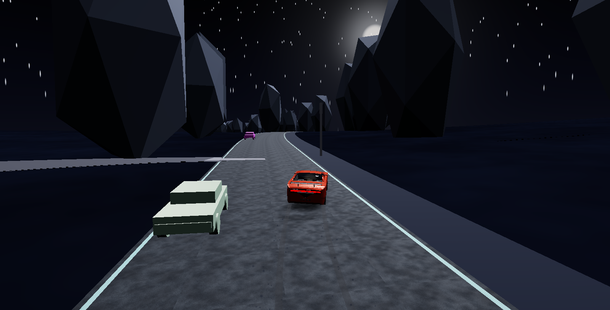
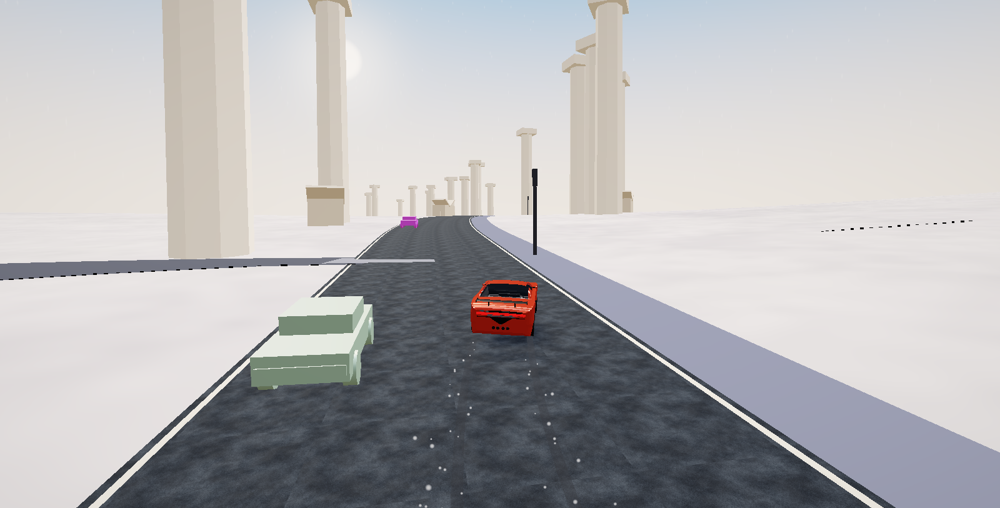
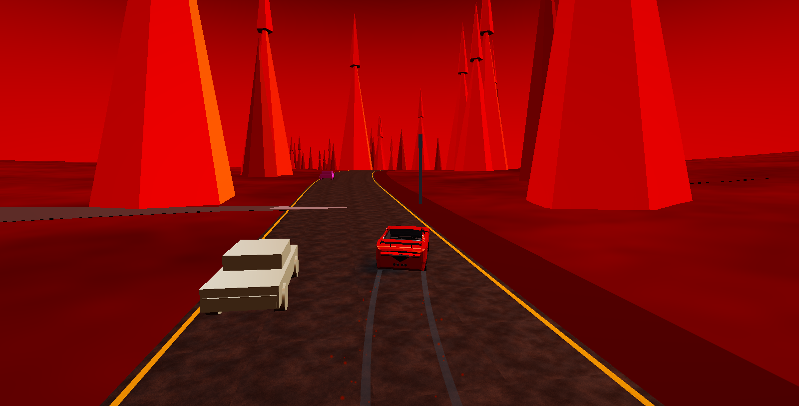
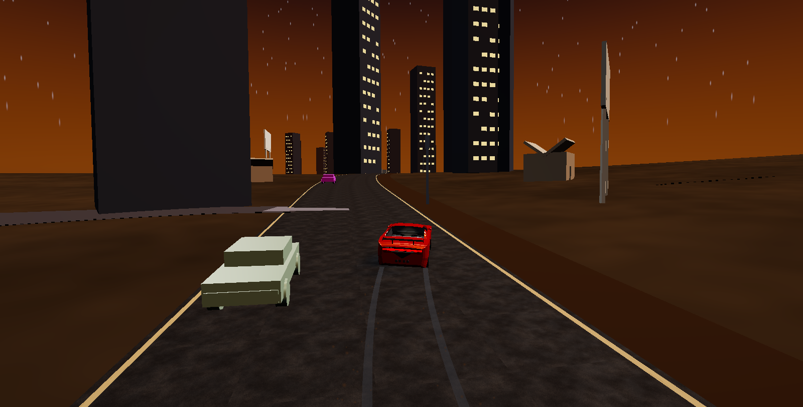
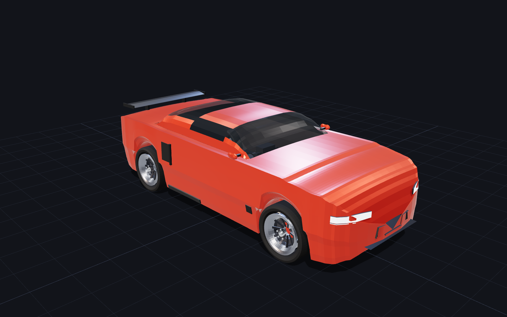

<div align="center">

# Continuum · 无限遛弯

**一条赛道，十一个世界，一直开下去。**

浏览器里无缝运行的无限赛道赛车游戏，同时是一件可以挂在墙上的作品。

[**▶ 在线试玩**](https://benign.host/continuum/) · [游戏技术细节](game-README.md) · [设计文档](docs/design.md)

<sub>three.js r160 · WebGL2 · 车模由纯 Python 标准库生成</sub>



</div>

---

## 这是什么

一条程序化生成、永不重复的赛道。车沿着它一直开下去，沿途穿过十一种截然不同的世界——从山间到太空，从地底到天堂，从深海到地狱。

切换世界是**原地变形**的：天空、雾、光照、地形、路面材质、路边建筑一起连续插值，没有加载、没有黑屏、没有跳变。你在开车，世界在你周围慢慢变成另一个样子。

不需要操作。打开页面它就开始跑，适合当壁纸。

---

## 驾驶

| 操作 | 键位 |
|---|---|
| 油门 / 刹车 | `W` `S` 或 `↑` `↓` |
| 转向 | `A` `D` 或 `←` `→` |
| 手刹 | `Space` |
| 手柄 | Gamepad API，即插即用 |
| 切机位 | `C` |
| 自动驾驶开关 | `P` |
| 下一个 / 指定场景 | `N` / `1`–`9` `0` `-` |
| 全屏 | `F` |
| 隐藏界面（壁纸模式） | `H` |

横摆角速度由**轮胎侧偏力**算出来，所以有转向不足、甩尾、出弯加油门时后轮滑移。路面有起跳坡，冲过坡顶时能飞多高由坡度和车速决定。

---

## 十一个世界

| | | | |
|---|---|---|---|
| 山间 `alpine` | 丘陵 `hills` | 河谷 `river` | 沿海 `coast` |
| 沙漠 `desert` | 城市 `city` | 太空 `space` | 地底 `cavern` |
| 地狱 `inferno` | 天堂 `heaven` | 深海 `abyss` | |

<div align="center">

| 太空 | 天堂 |
|---|---|
|  |  |

| 地狱 | 城市 |
|---|---|
|  |  |

</div>

每个世界是一份纯数据：地形振幅与起伏形态、雾距与雾色、太阳角度与光强、天空渐变、路面颜色、装饰物种类与密度、水面高度。切换时这些数字一起插值，几何体不重建。

---

## 车

车模由 [同仓库的 `carmodel/`](docs/design.md) 生成：纯 Python 标准库，车身的每根曲线都是一段函数。

```
4500 × 1816 × 1312 mm   轴距 2700 mm   20 英寸轮毂   45,900 三角面
```

<div align="center">



</div>

---

## 本地运行

```bash
python3 build.py            # 生成 out/car.glb
node tools/serve.mjs 8173   # http://localhost:8173
```

ES module 与 `fetch` 在 `file://` 下会被当成 null origin 拒绝，所以要起 http 服务，不能直接双击 html。

依赖：Python 3.10+（仅标准库）、Node 18+（仅用于本地静态服务），以及任何支持 WebGL2 的浏览器。three.js r160 已 vendored 到 `tools/vendor/`，无网络依赖。

---

## 技术要点

几个容易踩的坑，记下来：

**路面高程是世界坐标的函数**，不是赛道弧长的函数。路面网格在 CPU 侧算 `baseElevation(x, z)`，地形着色器在 GLSL 里复刻同一个表达式。两边算同一个世界点的同一个值，所以沥青不会悬空在山谷上方。

两边算得一样还不够。地形 tile 顶点间距 7.3 m，路面只有 9.6 m 宽，一块 tile 就横跨整条车道，任何偏差都会被插值摊到路面上。所以路廊内的地形不跟起伏走，直接压到同一高程场下方一个路缘的深度。走廊沿车辆朝向延伸，绕车成圆的话弯道会把路面甩出去。

**相机骑自己脚下的那段路**，不是车辆处的那段。相机在车后 8–11 m，15% 下坡时它脚下比车处高 1.65 m，而它只比车高 2.05 m——余量正好等于近裁剪面，于是镜头钻进沥青，切出一面黑墙。

**离开地面的判据是重力账**，不是位置差：冲过坡顶时路面要求车在 1/60 秒内卸掉垂直速度，如果 `G·dt` 不够，轮胎就离地了。

**过渡就是插值。** 一个 `blend` 标量从 0 走到 1，所有参数在两端之间线性过渡。测过相邻帧的增量是 0.003，60fps 下过渡约 7 秒。

---

## 项目结构

```
index.html               游戏入口
src/
  game.js                主循环、装配
  core/                  赛道曲线积分、车辆物理
  biomes/index.js        十一种世界的纯数据定义
  render/                路面 / 地形天空 / 场景物 / 车流 / 后处理 / 机位
carmodel/                程序化车模（纯 Python 标准库）
tools/                   截图驱动、物理检查、自动化验证、three.js r160
docs/design.md           车模设计文档
game-README.md           游戏技术细节
```

---

## 验证

不是"应该能跑"，是跑过：

| 检查 | 命令 | 断言 |
|---|---|---|
| 车模几何 | `python3 build.py --verify` | 尺寸、法线朝向、轮胎不穿车身、材质齐全 |
| 物理与 AI | `node tools/physics_check.mjs 420` | 420 秒零出界，最大横向偏差 6.3 m（路半宽 7 m） |
| 页面集成 | `node tools/shot.mjs` | 单次运行内截图 + 诊断数据，不跨运行比对 |
| 不泄漏 | 同上，比对 600 帧前后 | 跑道 chunk、赛道采样、几何数恒定 |

---

## 许可

MIT
