<div align="center">

# Continuum · 无限遛弯

缘溪行，忘路之远近。<br>
<sub>陶渊明《桃花源记》</sub>

[**▶ 在线试玩**](https://benign.host/continuum/) · [设计文档](docs/design.md)

<sub>three.js r160 · WebGL2 · 无构建步骤 · 车模由纯 Python 标准库生成</sub>

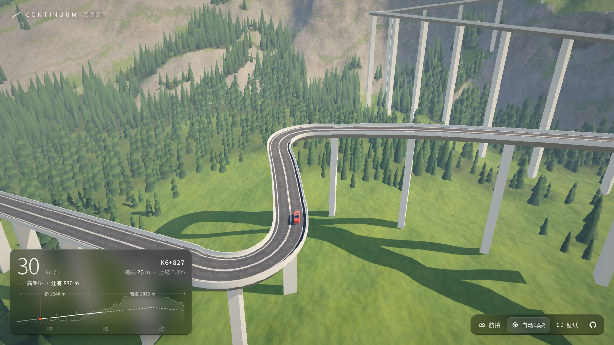

</div>

---

## 这是什么

浏览器里的一条路，车在上面自己开，可以一直开下去，也可以挂在墙上当壁纸。路边的世界按里程更换，一共十一个：山间、丘陵、河谷、沿海、沙漠、城市、地底、地狱、深海、天堂、太空。世界随开过的距离变化，不随时间变化。

到了两个世界的交界，地形、地面、树、水和天光一起变成下一个世界的样子，用一公里多慢慢换过去，没有加载，也没有黑屏。

现在接上了前六个：山间、丘陵、河谷、沿海、沙漠、城市，开完城市回到山间。其余五个按里程一个个接上。

路在每个世界里都像工程师那样选线：沿河谷走，翻垭口，绕开山体；坡太陡就修盘山回头弯，离地太高就上高架桥，埋得太深就打隧道，过水就架桥。路修过的地方，山体被挖成切坡、填成路堤。

<div align="center">

| 盘山路 | 切坡 |
|---|---|
| 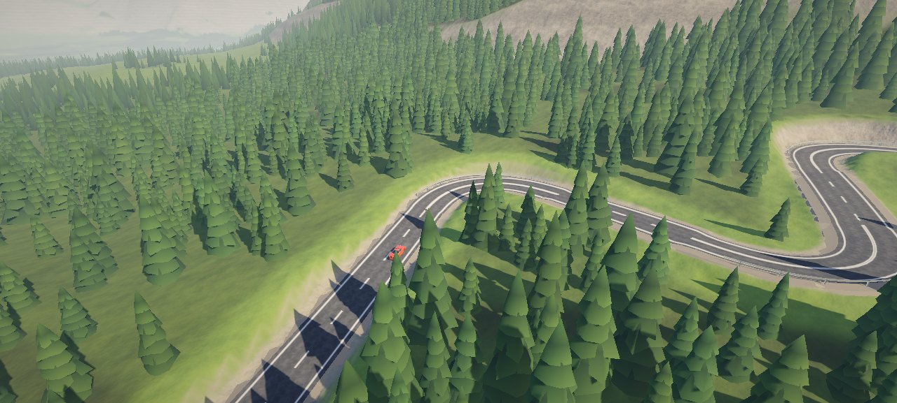 | 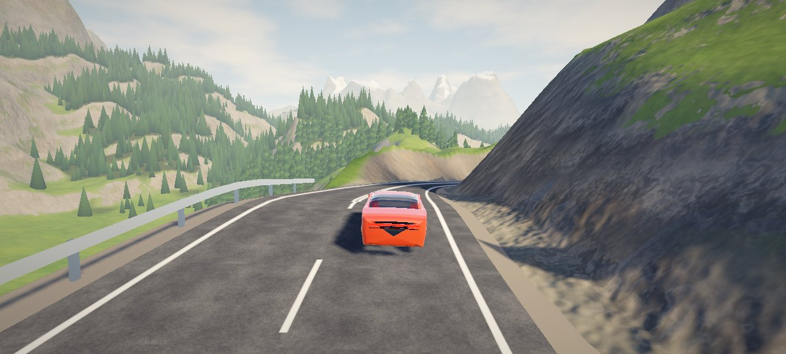 |

| 隧道 | 高架桥 |
|---|---|
| 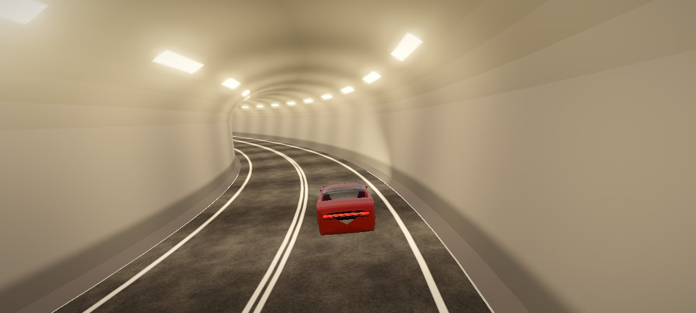 | 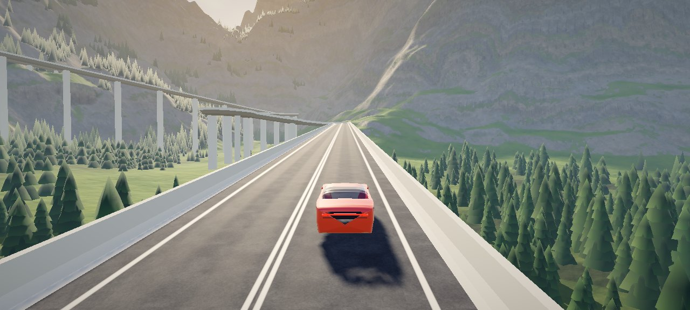 |

| 丘陵 | 河谷 |
|---|---|
| 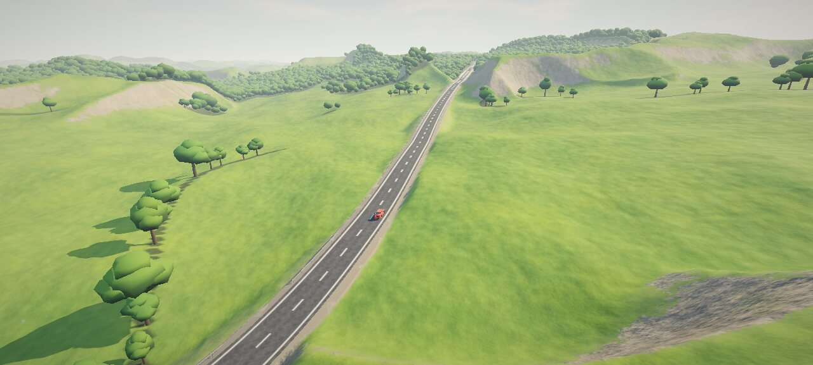 | 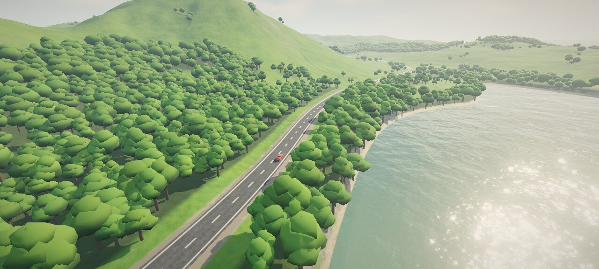 |

| 沿海 | 沙漠 |
|---|---|
| 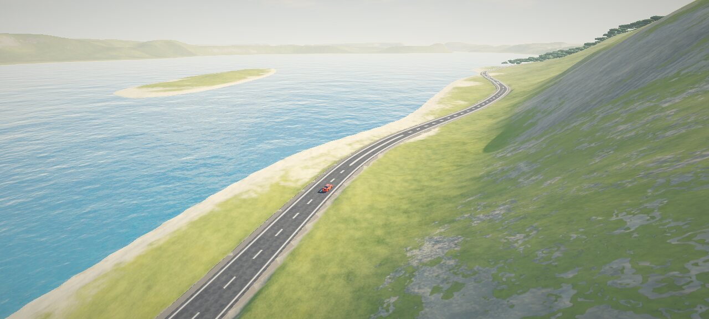 | 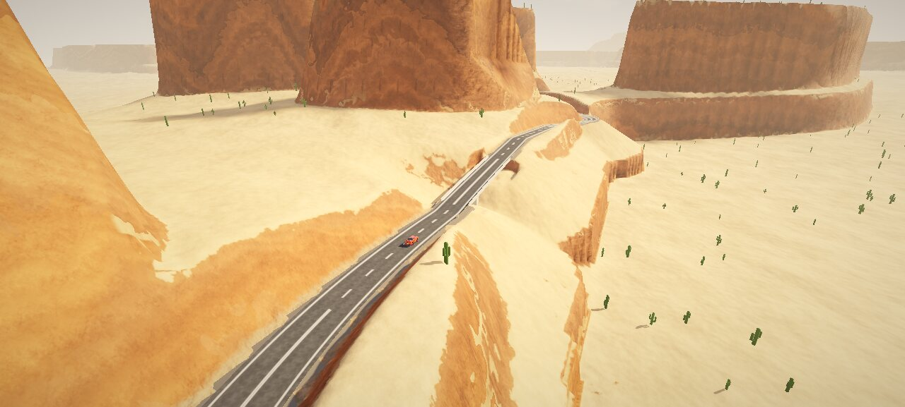 |

| 城市 | 城市里的高架 |
|---|---|
| 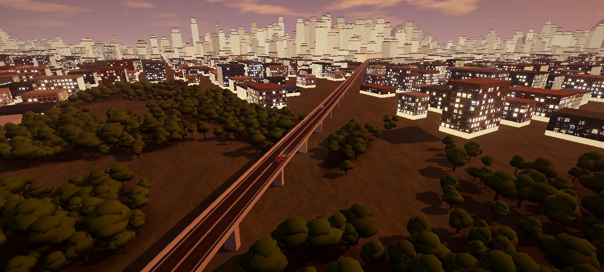 | 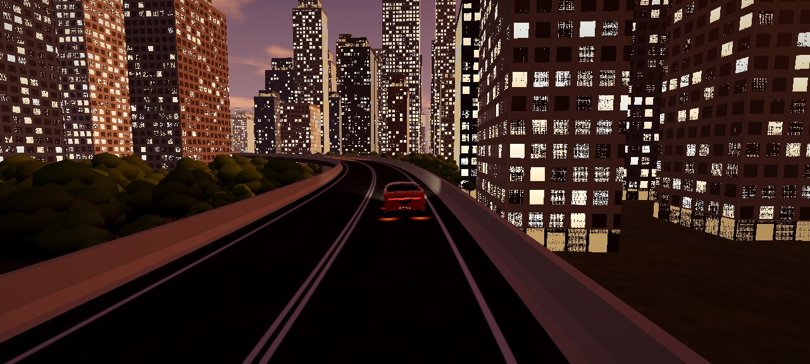 |

</div>

---

## 仪表

<div align="center">

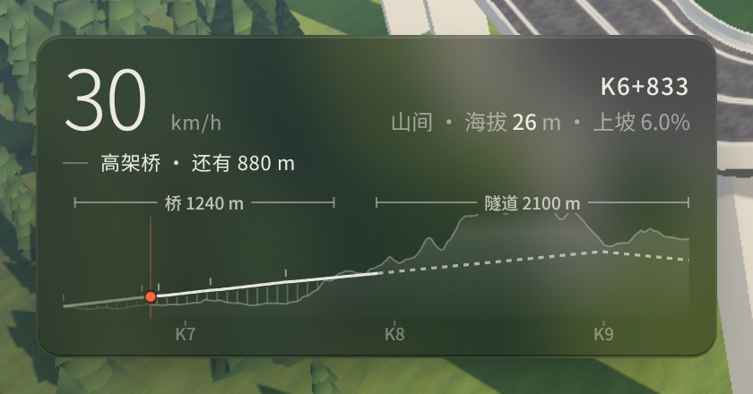

</div>

左下角是一张路线纵断面，画法照公路设计图：浅色的一片是地面，白线是设计线，也就是路面高程；桥下画出桥墩，隧道是一条穿过山体的虚线，回头弯在线上打一个短刻度。120 m 以上的桥和隧道在上方标出长度。图上往后 420 m、往前 2.6 km，下一座桥、下一条隧道还没开到就能看见。

上面是车速、桩号、海拔和坡度。桩号照工程写法，K6+827 是第 6 km 又 827 m。在桥上或隧道里，还会多一行，写着这一段还剩多少米。

图上的线都读自车正在开的那批路面采样。橙色的点是车。

---

## 驾驶

| 操作 | 键位 |
|---|---|
| 自动驾驶开关 | `P`（关掉后才能手动开） |
| 油门 / 刹车 | `W` `S` 或 `↑` `↓` |
| 转向 | `A` `D` 或 `←` `→` |
| 手柄 | 左摇杆转向，RT 油门，LT 刹车 |
| 切机位 | `C`：追车、导演、航拍、侧拍、低机位、正面 |
| 全屏 | `F` |
| 壁纸模式（隐藏界面，镜头交给导演） | `H` |

右下角的按钮也能切机位、开关自动驾驶、进壁纸模式。

| 地址栏参数 | 作用 |
|---|---|
| `seed=7` | 固定种子 |
| `s=6900` | 从第 6.9 km 开始 |
| `world=coast` | 从这个世界开始：`alpine` `hills` `river` `coast` `desert` `city` |
| `worldlen=2500` | 每个世界只有这么长（米），用来看交界 |
| `cam=drone` | 起始机位：`chase` `director` `drone` `side` `low` `front` |
| `auto=0` | 一开始就手动驾驶 |
| `debug=1` | 显示帧率、渲染倍率、绘制次数、三角形数和地形块数 |

---

## 车

车模由同仓库的 `carmodel/` 生成：纯 Python 标准库，车身的每根曲线都是一段函数。

车速过 40 km/h，车身先抬高 260 mm，四个轮子绕轮拱里的铰轴转 90°，平躺到底板下，外侧轮面朝下，车身再落到离地 200 mm。轮毂是一块整流盘，盘上一圈发光环，翻平后朝着路面。车速低于 20 km/h 或出了事故，按相反的顺序放下轮子。翻转只改外形，物理仍按四个轮胎算。

```
4500 × 1816 × 1312 mm   轴距 2700 mm   20 英寸轮毂   51,300 三角面
```

<div align="center">


</div>

`preview.html` 可以转着看车模，"悬浮"按钮播放翻转。

---

## 本地运行

```bash
python3 build.py            # 生成 out/car.glb（仓库里已带一份）
node tools/serve.mjs 8173   # http://localhost:8173
```

ES module 在 `file://` 下会被当成 null origin 拒绝，所以要起 http 服务。

改过 `src/` 或 `out/car.glb`，提交前跑一次 `node tools/stamp.mjs`。它给每个模块的地址加上内容哈希，线上的浏览器缓存就不会把新旧文件混着用。

依赖：Node 18+（本地静态服务与检查脚本）、Python 3.10+（仅标准库，只在重建车模时需要），以及支持 WebGL2 的浏览器。three.js r160 已放在 `tools/vendor/`，不需要联网。

---

## 怎么做的

### 世界

每个世界是一份数据加一个地形函数：天空、雾和光，地面每一层的颜色，水，长什么树，以及这个世界的山形。一个点属于哪个世界，只看它在哪：沿着路出发的方向走了多远，交界线再用一个慢变的噪声弯一弯，不会是一条直线。每个世界 7 km，最后 1.5 km 变成下一个：地形在两个函数之间插值，地面颜色、树种、水跟着换，天光按镜头所在的位置混合。

着色器用同一条轴、同一个整数哈希逐像素算出这个点在哪个世界，颜色从一张每个世界一行的调色板里取，所以地面换颜色的地方正好是地形换形状的地方。太阳在所有世界里站在同一个方向，因为阴影烘焙在地形块里。

河谷的河、沿海的海岸线顺着路出发的方向延伸，路会找最平的那条线走，所以河和海大多就在路边。过水的地方，设计线抬到水面以上 6.5 m 架桥；选线时水面算作平地，但价钱是路的两倍半，窄的海峡直接架桥，宽的海湾绕过去。

城市是蓝调时分：太阳刚落，天顶深蓝，地平线一圈暖色，楼一扇窗一扇窗地亮着。楼按一套顺着出发方向的街网排，每 46 m 一块地，市中心的楼最高，公园里不盖楼、只长树；每栋楼的四个角都离路够远。窗户在着色器里按立面上的米数画，所以不论楼多大都对齐楼边；窗小到几个像素时退成平均的亮度，远处的天际线是一片柔光，不闪。路在城里上 12 m 的高架。

### 选线

先在粗地形上用 A* 找走廊（爬升很贵，所以走河谷和垭口），再用纯追踪沿走廊铺中心线。走廊爬得比公路能爬的快，就设计一段盘山：一条条直腿，每条斜着往山上爬，腿尾一个回头弯掉头。每条腿的角度和长度都先用真正的转向律在地形上试跑一遍，挑最贴地的，所以回头弯落在山坡上，不会埋进山里。

### 纵断面、桥和隧道

纵坡求解器把高程拟合到地面，坡度不超过 9.5%。离地超过 7 m 变高架桥，覆土超过 20 m 变隧道，从另一层路上方经过时一定是桥。

### 同一份采样

路一旦提交就不再改。路面网格、地面改造、物理、自动驾驶、仪表、导演读的是同一批采样，所以画出来的路就是开的路。

### 修路后的地面

`corridor.js` 给每个点算出修路后的地面：路肩平台、1:0.8 的切坡、1:1.6 的路堤；桥下只要求低于梁底，隧道上只要求高于拱顶。地形、树、镜头都问这一个函数。

### 岩层与草地

草皮到崖边断开，边缘不规则，但断得利落。岩壁约 29 m 一层，层层深浅不同；层面随公里尺度的褶皱起伏，所以岩层会斜着穿过一面山。大约每四层有一层更软更暗的泥灰岩。层顶是一道窄台，林线以下长草，以上是碎石。层理只在真正的陡壁和切坡上看得清。草地分出偏干发黄和偏湿发深的片，草坡变陡的地方成簇地露出岩石。

### 阳光

朝太阳沿山体做一次光线步进。地形逐顶点烘焙，路面逐采样烘焙，树逐棵烘焙，车每帧采样，所以车开进山影里会一起变暗。

### 天光

天空球渲染成环境贴图，给地形、路面和车漆提供天光与反射；山谷和冲沟按看得见多少天空变暗。隧道里的光跟着镜头走：镜头进了洞，画面换成灯带的光；镜头在洞外时，洞口是黑的，车开进去就暗下来。

### 导演

导演镜头读前方几百米的路，下一座桥、下一个弯、下一组回头弯还没开到，机位就已经在那里等着。跟着车走的机位（追车、侧拍、前拍、环绕）之间用 1.6 s 绕车滑过去；站着不动的机位（路边长焦、河谷对岸的远景、回头弯上方俯拍）用 0.45 s 的叠化切入。隧道里一律叠化。只有镜头到车的视线大部分时间不被山体和桥的护栏挡住，这个机位才会被用；中途被挡住就换掉。在高架上，侧拍的机位升到护栏上方，长焦浮在桥面上方。长焦、远景、俯拍、环绕各有 30–35 s 的冷却，好镜头不会每个弯都来一遍。竖屏也照样构图。

### 分帧烘焙

一个近处地形块要算 5–10 ms，一帧给不起。烘焙函数写成生成器，每帧给地形 4 ms、森林 2 ms，时间到了就停，下一帧接着算。算到一半的块如果不再需要，或者新修的路改了它下面的地面，就丢掉重来。

### 自适应画质

每半秒量一次帧率。连续 2 秒低于 55 fps，渲染分辨率降一档，五档从满分辨率到一半，最后两档阴影贴图从 2048 降到 1024；连续 8 秒高于 58 fps 再升一档。因为太慢降下来的那一档，1 分钟内不再试，再失败就等 2 分钟、4 分钟，画面不会忽清忽糊。

---

## 项目结构

```
index.html               入口：界面、按钮、无头运行与诊断输出
src/
  game.js                装配、主循环、隧道里的光
  world/                 世界本身，不碰渲染
    worlds.js            十一个世界的数据和地形，世界在哪、怎么交界
    landform.js          山间的山形：扭曲 fbm、山脊、冲沟
    surveyor.js          选线：A* 走廊、纯追踪、盘山设计
    road.js              纵断面、桥隧判定、提交后不变的采样
    corridor.js          修路后的地面
    sunlight.js          太阳遮挡的光线步进
    vegetation.js        每个世界长什么树、长在哪
  core/                  车辆物理、自动驾驶、碰撞
  render/                地形、路面与桥隧、森林、水、天空与雾、后处理、车流、镜头
    worldlook.js         着色器里的世界、调色板、交界处的天光
    water.js             河、湖和海
    city.js              城市的楼和窗
    director.js          导演：按前方的路挑镜头、滑移与叠化
    quality.js           自适应画质
  ui/hud.js              仪表：车速、桩号、路线纵断面
carmodel/                程序化车模（纯 Python 标准库）
tools/                   检查脚本、截图、发布前加版本号、本地服务、three.js r160
  brand/                 og 图、图标和字标的生成
docs/design.md           设计文档
```

---

## 验证

| 检查 | 命令 | 结果 |
|---|---|---|
| 路网 | `node tools/road_check.mjs 16` | 5 个种子，每 16 km 有 26–54 个回头弯、13–22 座桥、2–12 条隧道；最大纵坡 9.5%，最小半径 14 m，自交 0 |
| 世界 | `node tools/world_check.mjs 70` | 种子 7、42、3 各 70 km，不渲染：六个世界按顺序出现，每个 7–15 km 路，路面没有一处在水下，最大纵坡 9.5% |
| 驾驶 | `node tools/physics_check.mjs 600 <seed>` | 600 秒出界 0 帧、翻车 0 次，车道偏差最大 0.92 m，最大横向加速度 0.57 g |
| 整页 | `node tools/game_check.mjs 300 42` | 真实页面跑 300 秒：4.8 km，碰撞 0，翻车 0，路面块与几何体有上限 |
| 车身表现 | `node tools/presentation_check.mjs` | 车轮转动、前轮转向、车身俯仰侧倾、镜头有滞后；起步时轮子着地，过 40 km/h 后轮子翻平、车身悬浮 |
| 导演 | `node tools/director_check.mjs 180` | 种子 7、42、3 各 180 秒，外加一次竖屏和一次种子 7 的 1.2 km 高架：车在画面里 99.6–100% 的帧，被山体或护栏挡住的不到 0.3%，没有不带叠化的跳切 |
| 截图 | `node tools/shot.mjs out/a.png 90 "s=6900&cam=drone"` | 一次运行里同时出图和诊断数据 |
| 发布前 | `node tools/stamp.mjs` | 每个模块的地址带上内容哈希，浏览器不会把新旧文件混着用；`game_check` 会先查这一步 |
| 车模几何 | `python3 build.py --verify` | 尺寸、法线朝向、轮胎不穿车身、材质齐全；轮子翻转的全过程不碰路面、底板和车身 |

---

## 许可

MIT
