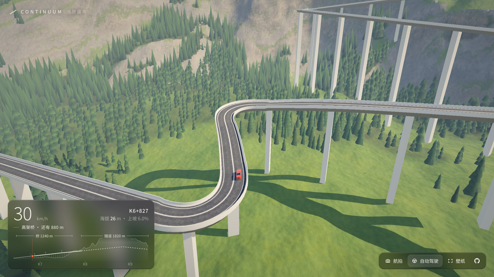
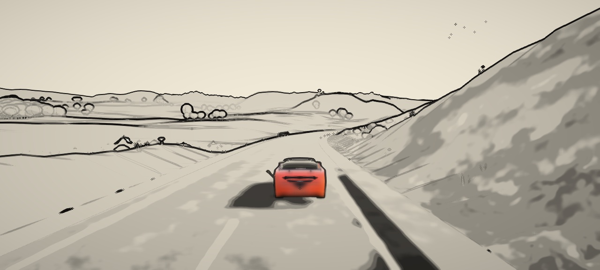
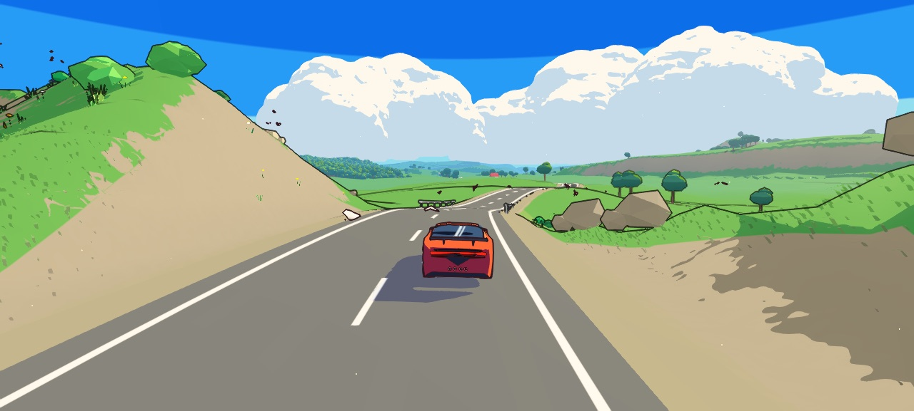
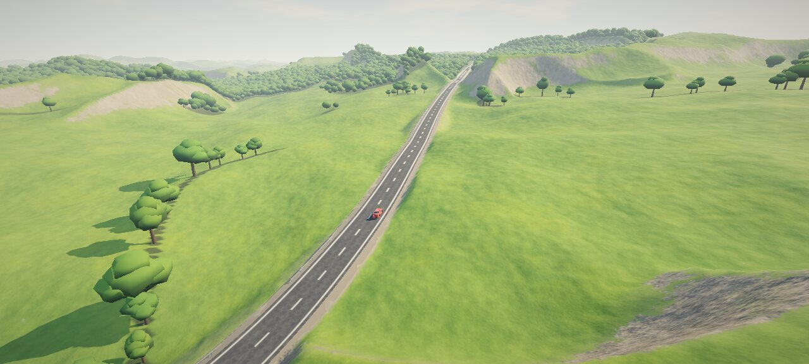
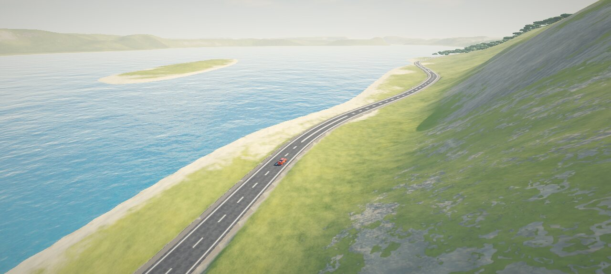
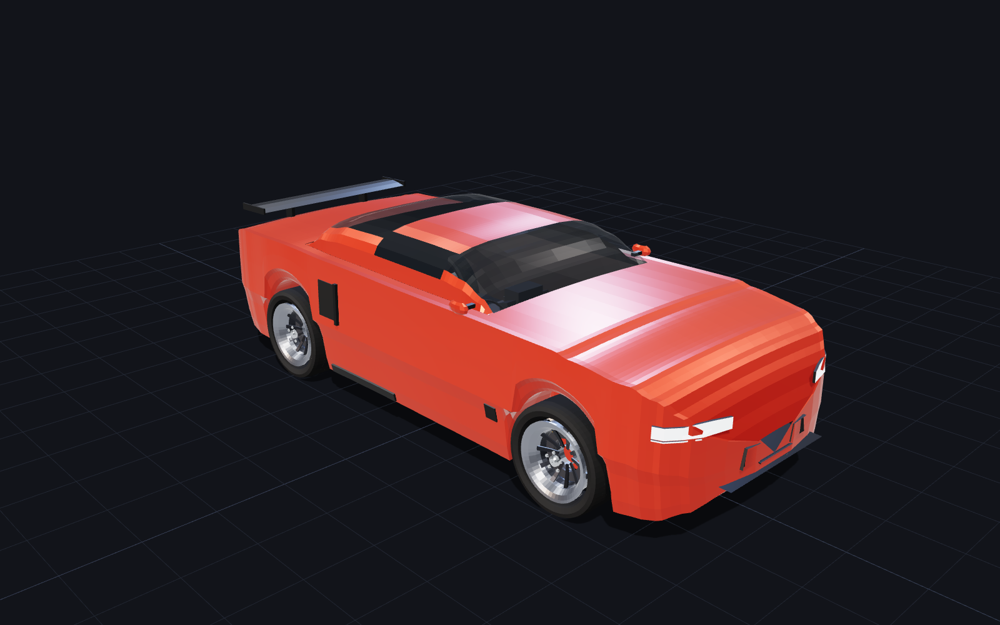

<div align="center">

# Continuum · 无限遛弯

缘溪行，忘路之远近。<br>
<sub>陶渊明《桃花源记》</sub>

[**▶ 在线试玩**](https://benign.host/continuum/) · [设计文档](docs/design.md)

<sub>three.js r160 · WebGL2 · 无构建步骤 · 车模由纯 Python 标准库生成</sub>



</div>

---

## 这是什么

浏览器里的一条路，车在上面自己开，可以一直开下去，也可以挂在墙上当壁纸。路边的世界按里程更换，一共十二个：山间、丘陵、河谷、沿海、沙漠、城市、地底、地狱、深海、天堂、太空、颠倒。世界随开过的距离变化，不随时间变化。

到了两个世界的交界，地形、地面、树、水和天光一起变成下一个世界的样子，用一公里多慢慢换过去，没有加载，也没有黑屏。

十二个世界都接上了，开完太空翻进颠倒，再回到山间，一圈大约 120 km。

世界也可以自己挑。右下角的「世界」里点一个，约一公里后开始换过去，换法和交界一样；`N` 换到下一个。勾选哪些世界轮流出现，选择会记住。

画法也可以换。右下角的「画风」里有七种：写实、手绘、水墨、赛璐璐、版画、像素、方块，`V` 换下一种。一种换成另一种用一秒半慢慢过去，选择会记住。

路不是唯一能开的地方。手动开的时候，车可以开出路肩，贴着地面走：上坡慢，下坡快，草和沙抓地差；树是实心的，楼是实心的，撞上去就停，撞得越快伤得越重；陡坡和深水过不去，车被弹回来。路边的动物能被撞飞：抛出去，翻着跟头落地，弹几下，躺一会儿，消失；越重的越让车掉速，大的还会把车撞得弹起来。动物也会躲树，跑的时候绕开树干。开自动驾驶时，车先被放回路上；`R` 随时把车放回路上，不算翻车。

第十二个世界叫「颠倒」。红云压着天，云里有闪电，每闪一下，整个世界跟着红一下，偶尔闪电照亮的云上，立着一个巨大的蜘蛛的影子。空气里漂着灰，树一片叶子也没有，路边的地里钻出触手，车开近了，它们朝车弯过来。地不再干净：灰一片一片落着，煤烟熏黑的地方，一块块干裂的地，每隔几块有一块底下还烧着，一道道黑色的脉络爬过去，里面红红的。黑的根从远处的荒地里一路爬向路肩，边爬边分叉，爬到哪里，哪里就从根梢上立起一根触手；在里面待得越久，根和触手越多，脉络也越粗。天上飞着成群的蝙蝠，闪电一亮，翅膀的边缘红一下。进颠倒的那一段路是拧过去的：一段直路绕着自己的走向拧半圈，像一根麻花，最长 500 m，路不够直就短一些，最短 200 m；路正好在交界上拐弯的话，这一段挪到前后 500 m 内最近的一段直路上。大地跟着卷过去，离路越远卷得越缓：路上几百米拧完，离路 300 m 的地用一公里，一公里外的地用三公里。所以它不是横在路上的一面墙，是一道几公里长的大卷：前面的大地在路的一侧立起来，越过头顶，在另一侧落下去，再往前整个世界倒挂着，从几公里外就看得见。这个大卷是世界里固定的形状，开过去的一路上它不动。卷到天上去的远处的地是淡进天里的，不是一面雾色的墙；从底下看过去的地是天，看不见站在另一面的树。车沿着麻花开过去，跟着路翻过来，画面跟着车转。天不跟着翻：这一头的天在上，那一头的天在它的地平线下面，车是从一片天底下开到另一片天底下。转到哪里只看车开到路上的哪里，不看时间：开得快转得快，停在半路就侧着停在那里，倒出来又转回去；先慢，中间最快，到头时多冲一点再回来。车一直在画面中间，车下面的路一直在车下面。翻完，天在脚下，路在头顶；从颠倒里出来的那一段接着往同一个方向拧，拧满一整圈。手动开的时候，画面转过一半，左右就换了位置，方向盘往反的方向打。翻的时候，画面上浮出一句：天旋地转回龙驭。

<div align="center">

| 写实 | 手绘 |
|---|---|
|  |  |

| 水墨 | 赛璐璐 |
|---|---|
|  |  |

| 版画 | 像素 |
|---|---|
|  |  |

| 方块，樱树、黑橡和白桦 | 手绘，风、花瓣、路边的鹿和天上的鸟 |
|---|---|
|  |  |

</div>

路在每个世界里都像工程师那样选线：沿河谷走，翻垭口，绕开山体；坡太陡就修盘山回头弯，离地太高就上高架桥，埋得太深就打隧道，过水就架桥。路修过的地方，山体被挖成切坡、填成路堤。

<div align="center">

| 盘山路 | 切坡 |
|---|---|
|  |  |

| 隧道 | 高架桥 |
|---|---|
|  |  |

| 丘陵 | 河谷 |
|---|---|
|  |  |

| 沿海 | 沙漠 |
|---|---|
|  |  |

| 城市 | 城市里的高架 |
|---|---|
|  |  |

| 地底 | 地狱 |
|---|---|
|  |  |

| 深海，往上爬出海面 | 天堂 |
|---|---|
|  |  |

| 太空 | 颠倒 |
|---|---|
|  |  |

| 进颠倒：大地卷过去，车沿着拧成麻花的路翻过去（1.2 km 外、开到之前、九十度、翻完） |
|---|
|  |

</div>

---

## 仪表

<div align="center">


</div>

左下角是一张路线纵断面，画法照公路设计图：浅色的一片是地面，白线是设计线，也就是路面高程；桥下画出桥墩，隧道是一条穿过山体的虚线，回头弯在线上打一个短刻度。120 m 以上的桥和隧道在上方标出长度。路开进下一个世界的地方竖一条虚线，旁边写着那个世界的名字。图上往后 420 m、往前 2.6 km，下一座桥、下一条隧道还没开到就能看见。

上面是车速、桩号、所在的世界、海拔和坡度；过交界时，世界一栏写成「河谷 → 沿海」。桩号照工程写法，K6+833 是第 6 km 又 833 m。在桥上或隧道里，还会多一行，写着这一段还剩多少米。

图上的线都读自车正在开的那批路面采样。橙色的点是车。

---

## 驾驶

| 操作 | 键位 |
|---|---|
| 自动驾驶开关 | `P`（关掉后才能手动开） |
| 油门 / 刹车 | `W` `S` 或 `↑` `↓` |
| 转向 | `A` `D` 或 `←` `→` |
| 手柄 | 左摇杆转向，RT 油门，LT 刹车 |
| 切机位 | `C`：追车、导演、航拍、侧拍、低机位、正面 |
| 全屏 | `F` |
| 壁纸模式（隐藏界面，镜头交给导演） | `H` |
| 声音开关（默认关，选择会记住） | `M` |
| 下一个世界 | `N` |
| 回到路上（不算翻车） | `R` |
| 下一种画风 | `V` |

右下角的按钮也能挑世界、换画风、切机位、开关自动驾驶、进壁纸模式、开关声音。

| 地址栏参数 | 作用 |
|---|---|
| `seed=7` | 固定种子 |
| `s=6900` | 从第 6.9 km 开始 |
| `world=coast` | 从这个世界开始：`alpine` `hills` `river` `coast` `desert` `city` `cavern` `inferno` `abyss` `heaven` `space` `upside` |
| `worldlen=2500` | 每个世界只有这么长（米），用来看交界 |
| `loop=coast,city` | 只让这几个世界轮流出现 |
| `cam=drone` | 起始机位：`chase` `director` `drone` `side` `low` `front` |
| `style=ink` | 起始画风：`real` `paint` `ink` `cel` `print` `pixel` `block` |
| `auto=0` | 一开始就手动驾驶 |
| `debug=1` | 显示帧率、渲染倍率、绘制次数、三角形数和地形块数 |
| `cap=30` | 每秒最多画这么多帧。默认 60：屏幕刷新率在 108 Hz 以上就隔一两次画一次；`0` 是每次刷新都画 |
| `ppr=1` | 画布像素比的上限，默认 2；场景最多按 1.5 画，见「清晰」 |
| `gpu=high` | 机器有两块显卡时用快的那块；默认让浏览器挑 |
| `tier=low` | 把画质的档位钉在 `high` `mid` `low` 中的一档（画多少东西，见「自适应画质」）；分辨率照旧跟着帧率升降 |

车是车：路有起伏的地方它会离地。每一步在车前后各 3 m 取一次地面，量这一处坡顶有多尖；尖到车速的平方除以曲率半径超过重力加速度的 1.2 倍，轮胎就卸了载，车按抛物线飞出去，空中不转向、不加油、不刹车，落下来的那一下，撞地的速度决定车身压下去多深、镜头抖多少、尘扬多高、响多重的一声，重的还会损一点速度。丘陵、山间、河谷、沿海、沙漠、地狱、颠倒的直路上，隔一阵有一段路起伏成三到五个坡，每个坡六十米上下，高低差三米多：车速过 80 到 105 km/h（看这一段的坡顶多尖），每个坡顶都会离地，120 km/h 上下能飞到近两米、几十米远。开到路外，土坡的坡顶用的是同一个算法。自动驾驶过这些坡不减速，所以它也飞。

---

## 车

车模由同仓库的 `carmodel/` 生成：纯 Python 标准库，车身的每根曲线都是一段函数。

车速过 40 km/h，车身先抬高 260 mm，四个轮子绕轮拱里的铰轴转 90°，平躺到底板下，外侧轮面朝下，车身再落到离地 200 mm。轮毂是一块整流盘，盘上一圈发光环，翻平后朝着路面。车速低于 20 km/h 或出了事故，按相反的顺序放下轮子。翻转只改外形，物理仍按四个轮胎算。

```
4500 × 1816 × 1312 mm   轴距 2700 mm   20 英寸轮毂   51,300 三角面
```

<div align="center">



</div>

`preview.html` 可以转着看车模，"悬浮"按钮播放翻转。

---

## 本地运行

```bash
python3 build.py            # 生成 out/car.glb（仓库里已带一份）
node tools/serve.mjs 8173   # http://localhost:8173
```

ES module 在 `file://` 下会被当成 null origin 拒绝，所以要起 http 服务。这个服务只监听本机；要从别的设备打开页面，加 `HOST=0.0.0.0`。

改过 `src/` 或 `out/car.glb`，提交前跑一次 `node tools/stamp.mjs`。它给每个模块的地址加上内容哈希，线上的浏览器缓存就不会把新旧文件混着用。

依赖：Node 18+（本地静态服务与检查脚本）、Python 3.10+（仅标准库，只在重建车模时需要），以及支持 WebGL2 的浏览器。three.js r160 已放在 `tools/vendor/`，不需要联网。

---

## 怎么做的

### 世界

每个世界是一份数据加一个地形函数：天空、雾和光，地面每一层的颜色，水，长什么树，以及这个世界的山形。一个点属于哪个世界，只看它在哪：沿着路出发的方向走了多远，交界线再用一个慢变的噪声弯一弯，不会是一条直线。哪段路程是哪个世界，写在一张时间表里，默认十二个世界依次轮流，每个 7 km，最后 1.5 km 变成下一个：地形在两个函数之间插值，地面颜色、树种、水跟着换，天光按镜头前方的位置混合（见「天气」）。

着色器用同一条轴、同一个整数哈希逐像素算出这个点在哪个世界，时间表里镜头前后的那几段以数组传进去，颜色从一张每个世界一行的调色板里取，所以地面换颜色的地方正好是地形换形状的地方。太阳在所有世界里站在同一个方向，因为阴影烘焙在地形块里。

### 换世界

点了别的世界，时间表在已经修好的东西之后改写：车前约一公里以外找一处平直的路切断，切口之后的路作废，选线从切口接着往新世界里走；交界从切口之后开始，和别的交界一样慢慢换过去。旧路经过的地形块、树和楼照旧画着，等新路铺好再按新路、新地形重建，好了再换上，不会出现空洞。已经开始交界的那一段改不了，再按「下一个」改的是它之后那一段。

任意两个世界都可能接在一起，有的高差很大。纵断面求解器多了一个下限：除了深海，路不进显出来的液面，所以从云海或海面换到低处的陆地时，路先在液面上走完，再沿高架下来。

河谷的河、沿海的海岸线顺着路出发的方向延伸，路会找最平的那条线走，所以河和海大多就在路边。过水的地方，设计线抬到水面以上 6.5 m 架桥；选线时水面算作平地，但价钱是路的两倍半，窄的海峡直接架桥，宽的海湾绕过去。

城市是蓝调时分：太阳刚落，天顶深蓝，地平线一圈暖色，楼一扇窗一扇窗地亮着。楼按一套顺着出发方向的街网排，每 46 m 一块地，市中心的楼最高，公园里不盖楼、只长树；每栋楼的四个角都离路够远。窗户在着色器里按立面上的米数画，所以不论楼多大都对齐楼边；窗小到几个像素时退成平均的亮度，远处的天际线是一片柔光，不闪。路在城里上 12 m 的高架，每 40 m 一盏路灯，左右交替。

水面其实是一张"液面"，每个世界给它不同的样子：河谷和沿海是水，地狱是带着暗壳、裂缝发光的岩浆，天堂是一片云海，太空里同一片云海落在 320 m 以下。路过液面一律架桥，各世界的桥高不同：水 6.5 m，岩浆 9 m，云海 55 m，太空 320 m，太空里的桥没有墩。深海反过来，路贴着 120 m 深的海底走，海面是头顶一块亮的天花板，海底成片长着海带；从深海到天堂，路沿着一座海山盘上去，穿出海面，海面变成云海。太空的天是黑的，白天也看得见星星，地平线外挂着一颗行星，桥两侧的护栏上一排小灯。深海里海雪往下沉，一群群发青光的小鱼在海带上方绕圈，地狱里火星往上飘，地底的空气里浮着尘。

地底在城市和地狱之间：一个国家那么大的洞，洞顶在 170 m 上，满是蓝绿色的萤火虫光；地上散着发光的水晶，石柱从地面一直顶到洞顶，路在石柱之间绕，路边一盏盏暖色的灯。洞顶是一张跟着镜头的圆盘，形状在顶点着色器里按噪声算，近处挂着钟乳石；跨过边界时洞顶升到天上，所以从城市开过来，天慢慢合上，开进地狱时又打开。

### 选线

先在粗地形上用 A* 找走廊（爬升很贵，所以走河谷和垭口），再用纯追踪沿走廊铺中心线。走廊爬得比公路能爬的快，就设计一段盘山：一条条直腿，每条斜着往山上爬，腿尾一个回头弯掉头。每条腿的角度和长度都先用真正的转向律在地形上试跑一遍，挑最贴地的，所以回头弯落在山坡上，不会埋进山里。

### 纵断面、桥和隧道

纵坡求解器把高程拟合到地面，坡度不超过 9.5%。离地超过 7 m 变高架桥，覆土超过 20 m 变隧道，从另一层路上方经过时一定是桥。

### 同一份采样

路一旦提交就不再改，只有换世界时，车前约一公里以外的那段重修。路面网格、地面改造、物理、自动驾驶、仪表、导演读的是同一批采样，所以画出来的路就是开的路。

### 修路后的地面

`corridor.js` 给每个点算出修路后的地面：路肩平台、1:0.8 的切坡、1:1.6 的路堤；桥下只要求低于梁底，隧道上只要求高于拱顶。地形、树、镜头都问这一个函数。

### 岩层与草地

草皮到崖边断开，边缘不规则，但断得利落。岩壁约 29 m 一层，层层深浅不同；层面随公里尺度的褶皱起伏，所以岩层会斜着穿过一面山。大约每四层有一层更软更暗的泥灰岩。层顶是一道窄台，林线以下长草，以上是碎石。层理只在真正的陡壁和切坡上看得清。草地分出偏干发黄和偏湿发深的片，草坡变陡的地方成簇地露出岩石。

### 阳光

朝太阳沿山体做一次光线步进。地形逐顶点烘焙，路面逐采样烘焙，树逐棵烘焙，车每帧采样，所以车开进山影里会一起变暗。

### 天光

天空球渲染成环境贴图，给地形、路面和车漆提供天光与反射；山谷和冲沟按看得见多少天空变暗。隧道里的光跟着镜头走：镜头进了洞，画面换成灯带的光，眼睛慢慢适应，前面的洞口白得发亮，出了洞那一下外面太亮；镜头在洞外时，洞口是黑的，车开进去就暗下来。

### 天气

天空、雾和光原来只按相机所在的那一点混合，地面却是逐像素画的：前面的世界早就铺着自己的颜色，头顶还是上一个世界的天，沙漠在丘陵的雾里发灰，城市迎着满天的日光迎面走来，车开进去才暗下去。现在相机周围有一圈二十四个方向，每个方向读 1.8 km 外那一点的世界（交界处照旧混）：低处的天空和远处的雾用它，头顶的天空和身上的光用相机往前 450 m 处的。天气的锋面是迎面来的：地平线上先暖起来，先暗下去，先出星星，云先聚拢，城市在暮色里远远立着；车开近了，头顶才变，车开进去，光才落到身上；身后还是上一个世界的天。风声和空气里飘着的东西跟着那 450 m 走；白天的世界里，一粒小东西最大只画 2.4 像素，贴着镜头的一粒灰就是一粒灰。

### 画风

画风改三处：材质的光，阳光分成两三级、阴影偏蓝紫、高光变弱；天空，换成一团团积云；调色之后的一道处理，笔触、平涂、墨线、墨色、版画的几块平色和像素。墨线和平涂读场景的深度：深度跳变的地方是轮廓，深度的坡度折断的地方是折线。会勾线的画风让东西在画面的 alpha 里给自己做记号：树叶和草 0.92，建筑 0.80，自己的车每个部件一个数（0.46–0.58，玻璃不写），动物和路上的车 0.30；液面是混合画的，不做记号。所以手绘只给车勾线，水墨只留车的颜色；树叶和建筑的记号备着，还没有画风用。写实画风下三处全关，画面和没有画风时逐位相同。

手绘照着手绘动画的背景画：天是饱满的蓝，每个白天世界给天顶、中间、地平线三个颜色，直接上屏，不再被曝光洗白，用的是画家的色调曲线（调色板里的颜色原样上屏，亮处慢慢压住，不烧白），地平线上立着一座座积云塔，向阳面白、背阴面蓝灰；空气清透，雾只留四分之一，远山一层层变蓝；每样东西有亮、暗两个颜料：暗的是另调的颜色（有颜色的朝青蓝转，树叶转得多些，灰的偏蓝），不是把亮的压暗，受光的一边和背光的一边之间一步跨过去，云的影子在地上也是这样；车、路上的车和动物先不走这条路，等它们自己的颜料；草地上是一片片深浅、偏黄偏蓝的色块，近处的草里还有成片的野花；树冠的光碎成一团一团，像一笔一笔点上去的叶子；云的影子被风推着从地上慢慢滑过；亮的地方有一层柔光；笔触是圆的一团团，只落在地、树和房子上，不碰天、车和动物，贴着镜头的草叶和树叶抹得小。积云塔、深蓝的天和远山变蓝只在白天的天下面，夜里的城市、地狱和太空留着自己的天。

手绘里还有活物：丘陵、山间、河谷、沿海的路边，草地上站着鹿、兔、狐，有时路边坐着一只黑猫；车开近了，鹿、兔、狐就朝远离路的方向跑开。天上有成群的鸟绕着大圈，路边的草上飞着蝴蝶。它们和车一样被勾上线。动物不只是手绘的：写实、水墨、赛璐璐、版画、像素里一样有，各按各的画法画出来；方块里路边是方块搭的猪羊牛鸡，天上照样有鸟。每个世界的动物不一样：山间有山羊，丘陵里有狸，河谷里有苍鹭，沙漠里是骆驼，地底有一种白色的小精灵低着头走。

手绘里还刮着风。天上画出一道道长长的淡线，像手绘动画里画风的那几笔：先一点点画出去，拐几个弯，有时在尾巴上绕个圈，再一点点擦掉；风是一阵一阵的，阵里有七八道，阵与阵之间只有零星几笔；线里夹着花瓣，一片一片翻着往下落，跟着风往同一个方向飘。风线和花瓣只在白天的几个世界里有：丘陵、山间、河谷，沿海少一些，天堂里的花瓣是金色的。

方块把世界当成一块块方块来画：每个面都铺上一格一格的方格，每格的颜色取自那一格正中的画面，再按各自的随机数明暗一点，像方块表面那张小图；方格贴在世界上，车往前开，它们跟着世界走。离得越远方格越大，所以屏幕上总是几个像素一格。顶面最亮，侧面次之，底面最暗。天是浅蓝的，太阳是方的，云是一块块白色的方块，由风推着走。树换成方块搭的：云杉一层层收窄，阔叶树是一根树干顶着几层叶子，石松是平顶，仙人掌是方柱。路边的动物也是方块搭的，每个世界不一样：山间是羊、牛和狼，丘陵里是猪、羊、牛、鸡、马和村民，沙漠里是骆驼和兔，地底是蜘蛛，地狱里是岩浆怪，太空里是末影人那样的高个子。树也不止一种：丘陵里有橡树、白桦、黑橡和樱树，河谷里有垂柳，沿海有棕榈和金合欢，山间的云杉有高的、有落着雪的，沙漠里有高仙人掌和枯灌木，天堂里是一团团白云做的树。

画面上没有钉在屏幕上的东西。原来的纸纹、水墨的墨斑和枯笔的噪声按屏幕取，世界在动它们不动，看着像镜头上的脏点；现在纸纹和墨斑去掉了，枯笔的噪声贴在世界上，跟着线走。只有像素画风的抖动按屏幕取，那是它本来的样子。

### 路上的车，地上和空气里的东西

路上跑的车是各个世界自己的：山间有越野车和扫雪的橙色卡车，丘陵里是掀背车、皮卡和慢吞吞的拖拉机，河谷里是厢式货车和房车，沿海是跑车、房车和旅游大巴，沙漠是吉普、皮卡和卡车，城市里黄色的出租车和公交，地底和地狱是矿用卡车和越野车，深海和天堂是白色的悬浮舱，太空是月球车，颠倒里是锈透了的旧车，红色的灯一闪一闪。每种车是几十块面搭起来的，每块面有自己的种类（车漆、玻璃、轮胎、车灯、镀铬、货箱），一种车一个实例化网格，车漆是每辆车自己的颜色，车灯在暗的世界和隧道里亮起来。方块画风里车是方块搭的，轮子也是方的；手绘里圆角更大，更软。

地面上撒着小东西，也是各个世界自己的：山间的雪岩、草簇和倒木，丘陵的野花、灌木和蘑菇，河谷的芦苇，沿海的贝壳和浮木，沙漠的枯草球、仙人掌苗和白骨，城市路边的杂物箱和路锥，地底的石笋、发光的水晶，地狱的黑色碎岩和火炭，深海的珊瑚和海草，天堂云海上的云团，太空里漂在路边的碎金属板，颠倒里的孢子荚、枯根和骨头。地面按 10 m 一格撒，一格里有什么只由格子的编号和种子决定，所以每次开过都一样；镜头 84 m 内的格子一帧补几格，远了丢掉，边上淡出；路上、水里（芦苇、海草、珊瑚、贝壳除外）、楼里不放；方块画风下全换成方块。

空气里也各不一样：山间飘雪沫，丘陵里是花粉，河谷里是蠓虫，沿海是顺风跑的浪沫，沙漠里是贴着地吹过去的沙，城市里是灯光里的灰，天堂里金粉往上升，太空里是几乎不动、一闪一闪的冰晶；深海的海雪、地狱的火星、地底的浮尘、颠倒的灰照旧。

车扬起的东西看脚下是什么：沙漠是沙，沿海是细沙，山间是雪粉，丘陵和河谷是泥，地狱和颠倒里夹着火星，深海是淤泥，云上是白雾。路面上只有沙多的几个世界会扬一点；开出路外，后面拖一道长长的尘；悬浮着的时候，四个托盘把地上的东西往外吹出一圈低低的尘；落地时往四周抛一圈；轮胎滑的时候照旧冒烟。

### 导演

导演镜头读前方几百米的路，下一座桥、下一个弯、下一组回头弯还没开到，机位就已经在那里等着。跟着车走的机位（追车、侧拍、前拍、环绕）之间用 1.6 s 绕车滑过去；站着不动的机位（路边长焦、河谷对岸的远景、回头弯上方俯拍、隧道洞口）用 0.45 s 的叠化切入。隧道里一律叠化。只有镜头到车的视线大部分时间不被山体和桥的护栏挡住，这个机位才会被用；中途被挡住就换掉。在高架上，侧拍的机位升到护栏上方，长焦浮在桥面上方。洞口的机位站在洞门外，看车开进山里；车已经在洞里，就在出口外回头等它出来。长焦、远景、俯拍、环绕各有 30–35 s 的冷却，洞口 40 s，好镜头不会每个弯都来一遍。竖屏也照样构图。航拍机位不归导演管，但查的是同一条视线：楼或山挡住车，它就换到另一侧，或升到车后高处顺着路往下看。

### 后台烘焙

一个近处地形块要算 5–10 ms，一帧给不起。地形块和树块交给 1–3 个 Worker 在后台烤：主线程把路的走廊交过去，拿回烤好的数组，只建网格。两边跑的是同一份烘焙代码，烤出来的块逐位相同。主线程上地形每帧的 95 分位从 4.5 ms 降到 0.3 ms，换世界后要重建的地形 1.6 s 建完，原来要 6.9 s。没有 Worker 的时候（还没起来、出过错、无头运行、地址带 `bakers=0`），照旧在页面上分帧烤：每帧给地形 4 ms、森林 2 ms，时间到了就停，下一帧接着算。

### 清晰

边缘原来是台阶。场景画进合成器自己的目标，画布自带的多重采样一个三角形也没见到，什么边都没抹；屏幕的像素比是 2 时画布只有 1.5，浏览器再按双线性放大，画面发软。现在画布取屏幕自己的像素（像素比至多 2），场景仍按 1.5 画（屏幕没有那么多就按屏幕的），多了最后一道 pass（`render/present.js`），做三件事：

- 抹边：沿每条边走到两头，把像素挪到它那一侧覆盖率相当的位置（FXAA 的搜索）；单个或并排两个像素的小点（星、火星、雪上的闪点）不抹，抹了只会变暗；
- 锐化：不在边上的像素按四邻离削顶的余量加权（CAS），暗部和亮部不烧，边上交给抹边，锐化画不出亮边；
- 放大：场景比画布小时，抹边和锐化先在场景的大小上做，再用 Catmull-Rom 五个采样放上去，不是双线性。

一种画风自己定抹多少、锐多少：写实 1 和 0.2，手绘 1 和 0.15，水墨和赛璐璐 1 和 0，版画 0.8 和 0，像素和方块都是 0，它们的硬边就是画风。

怎么量：同一帧画到两倍大，2×2 取平均，当"一个像素四个采样"的参照，量各种画法离它多远（PSNR，越高越近）。

| 画法 | 山间 | 沙漠 |
|---|---|---|
| 画布大小，原来 | 33.46 dB | 33.44 dB |
| 画布大小，现在 | 34.93 dB | 34.45 dB |
| 场景 0.75 倍放大，原来（双线性） | 31.96 dB | 31.15 dB |
| 场景 0.75 倍放大，现在 | 32.99 dB | 31.97 dB |
| 边之间的细节（参照 = 100%），画布大小，原来 → 现在 | 101% → 105% | 93% → 99% |
| 同上，0.75 倍放大，原来 → 现在 | 80% → 104% | 60% → 84% |

### 功耗

同一件事，每一帧少做点。软件渲染（SwiftShader，1280×577）画一帧的时间，原来 → 现在，各量两次取平均；现在的数里已经含最后一道（占一帧的 1%–2.5%）：

| 世界 | 山间 | 丘陵 | 沙漠 | 城市 | 深海 | 颠倒 |
|---|---|---|---|---|---|---|
| 一帧，原来 → 现在（ms） | 1268 → 1098 | 1197 → 1077 | 845 → 675 | 1259 → 1112 | 931 → 753 | 1244 → 1001 |
| 少了 | 13% | 10% | 20% | 12% | 19% | 20% |

| 做法 | 省在哪 |
|---|---|
| 刷新率 108 Hz 以上的屏幕隔一两次画一次 | 车的物理每秒走 60 步，两步之间画的是同一辆车：120 Hz 和 144 Hz 画的帧减半（60 和 72 帧），165 Hz 少三分之二（55 帧），240 Hz 少四分之三（60 帧） |
| 地形最后画 | 深度测试先把被树、路、楼和车盖住的地面挡掉，不进着色器：六个世界里这样的像素占地面的 39%–88%（沙漠 39%、丘陵 44%、深海 60%、山间 68%、河谷 69%、城市 88%），原来先算一遍再被盖掉。软件渲染器没有提前的深度测试，上表里没有它 |
| 岩层只在有岩石的像素上算 | 草地的像素不再读岩层的几次纹理、算一串正弦：单这一项，一帧快 6%–8%，画面 3 级以上不同的像素不到万分之零点五 |
| 地形细节贴图的各向异性 8 → 4 | 贴着地面看过去，每次读取要读好几下：沙漠快一成，画面 4 级以上不同的像素不到 0.15% |
| 调色板每色只读一行 | 世界交界以外，不读第二个世界的那一行 |
| 画布不要多重采样 | 少一块几倍大的缓冲，每帧不再白白合并 |
| 让浏览器挑显卡 | 有两块显卡的笔记本不再默认叫起快的那块（`gpu=high` 要回来） |
| 仪表的剖面每秒画 20 次 | 一张画布每秒少往显卡传 40 次，肉眼看不出 |

### 自适应画质

每半秒量一次帧率，对着页面要画的帧率：60，屏幕刷新率更低就取它。连续 2 秒低于它的 92%，场景画的大小降一档，五档从满到一半，最后两档阴影贴图从 2048 降到 1024；连续 8 秒高于它的 96.5% 再升一档。画布一直是屏幕自己的像素，降档不重建它，也不闪。因为太慢降下来的那一档，1 分钟内不再试，再失败就等 2 分钟、4 分钟，画面不会忽清忽糊。

分辨率之外还有一个档位（`tier`），管的是画多少东西：`high`、`mid`、`low`。它跟着上面五档走，依次是 `high high mid mid low`，就是说分辨率降到 0.72 才到 `mid`，降到一半才到 `low`。换档位也不重建画布、不闪。地址里带 `tier=low` 把它钉死：分辨率照旧跟着帧率升降，档位不动。无头运行是 `high`。现在还没有哪样东西按档位少画，三档画出来的帧逐像素相同；以后加东西的，都按它分三档，`low` 不比现在贵。

---

## 项目结构

```
index.html               入口：界面、按钮、无头运行与诊断输出
src/
  game.js                装配、主循环、隧道里的光
  world/                 世界本身，不碰渲染
    worlds.js            十二个世界的数据和地形，世界在哪、怎么交界，时间表
    turn.js              换世界：在车前切断路、改写时间表、重新选线
    landform.js          山间的山形：扭曲 fbm、山脊、冲沟
    surveyor.js          选线：A* 走廊、纯追踪、盘山设计
    road.js              纵断面、桥隧判定、提交后不变的采样
    corridor.js          修路后的地面
    sunlight.js          太阳遮挡的光线步进
    vegetation.js        每个世界长什么树、长在哪
    bakery.js            地形块和树块的烘焙，页面和 Worker 共用
    bakeworker.js        后台烘焙的 Worker
  core/                  车辆物理、自动驾驶、碰撞
  render/                地形、路面与桥隧、森林、水、天空与雾、后处理、车流、镜头
    worldlook.js         着色器里的世界、调色板、交界处的天光
    water.js             河、湖和海
    city.js              城市的楼和窗
    ceiling.js           地底的洞顶
    director.js          导演：按前方的路挑镜头、滑移与叠化
    quality.js           自适应画质
    pacing.js            读屏幕的刷新率，高刷新率的屏幕隔一两次画一次
    present.js           最后一道：抹边、锐化、放大到画布
    style.js             画风：材质的光、天上的积云、调色之后的一道处理
    critters.js          小动物：每个世界的，躲树、被撞飞；天上的鸟、蝶和颠倒里的蝙蝠
    traffic.js           车流：每个世界、每种画风自己的车
    clutter.js           地上的东西：草、花、芦苇、贝壳、骨头、水晶、珊瑚、孢子荚……
    effects.js           车辙，和车扬起的尘、沙、雪、灰、火星
    creep.js             颠倒里爬过地面的根
    drift.js             手绘的风线和花瓣
    twist.js             颠倒：拧成麻花的路和跟着卷过去的大地，离路越远卷得越缓
    turn.js              颠倒：跟着车翻过去的镜头，车是锚
    upside.js            颠倒里的闪电、触手，路在哪里拧，卷过的东西按画在哪里剔
    props.js             每个世界路边的建筑
    bakers.js            Worker 池：发块、收块，出错退回页面
  ui/hud.js              仪表：车速、桩号、路线纵断面
carmodel/                程序化车模（纯 Python 标准库）
tools/                   检查脚本、截图、发布前加版本号、本地服务、three.js r160
  brand/                 og 图、图标和字标的生成
docs/design.md           设计文档
```

---

## 验证

| 检查 | 命令 | 结果 |
|---|---|---|
| 路网 | `node tools/road_check.mjs 16` | 5 个种子，每 16 km 有 26–54 个回头弯、13–22 座桥、2–12 条隧道；最大纵坡 9.5%，最小半径 14 m，自交 0 |
| 世界 | `node tools/world_check.mjs 130` | 种子 7、42、3 各 130 km，不渲染：十二个世界按顺序出现，每个 7–18 km 路，除了深海路面没有一处在液面下，最大纵坡 9.5% |
| 换世界 | `node tools/switch_check.mjs <seed>` | 种子 7、42、3 各 110 种换法，不渲染：切口处路接得上，只遇到点的那个世界，最大纵坡 9.5%（起伏的一段不算），除了深海路面不在液面下；交界在点了之后 1.15–3.6 km 开始，通常 1.3 km |
| 天气 | `node tools/weather_check.mjs` | 六个交界（丘陵到沙漠、河谷到城市、城市到地底、深海到天堂、天堂到太空、太空到颠倒）上，沿路每 12 m 读一次太阳、曝光、头顶的地平线色和二十四个方向上的地平线：12 m 里最多动全程的 1.7%，没有一处跳；到交界起点时前方的地平线已经是下一个世界的，身后的还是上一个世界的；过了交界全是下一个世界的 |
| 清晰 | `node tools/clarity_check.mjs` | 不开浏览器：120 Hz 的屏幕隔一次画、144 Hz 隔一次（72 帧）、165 Hz 隔两次、240 Hz 隔三次，60–100 Hz 每次都画，每帧都错过刷新的慢机器不被当成 30 Hz 的屏幕；画质档位在 60 帧时不动，40 帧一路降到最后一档（一路上 `tier` 依次是 high、high、mid、mid、low；钉死 `tier` 时分辨率照样降到一半、`tier` 不动），一次 0.4 s 的卡顿不算。真实页面里（山间和沙漠）：画布大小时比原来近参照 1.0–1.5 dB（门槛 0.4），场景 0.75 倍放大时近 0.8–1.0 dB（门槛 0.3），边之间的细节和参照持平（山间 105%、沙漠 99%，门槛 90%–115%），放大时比原来的双线性多出 30%–39%（门槛 8%） 的细节，被削成纯黑纯白的像素没有变多；像素比 2 的屏幕上画布拿到全部像素、场景画到 0.75、整帧的亮度和像素比 1 的差不到 6%；地形最后画、岩层只在有岩石处算，各改动的像素不到万分之一、万分之零点五；太空里最亮的一百颗星保住 95% 以上的光（实测 98%）；画布没有多重采样 |
| 驾驶 | `node tools/physics_check.mjs 600 <seed>` | 600 秒出界 0 帧、翻车 0 次，车道偏差最大 0.92 m，最大横向加速度 0.57 g |
| 整页 | `node tools/game_check.mjs 300 42` | 真实页面跑 300 秒：4.8 km，碰撞 0，翻车 0，路面块与几何体有上限，档位是 `high`；第三个参数是加在地址后面的查询串，`node tools/game_check.mjs 60 42 "tier=low"` 要页面报的档位是 `low` |
| 后台烘焙 | `node tools/bake_check.mjs` | 真实页面，五个世界外加一次换世界：镜头周围和前方路边的 365 个地形块、276 个树块，在页面上和 Worker 里各烤一次，1892 万个数逐位相同；Worker 加载的十个模块地址都带内容哈希 |
| 车身表现 | `node tools/presentation_check.mjs` | 车轮转动、前轮转向、车身俯仰侧倾、镜头有滞后；起步时轮子着地，过 40 km/h 后轮子翻平、车身悬浮；按 10–40 fps 走帧，镜头离车 14.7–15.7 m |
| 画风 | `node tools/style_check.mjs` | 同一帧画七种：水墨除了车，95% 的像素饱和度不到 0.13，车的红一点没少，纸和淡墨占四成多；手绘、赛璐璐饱和度 0.24–0.25（写实 0.19），纹理只剩一半到三分之一；版画天顶印一道靛蓝；像素全是 3 px 的方块、每通道八级；方块的路面 79% 的像素和右邻同色（写实 16%），饱和度 0.28。手绘、水墨、版画、方块相隔半秒的两帧里，没有钉在屏幕上的图案（相关 −0.02、0.04、0.07、0.01，门槛 0.09）。丘陵里 7 秒：写实、水墨、手绘都是 11 只左右在走、103 只在飞，手绘里风 30 道线、300 片花瓣，方块 13 只在走、103 只在飞，树比写实多三种；手绘换回写实，风没了、动物还在，方块换回写实，路边换成树林里的动物，树又是树，和没换过的只差 0.2%。换画风时一半时间过一半，路上天空重画 6 次；换回写实，和从没换过的那次只差 0.1% |
| 开出路外 | `node tools/offroad_check.mjs` | 离路 16 m 的车贴着地面走，离地最多 0.05 m，上上下下 12 m、腾空 89 步；撞树停在离树皮 0.15 m 处，撞房子也一样；自动驾驶把车放回路上；方块里一只羊挡在路上被撞飞 5.4 m，车慢了 1 m/s，躺着躺着消失了；手绘里一头鹿冲着树干跑，绕过去，离树 1.2 m |
| 飞坡 | `node tools/drive_check.mjs` | 种子 7 丘陵里一段起伏的路：12 m/s 过去全程不离地，34 m/s 过去飞 6 次、最高离地 1.9 m、落地 3 次、车身画得跟着升起来、空中垂直速度只降不升、没有翻车；十二个世界各有各的车（只出现自己名单里的几种）、地上各有 3–6 类、四百到一千件东西，空气里各有东西；方块里车和地上的东西是方块，手绘里车是更软的一套；沙漠和地狱里开到路外，后面拖出 95 和 117 个尘点，地狱里有火星，落地往四周抛 70 个点 |
| 颠倒 | `node tools/upside_check.mjs` | 太空进颠倒的路在 102 m 里翻过去；拧的是那里的一段直路：500 m（两头的直线距离 499.9 m），中点就在交界上。从 150 m 外看，这一段开头以前的路是平的，四分之一处拧了 0.32 rad，中点 1.57 rad，四分之三处 2.83 rad，末尾拧满半圈；同一处拧多少，离近了看、换成航拍看都一样（差 0）。车开过去，从 486 m 转到 978 m，最快在中间（0.24 rad/s），转到半圈、多冲 0.05 rad 再回来，中途不跳；相机自己的轴和数字对得上；车下面的路画出来离车下不到 0.02 m，400 m 外的世界从头到尾在画面上倒挂着不动（偏不到 0.02 rad）；转到侧面时车仍在画面正中，视野从 56.0° 宽到 62.7°；40 m/s 开过去，每一处转到的角度和 22 m/s 一样，用时 15.6 s 对 24.1 s；停在半路的车侧着不动；转完天在画面下方、方向盘反过来，被放进去的车一帧就在里面。大地离路越远卷得越缓：从卷了一成到卷了九成，离路 0、100、300、1000、3000 m 处各要 251、293、517、1528、1528 m。出去时接着往同一个方向拧满一整圈，相机摆正，方向盘回来。世界不缩短再开两趟，进一趟出一趟：大卷里离路 600 m 的一处地，车从 2800 m 外开到 300 m 外，每一步画出来的位置最多挪 0.01、0.14 m，从头到尾挪 8、33 m（那根轴跟着镜头走的那 60 m）；画面里按深度最远的二十分之一，相邻两次（隔 3.7 m）颜色最多变 0.029、0.004（没有大卷、远处整个翻过去的时候是 0.30、0.33；进去那一趟的 0.029 是大卷的侧面在头顶一百米外掠过，上面的岩石和雪跟着过去）；从 2000 m 外开到过后 2700 m，一万四千到一万九千步，天空球在画面上始终是原来的角度或正好差半圈（偏 0），只在车侧着的那一下换一次，那时地平线下面那一头的天是全的，多转半圈再画一遍两帧只差 0.20‰（多转 0.3 rad 差 66‰）；离麻花远的时候，那一头的天只朝大卷的方向露出来。太空的云海上（路下 190 m），麻花前七成里五处都看得见车（车身周围 81 个像素里 19–25 个是车的红）。镜头横过 57° 时，画出来在视野里的 222 个被转过的网格一个没漏，视野外的 81 个照旧剔。卷着的时候地形是混合着画的，背面只写深度；丘陵里（7.5 km 内没有交界）天、地、海都和平时一样。种子 11 的路在交界前后来回绕：拧的那一段落在交界前 50 m 的一段 200 m 直路上（两头 191.7 m），从交界前 1500 m 到过后 1500 m 车只翻一次，不往回翻。一次闪电点亮天空，路边有 27 个触手；黑根从荒地爬向路边，在里面待得越久越多（刚进去 7 根、27 个触手，后来 16 根、70 个），90 只蝙蝠只在这一个世界里；七种画风都能画翻过来的世界，没有一条报错 |
| 导演 | `node tools/director_check.mjs 180` | 种子 7、42、3 各 180 秒，外加一次竖屏、一次种子 7 的 1.2 km 高架，种子 7 在城市、地底、天堂、深海、太空各一次，一次潜进深海，和一次城市里的航拍：车在画面里 99.9–100% 的帧，被山体、护栏、楼或洞顶挡住的不到 0.3%，没有不带叠化的跳切 |
| 画面的数 | `node tools/look.mjs` | 不是通过或不通过的检查，是一把尺子：种子 7 的十五个固定机位（十二个世界），七种画风各量一帧。每个像素先分出是天、地形、路、树、建筑、液面、地上的东西还是车（把每一类单独画一遍，比深度），地面再按远近分四段；每个区域给出平均颜色、明暗两堆各自的亮度和色相、涂满九成要几种颜色、细碎的纹理、平色的份额、笔触的走向、过六十分之一秒变了多少，天空另给云量和云边的软硬；整帧给出绘制次数、三角形数、一帧的毫秒数、手里的几何体、贴图和着色器程序数（`--gpu` 在真显卡上量帧时间，拿不到显卡就报错退出，不拿软件渲染充数），以及有没有钉在屏幕上的图案（`frame.pinned`：同一时刻的两帧，第二帧把镜头横转 2.5°、抬 1.2°，世界上的东西在屏幕上都挪开三十多个像素；写实里两帧都平滑的像素上，这种画风两帧的细节相关多少）。`tools/look/baseline.json` 是现在的数，`reference.json` 是参考图的数，`--check tools/look/targets.json` 对着门槛量。现在的门槛：每个机位的绘制次数不超过基线加 40、三角形不超过基线的 1.03 倍、一帧不超过基线的 1.08 倍，写实没有烧白的像素，远处的地面不闪，手绘、水墨、版画、方块在十五个机位上都没有钉在屏幕上的图案（`frame.pinned` 不超过 0.09，基线里最高 0.071（颠倒的版画）；像素画风的抖动是它自己的，0.8 上下）。追车镜头的抖动跟墙上的时钟走，量的时候换成不动的，同一份代码量两次，画面逐像素相同。`--dump --out <目录>` 把每一帧、类别图和这次的数（`look.json`）写进那个目录；`--tier low` 在那一档量（不给就是 `high`，页面地址和原来一样），每个机位的结果里记着 `tier`。打开了记号的画风（手绘、水墨）还给 `marks`：把场景那个目标的 alpha 读回来，和类别图对，树（`forest`）、地上的东西（`ground`）、建筑（`built`）、车（`car`）、活物（`life`）的像素里各有多少带着这一类该有的记号；别的画风记 `null`。手绘（画笔触的画风）还给 `strokes`：同一帧再画两次，一次有笔触、一次没有，数天、车、活物的像素里有多少两次逐位相同（天该是 1，车 0.998 上下，车身上牌照、灯这样没写记号的小件让它低一点）。手绘的天、色调和曝光（P1-1）：八个白天机位烧白的像素不超过 0.004（天堂 0.02；量到 0），最亮的百分之一 `L99` 不超过 0.975，丘陵、沿海的 `frame.L50` 在 0.62–0.80（量到 0.73、0.79），河谷不低于 0.55（那一帧一半是路和林子，量到 0.57），丘陵、树林、河谷、沿海的晴空色度不低于 0.085、色相 228°–250°、亮度 0.62–0.76（量到 0.108–0.113、233°–237°、0.69–0.73，参考的画是 0.107–0.117、238°、0.67–0.70），晴空的颜色不超过 6 种（量到 4–6），丘陵的 `frame.sat` 不低于 0.30。夜里的六个世界（城市、地底、地狱、深海、太空、颠倒）手绘的帧和这之前逐项相同。手绘的亮面和暗面（P1-2，第二版）：门槛是树的暗面比亮面转的色相（`trees.turn`）树林 15°–35°、河谷和沿海不低于 8°，树林最暗的百分之一 `trees.L01` 不低于 0.36，树的 `step`（暗面比亮面暗多少）0.62–0.80、暗面留着的色度 0.55 以上，丘陵和河谷的地面暗面比亮面转的色相不比开工前低，近处地面的 `step` 0.74–0.90，路上的影子比受光处蓝（`road.dB` 不高于 −0.025），八个白天机位死黑的像素不超过 0.001；另有四条防第一版的毛病：车的平均颜色（L、a、b）和开工前差不到 0.01，山间云杉的色相和开工前差不到 10°，天堂的路和路肩比开工前亮不过 0.03，成本和 `main` 轮流量三轮平均不超过 1.02 倍。量到的（开工前 → 现在）：树的暗面转的色相，树林 2.5° → 15.9°，河谷 1.3° → 11.3°，沿海 5.6° → 16.2°；树林最暗的百分之一 0.242 → 0.363；树的 `step` 树林 0.73、河谷 0.77、沿海 0.817（沿海超过 0.80 一点，这一条没到）；树林里树的平均色：色度 0.082 → 0.068、亮度 0.41 → 0.48、色相 141° → 157°（参考图 0.07、0.58、165°）；近处地面的 `step` 丘陵 0.899、河谷 0.82；路上的影子 −0.033 到 −0.044；死黑 0；车的 L、a、b 和开工前差不到 0.01（最大 0.0099，树林）；山间云杉色相差 1°；天堂的路 `road.L` 低 0.007。成本：和 `main` 轮流量三轮（丘陵、树林、河谷），写实 ×0.993，手绘 ×1.018；原因和做法在 `docs/design.md`（没有 `pair` 的画风用没有这一段的着色器程序）。沿海的 `step` 没到的原因：沿海的树是深色的石松，暗面落在下限上，下限抬高（树林最暗处要 ≥ 0.36）它就抬高，下限降到 0.036 沿海 0.813、树林最暗 0.350，两头仍然顶着。丘陵、河谷远处地面的 `micro` 从 0.004、0.005 到了 0.0116、0.0090，和写实的 0.0157、0.0095 一个水平：原来是被洗白盖住的，画家曲线把它还了出来；这一条的门槛改成不超过 0.013、0.010，等远处的地自己画成平色再收紧。手绘这一道的门槛：手绘比写实每帧多的时间不超过 70 ms（丘陵、沿海、沙漠；软件渲染，量到 48–65，原来 122–126），在显卡上不超过 2.0 ms（1080p，丘陵；量到 1.7–1.9，其中 1.3 是手绘别的开销，笔触这一道约 0.5，原来约 3）；`strokes.sky` 是 1、`strokes.car` 不低于 0.995；`frame.texture` 在丘陵、树林是 0.0025–0.006；八个白天机位（`alpine` `valley` `hills` `wood` `river` `coast` `desert` `city`）的 `frame.flat` 不低于 0.65（量到 0.69–0.90，和原来 49 个采样时一样平）；`hills` 和 `river` 远处地面的 `micro` 见上。 |
| 对比图 | `node tools/sheet.mjs <之前> <之后> --metric ground.near.upright` | 两次 `look.mjs --dump --out` 的目录按机位和画风配对，一个机位一行，左边之前、右边之后，每格 960×433，角上写机位、画风、一帧的毫秒数、绘制次数和指定的一个数；`--ref` 加一列参考图。一张最多 6 行、不超过 2 MB 的 JPEG，在无头 Chrome 的 2D 画布上拼，不要别的依赖；每行两格逐像素相同的会说出来 |
| 开一段路的成本 | `node tools/perf_check.mjs --check tools/look/perf-baseline.json` | 种子 7，十二个世界各开一个页面，自动驾驶 20 秒、换到下一个世界再开 10 秒，每一步 `Game.update` 用了多少毫秒，不画。同步跑的页面把要的地形块、树块、楼当场烤完（真页面交给 Worker），所以 95 分位和最大值比真页面里一帧大得多，只和自己的基线比。基线（`tools/look/perf-baseline.json`）：中位数 0.14–0.30 ms，95 分位 0.39–1.42 ms，前 20 秒最贵的一步 11–32 ms，换世界后把前面的地全部重烤的那一步 86–345 ms；时间里地形占 53%–63%；结束时手里 293–613 个几何体、24–25 张贴图、39–49 个着色器程序，贴图内存估 64 MB（大多是画面后面那几道的渲染目标）。门槛：95 分位不超过基线加 0.5 ms，前 20 秒最贵的一步不超过基线加 4 ms，后 10 秒里拿下场景却没释放的几何体不变多，换世界 2 秒之后贴图不变多。同一份代码量两次，中位数差不到 4%，95 分位差不到 0.11 ms，前 20 秒最贵的一步差不到 1.4 ms，几何体和贴图的数一个不差；把路边小东西的上限和密度调成 10 倍，丘陵的 95 分位从 1.36 涨到 2.37 ms，报失败。`npm run check:perf` 就是这一条；量的时候机器上别跑别的 |
| 截图 | `node tools/shot.mjs out/a.png 90 "s=6900&cam=drone"` | 一次运行里同时出图和诊断数据 |
| 发布前 | `node tools/stamp.mjs` | 每个模块的地址带上内容哈希，浏览器不会把新旧文件混着用；`game_check` 会先查这一步 |
| 车模几何 | `python3 build.py --verify` | 尺寸、法线朝向、轮胎不穿车身、材质齐全；轮子翻转的全过程不碰路面、底板和车身 |

每个起服务的脚本（`tools/*_check.mjs`、`look.mjs`、`shot.mjs`、`sound_demo.mjs`）都用自己的端口，`PORT=8199 node tools/game_check.mjs` 换一个，两个检查同时跑时不会串到对方的服务上。

---

## 许可

MIT
